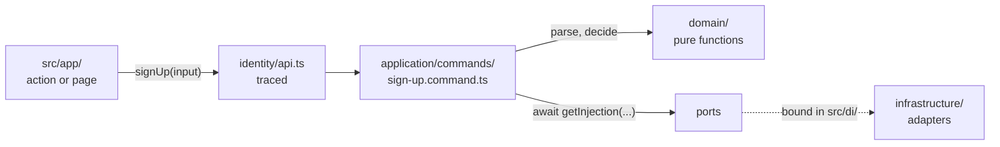
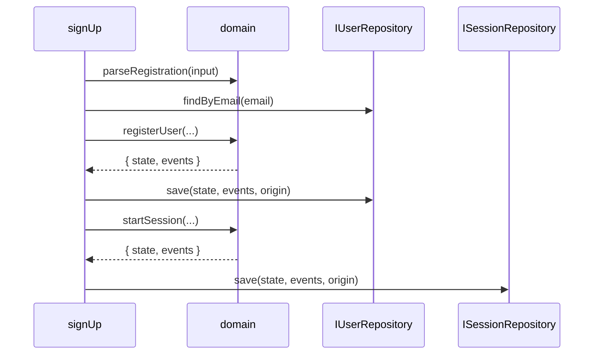

# §4 Application

Use cases as plain functions, reached only through a module's `api.ts`.

The application layer is where a request becomes a change or an answer. It sits between `app/`, which knows about forms, cookies and pages, and `domain/`, which knows only the rules. This page explains the rules in [§4 Application](/standards/#_4-application) using the code in the repo. The standards own the rules. This page only explains them.

## Where use cases live

Each use case is a plain exported async function in `application/commands/*.command.ts` or `application/queries/*.query.ts`. Use cases are not classes and not factories, and the container never binds them ([ADR 0003](https://github.com/B-Jones-RFD/next-ddd-starter/blob/main/docs/adr/0003-functional-core-class-adapters-and-mock-mode.md)). A module's `api.ts` imports them and re-exports each one wrapped in `traced`:

<<< @/../src/modules/identity/api.ts#use-cases{ts}

`application/` imports its own `domain/` and `application/`, the shared kernel, `@/di/container`, Zod and other contexts' `contracts.ts`, and never Next or React ([ADR 0002](https://github.com/B-Jones-RFD/next-ddd-starter/blob/main/docs/adr/0002-modules-around-a-pure-domain-with-next-confined-to-app.md)). The `api.ts` lint rules rely on the two use-case folders, so a use case anywhere else would slip past them.

## Commands: load, domain function, save

Every command has the same three steps. It **loads** what it needs through ports, calls a **domain function** that returns `{ state, events }`, and **saves** both with `save(state, events)`. Sign-up is the first command in the repo:

<<< @/../src/modules/identity/application/commands/sign-up.command.ts#sign-up{ts}

Sign-up is two aggregates, a User and a Session, so it runs the steps twice: once for each. Each `save` is its own transaction. A command never writes two aggregates in one transaction ([ADR 0007](https://github.com/B-Jones-RFD/next-ddd-starter/blob/main/docs/adr/0007-one-aggregate-per-transaction-with-a-transactional-outbox.md)).

Why one shape for every command:

- **Saving is publishing.** `save` writes the aggregate and its events to the outbox in the same transaction (§5, §6). No command can change state without saying so, or say so without changing state.
- **Effects on other aggregates happen later.** When identity saves a new User, boards doesn't hear about it inside `signUp`. Boards records the new user's display name in a handler that runs after the commit, from the published `UserRegistered` event (see [Contexts](/contexts/)). A command that touched several aggregates directly would need a transaction across all of them, and it would couple contexts that should only meet through events.
- **The rules stay in the domain.** The command only orders the steps. Whether a registration is valid is decided by `parseRegistration` and `registerUser`, which are pure and easy to test (see [Domain](/domain/)).

In the code, `save` takes a third argument, the event `origin` (`actorId` and `causationId`), which the outbox stores with each event (§6).

## The actor is an argument

Every command and query takes an explicit `actorId: UserId`. A use case never reads a cookie or a session itself, so it can't tell, and doesn't care, whether it runs from a page, an action, a seed script or a test. `listBoards` takes the actor:

<<< @/../src/modules/boards/application/queries/list-boards.query.ts#list-boards{ts}

Identity is the exception, because it is where the actor comes from. Its session use cases take the raw cookie token instead, and sign-up, which creates the actor, takes neither. `authenticate` turns a token into the actor that `app/` then passes to every other context (see [Auth](/auth/)):

<<< @/../src/modules/identity/application/queries/authenticate.query.ts#authenticate{ts}

## Queries skip the domain

A query doesn't load aggregates or call domain functions. It reads through a read port that returns DTOs, and the read itself filters by the actor's membership: a query for boards asks for "the boards this actor is a Board member of", not "all boards" followed by a check.

Why:

- **Reads have no rules to enforce.** Aggregates exist to protect invariants on change. Loading them to answer a question only adds work, and it ties the shape of a screen to the shape of the model.
- **Authorization can't be forgotten.** If membership is part of the read, a query that skipped the check would return nothing, not someone else's data. Nothing else authorizes a read, so there is one place to look. Each context has one test that calls every query as a non-member (see [Testing](/testing/)).
- **Commands are authorized in the domain, queries in the read** (§9). `app/` only hides UI.

`listBoards` above shows the shape before there is anything to read: no boards can be created yet, so it returns an empty list. When boards arrive, it reads through a read port that takes the `actorId` and filters by membership.

Queries are read-only. §13 names the one exception, in `authenticate`.

## Input shape: Zod, in the use case, and nowhere else

Each use case checks the shape of its input with a Zod 4 schema, before anything else runs:

<<< @/../src/modules/identity/application/commands/sign-up.command.ts#input-schema{ts}

The schema checks only shape: three strings. It doesn't say how long a display name may be or what an email looks like. Those are rules, and the domain's parse functions own them (`parseRegistration` above, §3). A wrong shape becomes a `ValidationError`, the same error the parse functions return, so callers handle one kind of failure.

Why there and nowhere else:

- **No rule exists in two places.** A length limit in a Zod schema and again in the domain will drift. Keeping Zod to shape means the domain is the only owner of every rule ([ADR 0011](https://github.com/B-Jones-RFD/next-ddd-starter/blob/main/docs/adr/0011-server-components-read-server-actions-write-nothing-cached-per-viewer.md)).
- **Zod never ships to the client.** Lint allows `zod` only in `application/`. Forms in `app/` don't validate with it: the action passes the submitted strings through unchecked, the browser gets only HTML constraint attributes as hints, and the form shows the `ValidationError` that comes back (see [Presentation](/presentation/)).
- **The use case is the boundary.** Everything reaches it through `api.ts`, whether a Server Action, a seed script or a test, so checking there checks every caller.

## Results and outages

A use case returns its expected outcomes in a `Result` and declares them in its signature: `signUp` returns `Result<SessionTokenDto, EmailTakenError | ValidationError>`. It lets outages, such as a database that won't answer, propagate as thrown `InfrastructureError`s. It catches one only to retry, compensate or fall back. Everything else is caught once, at the edge, by `to-action-error` ([ADR 0008](https://github.com/B-Jones-RFD/next-ddd-starter/blob/main/docs/adr/0008-error-classes-thrown-outages-and-an-edge-mapper-in-app.md); see [Errors](/errors/)).

In `signUp`, the Session's `save` can return a `ConflictError` only if a brand-new session id were already taken, which is a bug, so the command throws it. The User's `save` can conflict only on an email taken since the check, so the command returns `EmailTakenError`.

## DTOs, not aggregates

Use cases return plain DTOs typed in `application/dto/*.dto.ts`, never aggregates:

<<< @/../src/modules/identity/application/dto/session.dto.ts#dto{ts}

Why:

- **Aggregates are internal.** A `User` holds its password hash. Returning it would let every caller depend on, and leak, fields that only identity should see.
- **DTOs cross serialization boundaries.** A DTO goes from a Server Component to a Client Component as props, or comes back from a Server Action. Timestamps are ISO strings, so a DTO is plain data wherever it goes, and formatting a time is left to the `<Time>` component in `app/`.

## Ports

A port that only one context uses lives in that context's `application/ports/*.port.ts`, as an `interface I<Name>` that says what it returns and when it throws:

<<< @/../src/modules/identity/application/ports/password-hasher.port.ts#port{ts}

Repository ports belong to the aggregate and live with it in `domain/` (§3, §5). Ports that every context needs, like the id generator, live in `src/shared/kernel/ports/` (see [Layout](/layout/)).

## Resolve ports inside the function body

A use case gets each adapter with `await getInjection('IPortName')`, inside its body, as `signUp` and `authenticate` do above. It never resolves at module top level.

- **Importing `api.ts` never builds the container.** The adapter mode (mock or real) is decided once, before anything resolves ([ADR 0003](https://github.com/B-Jones-RFD/next-ddd-starter/blob/main/docs/adr/0003-functional-core-class-adapters-and-mock-mode.md)).
- **Tests can swap bindings between cases**, and inject an outage on one call.
- **The cost is a service locator.** A use case's dependencies are read from its `getInjection` calls, not its signature, and `application/` has a runtime edge out to `src/di/`. This is deliberate and listed in [Exceptions](/exceptions/).

## No telemetry in use cases

Use cases don't log, trace or touch OpenTelemetry. `traced` in `api.ts` gives each use case its span, and adapters and the edge write diagnostic logs (see [Observability](/observability/)). This keeps `application/` as plain as the domain it calls: it changes when a rule or a step changes, not when telemetry does.
