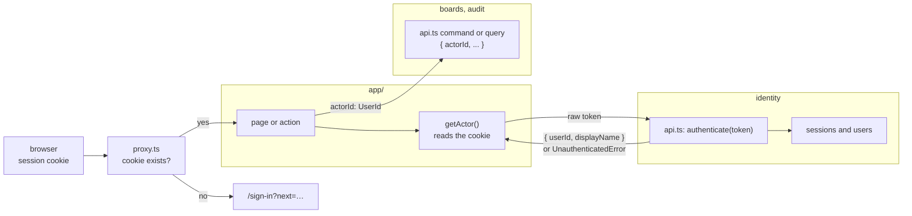
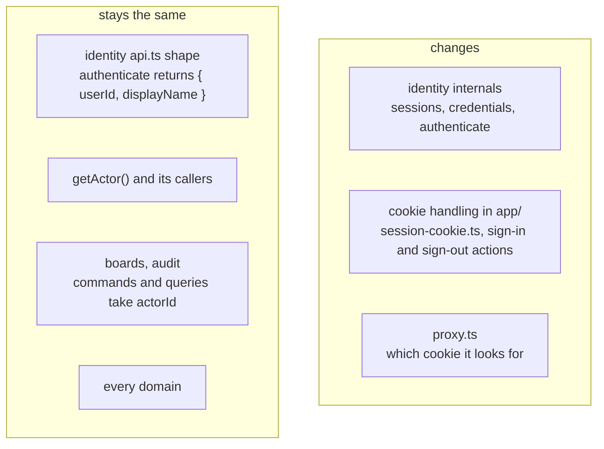

# §9 Auth seam

The authentication seam to keep, whatever a project puts behind it.

The rules are in [§9 Auth seam](/standards/#_9-auth-seam). This page explains them with the code that sign-in and sessions use: identity's `authenticate` query, `getActor()` and its helpers in `src/app/_lib/auth/`, the account page and its actions, and `proxy.ts`.

## The session model is a choice; the seam is the rule

This app stores sessions as rows in identity's database. The `session` cookie holds an opaque 256-bit token, the table stores only its SHA-256 hash, passwords are hashed with scrypt, and a session expires after 7 days idle or 30 days in all ([ADR 0009](https://github.com/B-Jones-RFD/next-ddd-starter/blob/main/docs/adr/0009-database-sessions-with-opaque-tokens-not-jwts.md)). Database sessions were chosen over JWTs because sign-out, "sign out everywhere" and "a password change ends other sessions" only work if a session can be revoked, and because idle expiry kept in the database never needs the cookie rewritten, which a Server Component can't do.

None of that is a template rule. Many apps built from this template will sign people in against an external directory or identity provider, and that choice decides the session model. What the template protects is the seam: how the rest of the app learns who is signed in, so that the session model can change without touching anything else. The rest of this page is that seam.

## The seam in one picture

A request carries a cookie. Only `app/` reads it, and only identity turns it into a user. Every other context sees a `UserId` and nothing more.

Three things cross the seam, and nothing else: a raw token going into identity, an actor coming out, and an `actorId` going into every other context.

## Identity's `api.ts` is the only door

`app/` reaches authentication only through identity's public API. The session use cases sit beside sign-up there, each wrapped in `traced` like any other export:

<<< @/../src/modules/identity/api.ts#use-cases{ts}

`authenticate` takes the raw cookie token and returns who it belongs to, or `UnauthenticatedError` for a token that is missing, unknown, ended or expired:

<<< @/../src/modules/identity/application/queries/authenticate.query.ts#authenticate{ts}

What comes out is deliberately small:

<<< @/../src/modules/identity/application/dto/session.dto.ts#dto{ts}

There is no session id in `ActorDto`, and no expiry or `lastSeenAt`. A session is identity's own aggregate, and once its id leaves identity, something else starts depending on how identity models sessions, which is exactly what a swap to an external provider would break. Sign-out and "sign out everywhere" take the raw token for the same reason: `app/` holds what the browser sent, and identity decides what it means.

The `touch` near the end is the one write a query makes, kept to once a minute and done straight through the repository with no events. It is listed in [Exceptions](/exceptions/) so nobody copies it.

Two lint rules hold the door shut. `src/app/` may import a module only through its `api.ts`, so a page can't reach for the session repository or the token generator:

<<< @/../eslint.config.mjs#app-imports{js}

And Next is imported only in `src/app/` and the root shims, so `cookies()` and `NextRequest` can't be called from inside a module:

<<< @/../eslint.config.mjs#no-next-or-react{js}

So the cookie is read in two places only. `app/` reads it, and passes the raw token in:

<<< @/../src/app/_lib/auth/session-cookie.ts{ts}

`proxy.ts`, the other, only checks that a cookie exists (see [below](#proxy-ts-is-only-an-optimistic-check)). Keeping Next out of the modules is the same boundary as [ADR 0002](https://github.com/B-Jones-RFD/next-ddd-starter/blob/main/docs/adr/0002-modules-around-a-pure-domain-with-next-confined-to-app.md): the domain and application layers don't know there is a request, let alone a cookie.

## Every other context takes an explicit `actorId`

Boards, audit and every later context never ask who is signed in. Each command and query takes the actor as a plain input field, typed as the one domain type every context shares:

<<< @/../src/shared/kernel/user-id.ts{ts}

The account page's rename action shows the shape every action follows ([ADR 0011](https://github.com/B-Jones-RFD/next-ddd-starter/blob/main/docs/adr/0011-server-components-read-server-actions-write-nothing-cached-per-viewer.md)): `getActor()`, then a plain input object, then the command with `actorId` first:

<<< @/../src/app/account/actions.ts#rename-action{ts}

Passing the actor in, rather than having a use case look it up, buys three things:

- **A context can't depend on how sign-in works.** It sees a `UserId` and never a session, a cookie or a token. That is why swapping the provider leaves boards and audit alone.
- **The use case states its inputs.** Who is acting is as visible in the signature as what they are doing, and the domain function that decides whether they may receives it as a plain argument.
- **Tests need no session.** A test calls a command through `api.ts` with any `actorId`, and needs no cookie and no sign-in first. Mock mode changes nothing here.

The `UserId` brand is what makes this checkable by the compiler: an arbitrary string won't pass as an `actorId`, and `toUserId` marks the few places an id enters from outside.

## `getActor()` is how `app/` learns who is signed in

<<< @/../src/app/_lib/auth/get-actor.ts{ts}

Each part of it is there for a reason:

- **`server-only`.** It reads cookies and the database, so it must never be bundled for the browser.
- **React `cache()`.** A page, its components and its `generateMetadata` can all ask for the actor in one render, and `cache()` makes that one `authenticate` call. The memo lasts one request only, so the next request asks identity again.
- **Never `'use cache: private'`.** `authenticate` reads the database and may write `last_seen_at`. A private cache can be served from the client router's memory, and in development from a server-side copy keyed by cookies, so a session that was signed out or ended by a password change could still render as signed in. A write inside a cached function can also be skipped. The session table is the source of truth, so it is asked every request.
- **`io()` after the cookie read.** It marks the synchronous clock and SQLite reads that follow as request-time work, so a runtime prefetch never runs them while prerendering.

`requireActor(path)` is the page-side wrapper: it returns the actor, or redirects to sign-in with `path` as the place to come back to.

Read it inside `<Suspense>`. Under Cache Components a cookie is request-time data, so whatever reads it has to sit under a boundary; everything outside it can still prerender. The account page keeps its heading in the static shell and reads the actor in the part that streams in:

<<< @/../src/app/account/page.tsx#account-page{tsx}

And read it in every page and action that needs it, never only in a layout. Layouts don't re-render on a client-side navigation, so a check in a layout doesn't run when the user moves between the pages under it. A Server Action is its own POST endpoint and doesn't render the layout at all. A page that relied on its layout's check would be unprotected on exactly the paths a check is for. Calling `getActor()` in each one costs nothing extra, since `cache()` collapses the calls within a render.

## Authorize commands in the domain and queries in the read

Knowing who the actor is isn't the same as knowing what they may do. That decision lives in the core, not in `app/`.

A **command** is authorized by the domain function that makes the change, which receives the actor and returns `ForbiddenError` when they may not:

<<< @/../src/modules/identity/domain/user/user.ts#rename-user{ts}

Here the rule is simple (only users rename themselves), but board rules take the same shape: whether an actor is the Owner, or a Board member at all, is checked by the aggregate's function, with the same `actorId` the action passed in.

A **query** is authorized by what it reads. A board query filters by membership in the read itself, so a board the actor isn't a Board member of never comes back; there is no "load it, then check" step to forget. `listBoards` already takes the `actorId` it will filter by, though no boards can be created yet (see [Application](/application/)).

`app/` only hides UI: it may leave out a button the actor can't use, but that is presentation. A Server Action can be posted to directly, with any form data, so the command it calls has to say no on its own. A hidden button with no rule behind it is no protection.

## Unauthenticated and forbidden, on pages and in actions

A page turns the two auth errors into navigation:

- **`UnauthenticatedError` redirects to `/sign-in?next=<same-origin path>`**, so the user lands back where they were after signing in.
- **`ForbiddenError` becomes `notFound()`.** A 403 would confirm that the thing exists. To someone who isn't a Board member, a board should look the same as one that was never created.

The `next` parameter comes back from the browser, so it is untrusted. Only a path on this origin is followed, and anything else lands on `/boards`; otherwise a crafted sign-in link could send a user to another site after they sign in:

<<< @/../src/app/_lib/auth/next-path.ts{ts}

Inside a Server Action, a missing session also redirects to sign-in, as `renameAction` does above. `ForbiddenError` and `NotFoundError` are instead returned as `ActionError`s and shown in the form's alert, so the user doesn't lose what they typed ([ADR 0011](https://github.com/B-Jones-RFD/next-ddd-starter/blob/main/docs/adr/0011-server-components-read-server-actions-write-nothing-cached-per-viewer.md); see [Errors](/errors/)).

`authInterrupts` stays off. It enables Next's experimental `unauthorized()` and `forbidden()`, which render a 401 or 403 page. A sign-in redirect and `notFound()` already cover both cases with stable APIs, and a 403 page is the existence leak the second rule avoids.

## `proxy.ts` is only an optimistic check

<<< @/../src/proxy.ts{ts}

The proxy runs before any page renders, on every matched request, prefetches included. That makes it a good place to send someone without a cookie straight to sign-in, and a bad place to decide anything. It only asks whether the cookie exists. It never looks the session up: that would put a database read in front of every prefetch, and it would still not be the real check, because the matcher can miss a route and a Server Action is a request the page's own check has to cover anyway. A stale or forged cookie gets past the proxy and is caught by `getActor()` in the page.

The matcher never includes `/sign-in`, and the sign-in page never redirects away because a cookie is present. A cookie can outlive its session: expired, signed out elsewhere, ended by a password change. If the proxy or the sign-in page sent anyone with a cookie on to `/boards`, the board page would find the session invalid and send them back to sign-in, which would send them on to `/boards`, forever. Signing in again replaces whatever session the browser held.

## Swapping in an external provider

Because only identity knows about sessions, replacing self-built sign-in with an external provider is a change in three places:

`getActor()` keeps returning `{ userId, displayName }` or `UnauthenticatedError`, whether identity looked the token up in its own table or validated it with the provider. Pages, actions, and every context behind them keep the same code. That is the payoff of passing `actorId` everywhere: the decision ADR 0009 calls per-project really can be made per project.

## Checklist

- A page or action that needs the actor calls `getActor()` or `requireActor(path)` itself, inside `<Suspense>` on a page.
- It passes `actorId: actor.userId` to the command or query; it never passes a token or session to any context but identity.
- A new command checks the actor in its domain function and returns `ForbiddenError`; a new query filters by the actor in its read.
- On a page, `UnauthenticatedError` redirects to sign-in with a same-origin `next`, and `ForbiddenError` calls `notFound()`.
- A new protected route is added to the proxy's matcher, which still never matches `/sign-in`.
