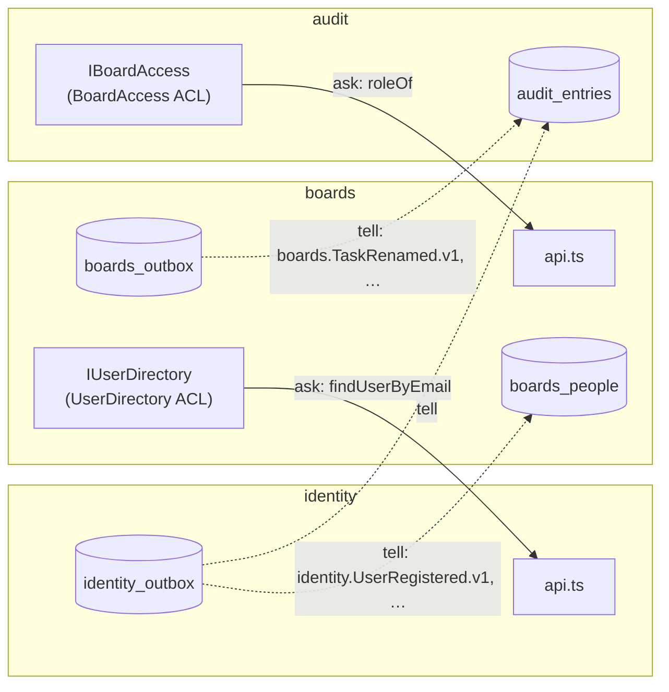
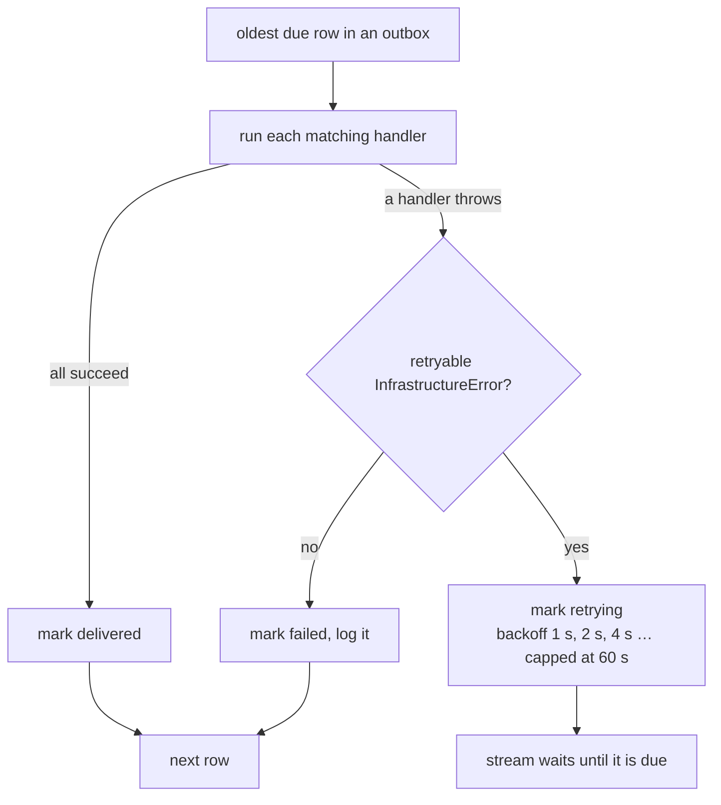

# §6 Between contexts

How bounded contexts ask through consumer-owned ports and tell through versioned integration events.

This page explains the rules in [§6 Between contexts](/standards/#_6-between-contexts) of the standards, using the code that follows them. The standards own the rules. This page only says what they look like and why they exist.

The app has three contexts. **Identity** owns the User and the Session. **Boards** owns the Board, the List and the Task. **Audit** owns the Audit log. They work together in only two ways:

- **Ask.** A context that needs an answer now calls a port it owns, and that port's adapter calls the other context's `api.ts`.
- **Tell.** A context that changes state publishes an integration event, and any context that cares handles it later.

Nothing else crosses the line. A context never reads another context's tables, never imports its domain, and never calls its commands to make something happen ([ADR 0006](https://github.com/B-Jones-RFD/next-ddd-starter/blob/main/docs/adr/0006-contexts-integrate-through-consumer-owned-ports-and-published-events.md)).

Solid arrows are calls that wait for an answer. Dotted arrows are events the relay delivers after the change has committed. Boards depends on identity, audit depends on both, and no arrow points back up.

## Ask through a port the consumer owns

When a Board member adds someone by email, boards has to ask identity who that is. It doesn't import identity's `findUserByEmail` into a use case. It declares the question in its own words, in its own `application/ports/`:

<<< @/../src/modules/boards/application/ports/user-directory.port.ts{ts}

The port says what boards needs, a `DirectoryUser` with three fields, and nothing about identity's User aggregate, its DTOs or its error classes. The adapter in boards' `infrastructure/` is the only code in boards that knows identity exists:

<<< @/../src/modules/boards/infrastructure/user-directory.ts{ts}

This adapter is an anti-corruption layer. It translates in both directions:

- **Answers.** It copies the three fields boards wants out of identity's DTO, and turns identity's `NotFoundError` into `null`, which is what "nobody has that email" means to boards.
- **Errors, thrown ones included.** An outage in identity surfaces as boards' own `PersistenceError` for `IUserDirectory`, keeping `retryable` and the original as `cause`. A boards use case catches nothing it can't name, and the trail back to identity stays in the diagnostic logs.

The same shape runs the other way. Audit needs to know whether a reader may see a board's Audit entries, so it owns `IBoardAccess`:

<<< @/../src/modules/audit/application/ports/board-access.port.ts#port{ts}

Its adapter, `BoardAccess` in `src/modules/audit/infrastructure/board-access.ts`, calls boards' `roleOf` query and translates it the same way. Audit asks at read time rather than keeping its own copy of who is on which board, so a removed Board member loses access to Activity on their next request ([ADR 0010](https://github.com/B-Jones-RFD/next-ddd-starter/blob/main/docs/adr/0010-one-audit-entry-per-integration-event-and-activity-as-a-filtered-view.md)).

### Why the consumer owns the port

If boards imported identity's API straight into its use cases, every change to identity's DTOs or error classes would ripple through boards' application code. With the port, a change in identity touches one adapter file in boards, and the use cases don't change. The port also makes boards testable on its own terms: `tests/contracts/user-directory.contract.ts` pins down what boards expects of any `IUserDirectory`, whatever identity does inside.

Neither ACL adapter does IO of its own, so the same class serves both adapter modes. In mock mode, the supplier's `api.ts` simply runs on the supplier's mocks.

## Tell through versioned integration events

A context changes its own state, then tells the others what happened. What it tells them is an integration event: a published contract with a name, a version and a plain payload.

<<< @/../src/shared/kernel/events.ts#integration-event{ts}

Each contract is one file in the publisher's `application/contracts/`, named for the event and its version. This is `boards.TaskRenamed.v1`:

<<< @/../src/modules/boards/application/contracts/task-renamed.v1.ts{ts}

The file holds the type and the translator from the domain event. The payload is strings: ids, and the title before and after. It can go through JSON into an outbox row and come back unchanged, and it says nothing about how boards stores a Task. The context's `contracts.ts` re-exports these types, and nothing else, for consumers to import.

### Never publish a domain event

The domain event `TaskRenamed` and the contract `boards.TaskRenamed.v1` look alike today. They're kept apart anyway, because they have different owners. The domain event belongs to boards' model, and boards can reshape it in any refactor. The contract belongs to every consumer, and once it has shipped it can only gain a new version. `translate.ts` in boards' `application/contracts/` maps each domain event to its contract, and the repository's `save` writes both: the domain event for boards' own handlers, the translation for everyone else.

A breaking change to a payload is a new contract, `task-renamed.v2.ts`, beside the old one. A consumer moves to v2 when it is ready, because each handler registers for a type and a version.

### Name events for intent, with `from` and `to`

There is no `boards.TaskUpdated` with a diff of changed fields. There is `TaskRenamed`, `TaskDescriptionChanged` and `TaskMoved`, and each one that changes a value carries both ends of the change: `from` and `to`, or `fromListId` and `toListId`.

The name tells a consumer what happened without opening the payload, so audit can map each contract to an Audit entry with its own wording. The two ends let a consumer show "renamed from Draft to Final" without keeping a copy of every Task to remember the old title. That is what keeps audit a pure consumer: it learns everything from the contracts, and nothing from boards' tables ([ADR 0010](https://github.com/B-Jones-RFD/next-ddd-starter/blob/main/docs/adr/0010-one-audit-entry-per-integration-event-and-activity-as-a-filtered-view.md)).

### Publish every change another context needs

Audit records every change, so every boards and identity state change is published, sign-ins and sign-outs included. A coverage test in `tests/modules/audit/application/handlers/translations.test.ts` fails for any v1 contract that audit has no handler for. A new contract has to arrive with its Audit entry, or the build goes red.

## Tell, don't command

Boards keeps each user's Display name in its own `boards_people` table, so it can show names on a board without asking identity on every read. It doesn't get that copy by having identity call into boards. Identity publishes `identity.UserRenamed.v1`, and boards handles it:

<<< @/../src/modules/boards/application/handlers/record-user-renamed.ts{ts}

The rule has two halves:

- **No context calls another context's commands to cause a side effect.** Identity's rename command knows nothing about boards. If it called a boards command, identity would depend on boards, a failure in boards would fail the rename, and every new consumer would mean an edit to identity.
- **A downstream context never writes back upstream.** Audit reads from boards through `IBoardAccess`, but it never calls a boards command. Audit can be broken, slow, or removed, and boards keeps working.

When a handler does need to change its own context's state in reaction to an event, such as handing a removed Board member's tasks to the Owner, it loads, changes and saves its own aggregate like any command does. That change is a Consequence, and it is published as an ordinary event like any other.

### Who started a change

Every change records its origin:

<<< @/../src/shared/kernel/events.ts#origin{ts}

A command a user runs passes `{ actorId, causationId: null }`. A handler that makes a Consequence keeps the `actorId` of the envelope it received, so the chain is still credited to the user who started it, and sets `causationId` to that envelope's id. Here is the hand-over, which boards runs when a Board member leaves or is removed:

<<< @/../src/modules/boards/application/handlers/reassign-to-owner.ts{ts}

It handles the published `boards.MemberRemoved.v1` and `boards.MemberLeft.v1`, not the domain events. Their ids are the ids of the Audit entries for the removal, so the `causationId` on each `TaskAssigned` points at an entry audit actually has.

There is no system user. Every Audit entry names a real person, and a Consequence points at the entry that caused it. Activity uses that pointer to show the cause beside the Consequence (`getActivity` loads the cause entries by id).

## One outbox per context

An event is written in the same transaction as the change that raised it. If it weren't, a crash between the commit and the send would lose the event for good, and the Audit log would miss a change. So each context has one outbox table, `<context>_outbox`, and its repositories append to it inside `save`'s `BEGIN IMMEDIATE … COMMIT` ([ADR 0007](https://github.com/B-Jones-RFD/next-ddd-starter/blob/main/docs/adr/0007-one-aggregate-per-transaction-with-a-transactional-outbox.md)). How `save` stays synchronous inside that transaction is on the [§5 Infrastructure page](/infrastructure/#save-is-synchronous-inside-an-async-signature).

Each row is one envelope:

<<< @/../src/shared/kernel/events.ts#envelope{ts}

`outboxEntries` builds the rows for one `save`, before the transaction opens:

<<< @/../src/shared/infrastructure/outbox/outbox-entries.ts{ts}

What each field is for:

- **`id`** is a UUID v7. Its leading timestamp makes ids sort in the order they were made, so the id doubles as the Audit entry's id and as the cursor for paging through the Audit log.
- **`aggregateId` and `aggregateVersion`** say which aggregate changed and which version the change produced. A projection uses the version to ignore stale events (below).
- **`actorId` and `causationId`** are the origin above.
- **`scope`** is on the row, not the envelope. Each domain event is a `domain` row and each translation is an `integration` row. A `domain` row reaches only handlers in the same context. That is how boards can react to its own domain events without publishing them.

The trace context of the active span goes on the row too, so the delivery span later links back to the request that saved it ([§8 Observability](/observability/)).

## Handlers live with the consumer

A handler is part of the context that reacts, not the one that publishes. It sits in the consumer's `application/handlers/`, imports the supplier's contract types from its `contracts.ts`, and is registered with the relay under `<module>.<camelCaseName>`, such as `boards.recordUserRenamed` or `audit.recordTaskRenamed`. Audit builds one handler per contract it records:

<<< @/../src/modules/audit/application/handlers/audit-handlers.ts#record{ts}

A handler loads whatever it needs outside any transaction, then makes one write: its own aggregate or projection, any outbox rows of its own, and its inbox row, all in one synchronous transaction. Here is boards' people projection doing exactly that:

<<< @/../src/modules/boards/infrastructure/people-projection.ts#record{ts}

## Consumers are idempotent

The relay delivers each event at least once, so a handler has to be safe to run twice. Two guards make it safe:

- **The inbox.** Each context has a `<context>_inbox(event_id, handler)` table. A handler's transaction inserts its row first. If the row is already there, the event was handled before, and the transaction rolls back having changed nothing.
- **The aggregate version.** A projection stores the `aggregateVersion` of the last event it applied, and the update runs only `WHERE excluded.aggregate_version > …`. A late event older than the one already applied changes nothing, so an old Display name can't overwrite a newer one.

The inbox is keyed by handler as well as event, because two handlers in one context may react to the same event, and each needs its own record. Audit has a third guard: an Audit entry's id is the event's id, so a second insert of the same entry does nothing even if two handlers tried. The contract suites check these on both adapters: `tests/contracts/people-projection.contract.ts` ("drops an event its handler already applied", "ignores a version older than the one it applied") and `tests/contracts/audit-log.contract.ts`.

The hand-over above is the one handler without an inbox row, and [§13](/exceptions/) lists it. It saves each task in its own transaction, because each Task is its own aggregate, and it is idempotent by what it does: a redelivery finds no task still assigned to the departed member, so it saves nothing.

## The relay delivers

Rows reach their handlers through the relay, behind a port in the kernel:

<<< @/../src/shared/kernel/ports/event-relay.port.ts#port{ts}

`EventRelay` in `src/shared/infrastructure/outbox/event-relay.ts` is the in-process implementation. `instrumentation.ts` starts it once per process, through `instrumentation.node.ts`, after the telemetry SDK. Two things make it drain:

- **A kick after each save.** `Outbox.append` signals once the caller's synchronous work, and so its `COMMIT`, is done:

  <<< @/../src/shared/infrastructure/outbox/outbox-signal.ts{ts}

  The signal lives on `globalThis`, so a save in any bundle reaches the relay started from instrumentation.

- **A one-second poll**, which picks up anything a kick missed, such as rows that are due for a retry.

`drain()` is single-flight: a drain asked for while one is running joins the next one rather than starting a second. A drain that hasn't started yet will see every row appended so far, so concurrent saves never deliver a row twice.

Each outbox is read in the order its rows were appended, and each row goes to the handlers registered for its type and version. A `domain` row is narrowed to handlers of the outbox's own module:

<<< @/../src/shared/infrastructure/outbox/event-relay.ts#handlers-for{ts}

A row is marked delivered only after every one of its handlers has succeeded. If the second of two handlers fails, the row is redelivered to both, and the first one's inbox drops it.

## Retry what is retryable, and fail the rest

What happens to a failed row depends only on what was thrown:

<<< @/../src/shared/infrastructure/outbox/event-relay.ts#record-failure{ts}

- **A retryable `InfrastructureError`**, such as a busy database, is retried with exponential backoff capped at 60 s, and retried indefinitely. The outage will end, and the event still needs delivering. A row that keeps failing for five minutes logs `outbox.row.stuck` once, so a person looks at it, and `outbox.row.recovered` when it finally goes through.
- **Anything else** marks the row `failed`, logs `outbox.row.failed`, and moves on. A bug or a bad payload won't fix itself, and retrying it forever would hold up everything behind it. `npm run outbox:replay` puts `failed` rows back to pending once the cause is fixed, and the inboxes drop anything already handled.

A retrying row holds up its own stream, but no other:

<<< @/../src/shared/infrastructure/outbox/event-relay.ts#streams{ts}

Order within one outbox matters: a Task's `TaskRenamed` mustn't reach audit before its `TaskCreated`. So while one boards row waits out its backoff, the boards rows behind it wait too. The identity and audit outboxes carry on. Delivered rows are kept rather than deleted, which leaves a record of what was sent, and the backlog gauges count what is still pending or failed ([§8](/observability/)). `tests/shared/infrastructure/outbox/event-relay.test.ts` covers each of these behaviours.

## Projections lag by one drain

A command returns as soon as its transaction commits. Its events are delivered afterwards, so anything built from them, such as boards' copy of a Display name or a task's Activity, catches up one relay drain later. Locally that is a few milliseconds, but it is never zero.

`app/` lives with the gap and never awaits the relay. A rename refreshes the page with the new title at once, and the matching Audit entry appears in Activity on a later render. When the user needs to see their own change immediately, such as a comment they just posted, the component shows it with `useOptimistic` until a refresh picks up the real entry.

Awaiting the relay would hide the lag only while every context runs in one process. Once audit runs somewhere else, it can't be awaited at all, and every screen that assumed it could would break. Planning for the lag now keeps that move possible.
