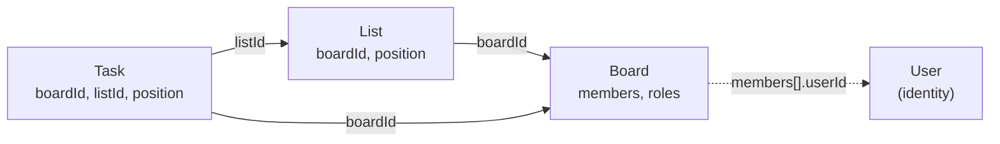
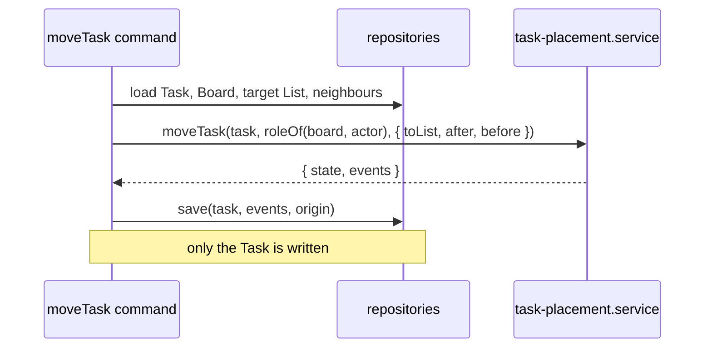

# §3 Domain

Pure aggregates that speak their context's language and return new state with the events it raised.

The domain is where a context's rules live: who may rename a task, how long a title can be, where a moved task sits. It is plain TypeScript with no framework, no I/O and no clock. Commands call it between loading and saving (see [Application](/application/)). This page explains the rules in [§3 Domain](/standards/#_3-domain) using the code in the repo. The standards own the rules. This page only explains them.

## Speak the context's language

Every name in a context's domain comes from its glossary: `src/modules/<context>/GLOSSARY.md`, indexed by `GLOSSARY-MAP.md` at the repo root. In boards, the things are a Board, a List and a Task. The people are Board members, and each one is the Owner or a Member. The glossary lists the synonyms to avoid next to each term, so a task is never a "card" and a list is never a "column" or "status" in code, UI or docs.

Why:

- **One word means one thing.** When code, screens and conversation use the same term, nobody has to translate. A reader who knows the glossary can find the code, and the reverse.
- **The same word can mean different things in different contexts.** A "user" in identity is a person who can sign in. In boards that person appears only as a Board member. Each context's glossary is the authority inside that context ([ADR 0006](https://github.com/B-Jones-RFD/next-ddd-starter/blob/main/docs/adr/0006-contexts-integrate-through-consumer-owned-ports-and-published-events.md); see [Language](/language/)).
- **Changing the glossary comes first.** A new or renamed term goes into `GLOSSARY.md` before it goes into code, so the code never invents vocabulary.

## Immutable types and pure functions

An aggregate is a `type` with `readonly` fields, and every operation on it is an exported function. There are no classes in `domain/`. A List is plain data:

<<< @/../src/modules/boards/domain/list/list.ts#list{ts}

Why:

- **Plain data crosses boundaries.** A class instance loses its prototype when Next serializes it, between a Server Component and a Client Component or out of a Server Action. A plain object survives.
- **Pure functions test without mocks.** A domain test builds a value, calls a function and checks the result. No container, no database and no fake clock ([ADR 0003](https://github.com/B-Jones-RFD/next-ddd-starter/blob/main/docs/adr/0003-functional-core-class-adapters-and-mock-mode.md)).
- **Nothing outside the domain can sneak in.** Lint lets `domain/` import only its own context's domain and the shared kernel, never Next, React, Zod or infrastructure ([ADR 0002](https://github.com/B-Jones-RFD/next-ddd-starter/blob/main/docs/adr/0002-modules-around-a-pure-domain-with-next-confined-to-app.md); see [Layout](/layout/)).

The kernel's `Result` is how a pure function reports an expected failure without throwing:

<<< @/../src/shared/kernel/result.ts{ts}

## Operations return `{ state, events }`

Every operation that changes an aggregate returns the new state together with the events it raised, inside a `Result`. `renameTask` is the example the standards use:

<<< @/../src/modules/boards/domain/task/task.ts#rename-task{ts}

Read it top to bottom and it is the whole rule: only a Board member may rename, the title must parse, the same title changes nothing, and a real rename raises `TaskRenamed` with `from` and `to`. The input task is never modified. The new state is a copy (`{ ...task, title }`).

Why:

- **The domain decides what happened. It doesn't act on it.** It never saves, publishes or writes the audit log. The command passes `state` and `events` together to `save`, which writes both in one transaction ([ADR 0007](https://github.com/B-Jones-RFD/next-ddd-starter/blob/main/docs/adr/0007-one-aggregate-per-transaction-with-a-transactional-outbox.md)). A state change without its event, or an event without its change, can't happen.
- **The type makes it hard to forget.** Because the return type carries `events`, an operation can't quietly change state without the compiler asking what it raised. An empty `events` array is how an operation says "nothing changed", and the command then skips the save.
- **Events are the domain's words.** A domain event's `type` has no context prefix (`TaskRenamed`). When it is saved, infrastructure translates it into a versioned integration event (`boards.TaskRenamed.v1`) for other contexts (see [Contexts](/contexts/)).

The events an aggregate can raise are a union in `<aggregate>.events.ts`, one type per event:

<<< @/../src/modules/boards/domain/task/task.events.ts{ts}

## Small aggregates, referred to by id

The design has five aggregates: Board, List, Task, Comment and User (Comment arrives with comments). Each one refers to the others only by id. A Task holds its `boardId` and `listId`, and a List holds its `boardId`, as the type above shows. A Board doesn't hold its lists, and a List doesn't hold its tasks ([ADR 0001](https://github.com/B-Jones-RFD/next-ddd-starter/blob/main/docs/adr/0001-small-aggregates-with-parent-owned-order.md)).



Why:

- **An aggregate is a unit of locking.** Each save checks the aggregate's `version`, so two edits to the same aggregate conflict. If a Board held every list and task, renaming one task would conflict with moving another, and every edit would load the whole board.
- **One aggregate per transaction.** A command writes exactly one aggregate. Small aggregates keep that cheap. Effects on other aggregates happen later, in event handlers ([ADR 0007](https://github.com/B-Jones-RFD/next-ddd-starter/blob/main/docs/adr/0007-one-aggregate-per-transaction-with-a-transactional-outbox.md)).
- **An id is all another aggregate needs.** Holding another aggregate's data would mean keeping a copy in step. An id can't go stale.

## One folder per aggregate

Each aggregate's folder in `domain/` holds its root, its value objects, its events, its errors and its repository port. Logic that spans aggregates goes in `domain/services/`:

```
src/modules/boards/domain/
  board/     board.ts  board-id.ts  board-name.ts  board.events.ts  board.errors.ts  board-repository.port.ts
  list/      list.ts   list-id.ts   list-name.ts   list.events.ts   list.errors.ts   list-repository.port.ts
  task/      task.ts   task-id.ts   task-title.ts  task-description.ts  task.events.ts  task-repository.port.ts
  services/  task-placement.service.ts
```

The repository port lives with the aggregate, not in `application/ports/`, because what the domain can load and save is part of its language. `ITaskRepository.findLastInList` exists because a new task goes after the last one. Its adapters live in `infrastructure/` (see [Infrastructure](/infrastructure/)).

## Permissions are checked inside the operation

An operation that needs a role checks it itself and returns `ForbiddenError`. A Board's own operations take the actor's id and read the role from the Board they are given:

<<< @/../src/modules/boards/domain/board/board.ts#add-member{ts}

A List's or a Task's operations can't do that, because those aggregates don't hold the members. They take the actor's `Membership` instead: the role read from the loaded Board by `roleOf`, or `undefined` for someone who isn't a Board member. That is what `renameTask` above checks. The command loads the Board, calls `roleOf(board, actorId)` and passes the result in.

Why:

- **Authorization can't be forgotten.** If the check lived in the command, or in `app/`, a new caller could skip it. In the operation, the only way to rename a task is a path that has already checked the role. The tests prove it per operation: a non-member gets `ForbiddenError`.
- **The rule sits next to the rule it guards.** "Only the Owner adds members" and "the new member isn't already on the board" are both board rules, and both read as one function.
- **The page decides what to show; the domain decides what's allowed** (§9). `app/` may hide a button from a Member, but the operation is still the authority. Queries are authorized differently: by filtering the read itself (see [Application](/application/)).

## Fields are value objects, built by parse functions

Each field of an aggregate is a branded type, made only by its parse function. The function trims, enforces the limits and returns a `ValidationError` naming the field:

<<< @/../src/modules/boards/domain/task/task-title.ts{ts}

`Brand` makes `TaskTitle` a string the compiler won't mix up with any other string, so a `Task` can't be built from raw input by mistake:

<<< @/../src/shared/kernel/brand.ts{ts}

Why:

- **The domain owns every rule.** The 200-character limit lives in `parseTaskTitle` and nowhere else. The Zod schema in the use case checks only that `title` is a string (§4), so the limit can't drift between two places.
- **A parsed value is proof.** Once a value has the type `TaskTitle`, every function that takes one knows it is trimmed and in range. Nothing checks again.
- **Errors name fields, not messages.** `ValidationError({ title: 'too-long' })` carries a code per field. `app/` turns the code into wording next to the right input (see [Errors](/errors/)). When a form has several fields, a parse function such as identity's `parseRegistration` merges their errors, so the user sees every problem at once.

## `now` and new ids are arguments

A domain function never reads the clock or makes an id. The command gets both and passes them in:

<<< @/../src/modules/boards/domain/task/task.ts#create-task{ts}

The command calls `createTask` with `id: toTaskId(ids.next())` from the `IIdGenerator` port and `now: new Date()`.

Why:

- **The domain stays deterministic.** The same input gives the same output, so a test asserts exact values, such as `createdAt`, without freezing time.
- **There is no clock port.** Time enters at one place, the use case, and nothing deeper needs a seam for it.

`createTask` also shows the other inputs a create takes: the list it goes in, loaded as a read-check (below), and `after`, the position of the list's last task.

## Every aggregate has a `version`

Every aggregate type ends with `version: number`. A new aggregate starts at `0`. The domain copies it unchanged and never reads it. Persistence owns it: `save` writes only if the stored version still matches the loaded one, then increments it, and returns a `ConflictError` if someone else saved first ([§5](/standards/#_5-infrastructure-and-persistence); see [Infrastructure](/infrastructure/)). Keeping it in the type means every load-and-save carries it without the domain having to think about it.

## Fractional keys order user-sorted items

Lists on a board and tasks in a list are in the order users put them. Each item holds its parent's id and a `position`: a base-62 string key from the kernel's `keyBetween(a, b)`, which returns a key that sorts strictly between `a` and `b`. `null` means "no item on that side", so `keyBetween(last, null)` puts an item at the end, as `createTask` does:

<<< @/../src/shared/kernel/key-between.ts{ts}

Rows sort by `(position, id)`. There is no unique index on `position`.

Why:

- **A move writes one row.** Moving a task changes only that task's `position`. Integer positions would renumber the siblings, and a parent-owned order would make every move a write to the List too ([ADR 0001](https://github.com/B-Jones-RFD/next-ddd-starter/blob/main/docs/adr/0001-small-aggregates-with-parent-owned-order.md), superseded on this point by [ADR 0007](https://github.com/B-Jones-RFD/next-ddd-starter/blob/main/docs/adr/0007-one-aggregate-per-transaction-with-a-transactional-outbox.md)).
- **Strings, not floats.** Floats run out of precision after repeated inserts into the same gap. A string key just grows a digit.
- **Ties are harmless.** Two concurrent inserts can compute the same key. With no unique index, both rows save, and `id` breaks the tie.
- **Archived items keep their key**, so restoring one puts it back where it was.

The client never sends keys. It sends the ids of the neighbours, and the domain checks them: a neighbour in another list is `NotFoundError`, and neighbours out of order mean the page was stale, so that is a `ConflictError`.

## Rules that span aggregates are domain services

A rule that needs more than one aggregate is a pure function in `domain/services/`. It takes every aggregate it needs, all loaded by the command before the change, and returns the change for the one aggregate being written. Moving a task to another list ("Move to list…") needs the task, its new list and the actor's role:

<<< @/../src/modules/boards/domain/services/task-placement.service.ts{ts}

The command loads the Board, the target List and the neighbouring Tasks, then saves only the Task. Those other aggregates are **read-checks**: read outside the Task's transaction and not version-checked when it commits.



Why:

- **One aggregate per transaction still holds.** The service reads several aggregates but changes one, so the write stays small and conflicts only with edits to the same task.
- **The rule is still pure.** "No tasks into an archived list" is `acceptTasks(list)` on the List, used by both `createTask` and `moveTask`, and tested without a database.
- **Races are accepted on purpose.** A list could be archived just after the check passes, and the task lands in an archived list. The state is odd but valid, and closing the race would bring back multi-aggregate transactions ([ADR 0007](https://github.com/B-Jones-RFD/next-ddd-starter/blob/main/docs/adr/0007-one-aggregate-per-transaction-with-a-transactional-outbox.md); see [Exceptions](/exceptions/)).
