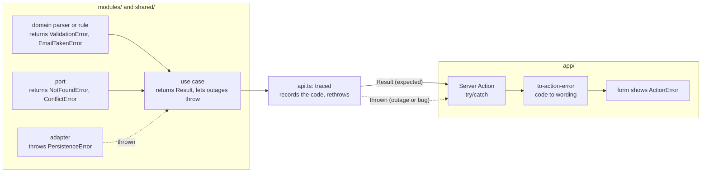

# §7 Errors

Error classes, returned expected outcomes, thrown outages, and the one edge mapper that turns them into words.

The rules are in [§7 Errors](/standards/#_7-errors). This page explains them with the code that sign-up uses: the identity context's `signUp` command, its Server Action, and the shared error classes they pass between them.

## The shape in one picture

An error starts as a class in the core, travels through `api.ts` unchanged, and becomes a plain object only at the edge in `app/`.



Two paths reach the edge. The solid one carries an expected outcome inside a `Result`. The dotted one carries an outage or a bug as a thrown exception. Both end in the same mapper, so a form shows a message either way.

## Errors are classes on `AppError`

Every error the app raises extends one abstract class in `src/shared/kernel/errors/`. Each concrete class declares a literal `code`, which is what `app/` keys its wording on:

<<< @/../src/shared/kernel/errors/app-error.ts#app-error{ts}

Classes, rather than plain objects, are a deliberate choice ([ADR 0008](https://github.com/B-Jones-RFD/next-ddd-starter/blob/main/docs/adr/0008-error-classes-thrown-outages-and-an-edge-mapper-in-app.md)):

- **`instanceof`** lets a caller pick out the one error it can act on, without string-matching a `kind`.
- **`cause`** chains keep the original driver or SDK error behind the translated one, so the diagnostic log and the span see the whole story.
- **Stack traces** come for free, which matters for the thrown path, where something went wrong that nobody planned for.

The `data` getter is the error's declared data: codes, ids and field names only. The diagnostic log's `err` serializer records it, so a class that carries more context (`NotFoundError { entity, id }`) overrides it, and one that carries nothing keeps the empty default.

The tree has three branches, and each has a different job:

```
AppError
├─ DomainError: ValidationError { fields }, ForbiddenError, <rule errors>
├─ NotFoundError { entity, id }    ConflictError { entity, id }    UnauthenticatedError
└─ InfrastructureError { port, retryable }: PersistenceError, ExternalServiceError
```

- **`DomainError`** is what the domain decides: a field that fails its parse rule, an actor who may not act, a rule that says no. These are always expected.
- **The middle row** is what ports and sessions report: the thing isn't there, it changed since it was loaded, or there is no session. Also expected.
- **`InfrastructureError`** is an outage. It is the only branch that is thrown rather than returned.

`ValidationError` carries a field-to-issue map. The issues are a closed set of codes, not wording, so the domain never decides how a problem is phrased:

<<< @/../src/shared/kernel/errors/domain-error.ts#field-issues{ts}

## Return what's expected, throw what isn't

An **expected outcome** is one a caller can act on: tell the user the email is taken, show which field is wrong, ask them to reload after a conflict. Those are returned in a `Result` and named in the signature:

<<< @/../src/shared/kernel/result.ts{ts}

The `signUp` command declares exactly the errors it can return. A caller reading the signature knows every expected way it can fail, and the compiler makes it handle them:

<<< @/../src/modules/identity/application/commands/sign-up.command.ts#signature{ts}

An **outage** is everything else: the database is locked, the disk is full, a service didn't answer. No caller in the middle can do anything useful about it, so it is thrown. This keeps use cases free of early returns for failures they can't act on. A use case catches an `InfrastructureError` only when it can retry, compensate or fall back; otherwise it lets it propagate.

An adapter never lets a raw driver error escape. It translates it into an `InfrastructureError` subclass, keeps the original as `cause`, and says whether trying again later may succeed:

<<< @/../src/shared/kernel/errors/infrastructure-error.ts#infrastructure-error{ts}

The SQLite adapters do this through one helper in `src/shared/infrastructure/sqlite/`, which marks `SQLITE_BUSY` and `SQLITE_LOCKED` as retryable (see [Infrastructure](/infrastructure/)). A mock adapter that fails throws the same classes as its real twin, so callers never see a failure shape that production can't produce.

`ExternalServiceError` has no user in this app. It is there because apps built from this template will call external services, and the split between "the database failed" and "a service failed" is cheaper to have from the start than to retrofit.

An outage is never returned. Returning it would put it in every port's signature and force every caller to pass it up by hand, which is the cost [ADR 0005](https://github.com/B-Jones-RFD/next-ddd-starter/blob/main/docs/adr/0005-ports-declare-their-errors-and-composition-catches-the-rest.md) paid and ADR 0008 removed.

There is one case where an expected error becomes a thrown one. At the end of `signUp`, a conflict on a session that was just created can't be a stale version, so it means something is wrong, and the command throws it:

<<< @/../src/modules/identity/application/commands/sign-up.command.ts#unreachable-conflict{ts}

The test is "can a caller act on this?", not "which class is it?".

## Rule errors are coded

A rule error is a `DomainError` subclass that lives beside its aggregate in `domain/<aggregate>/<aggregate>.errors.ts`. Its code names the context, the aggregate and the rule, `<context>.<aggregate>.<rule>` (`boards.list.archived`), so a code read in a log or a span says where it came from without a lookup. The shared errors use bare codes (`validation`, `forbidden`, `not-found`, `conflict`, `unauthenticated`), because they mean the same thing in every context.

Identity's first rule error:

<<< @/../src/modules/identity/domain/user/user.errors.ts{ts}

The code is a stable contract: `app/` keys its wording on it and spans record it, so renaming one is a breaking change to both.

## `message` is for developers

`Error` requires a `message`, but users never see it. It reaches diagnostic logs and span exception events, so it holds constant text plus codes, ids and field names, and never a value from input. `ValidationError` names the fields that failed, not what was typed into them; `NotFoundError` says `Task <id> not found`, never the title that was searched for. The rest of telemetry keeps user input out by its types; `message` is the one free-text string, so it is held to the rule by review ([ADR 0017](https://github.com/B-Jones-RFD/next-ddd-starter/blob/main/docs/adr/0017-telemetry-keeps-user-input-out-by-construction-except-error-messages.md)).

## Classes cross boundaries through `api.ts`

`api.ts` re-exports the errors its commands and queries return, as the classes they are, so `app/` can test with `instanceof` and read `fields`:

<<< @/../src/modules/identity/api.ts#errors{ts}

`traced`, which wraps every export, records an expected error's `code` on the span with the status left unset, records a thrown one with its `cause` chain and sets `ERROR`, and rethrows the same object. It never converts an error (see [Observability](/observability/)).

Between contexts, one more step applies. When a context calls another's `api.ts`, it does so from an ACL adapter behind its own port, and that adapter translates the upstream errors, thrown ones included, into its own port's errors. So one context's error classes never reach another context's domain (see [Between contexts](/contexts/)).

## One mapper turns errors into words

`src/app/_lib/errors/to-action-error.ts` is the only place an error becomes a plain object. It is the edge: it decides the shape `app/` passes around, and it holds every piece of user-facing wording, keyed by `code`.

The plain shape is serializable, so it can be returned from a Server Action and passed to a Client Component:

<<< @/../src/app/_lib/errors/action-error.ts{ts}

The wording lives in one table keyed by `code`. A `ValidationError` gets a message for the form and one per field; the field wording comes from a second table, per field with a fallback per issue code:

<<< @/../src/app/_lib/errors/to-action-error.ts#wording{ts}

The mapper itself does two things. A known `code` gets its wording. Anything else, which in practice means anything thrown, becomes `unexpected`, is logged once, and carries the trace id as its `reference`, so a user's report leads straight to the trace:

<<< @/../src/app/_lib/errors/to-action-error.ts#to-action-error{ts}

There is no `UnexpectedError` class. `unexpected` exists only as a code in `ActionError`, because nothing in the core can know an error is unexpected; only the edge, which has run out of wording, can.

Keeping this in one file in `app/` has two payoffs. All user-facing text is in the layer that owns presentation, so the domain and application layers never choose words. And there is one place to look when a message is wrong, or when a new code needs wording.

## A Server Action uses both paths

The sign-up action shows both paths meeting in the mapper. A returned error and a thrown one each come back as `{ status: 'error', error }`, so a failed save shows a message in its form instead of replacing the page:

<<< @/../src/app/sign-up/actions.ts#errors{ts}

`redirect` throws a Next.js control-flow signal, so it stays outside the `try`, where the `catch` can't swallow it.

Nothing in `app/` returns an error, passes one to a Client Component, or caches one without going through `toActionError`. Pages and layouts take the other road: they call `notFound()` or `redirect()` for `NotFoundError`, `ForbiddenError` and `UnauthenticatedError` (see [Auth](/auth/)), and let anything thrown reach `error.tsx`, which shows Next's `digest` as the reference.

## Checklist

- A new rule error extends `DomainError`, lives in `domain/<aggregate>/<aggregate>.errors.ts`, and has a `<context>.<aggregate>.<rule>` code.
- Its `message` is constant text plus codes, ids and field names.
- The command's signature names it in its `Result`, and `api.ts` re-exports it.
- `to-action-error.ts` has wording for its code.
- Adapters translate driver errors into an `InfrastructureError`, with `cause` and `retryable`, and throw it.
