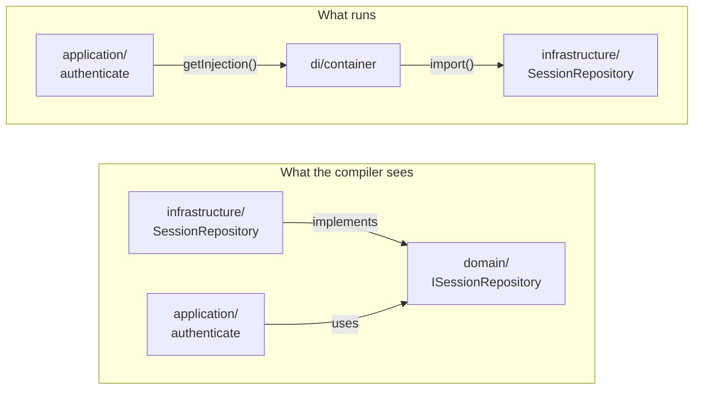
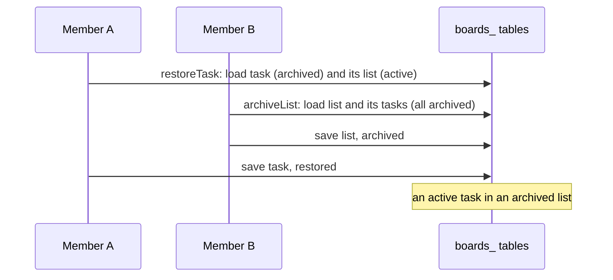

# §13 Known exceptions and local-only simplifications

The places where this app breaks one of its own rules on purpose, and the shortcuts it takes because it runs on one machine.

The rules are in [§13 Known exceptions and local-only simplifications](/standards/#_13-known-exceptions-and-local-only-simplifications). Every item there is deliberate. Don't "fix" one, and don't copy one anywhere else. This page shows the code each exception lives in, why the exception is there, and, for the local-only ones, what a deployed app puts in its place.

The exceptions fall into three groups:

- **Exceptions to a rule.** The code breaks a rule from another section in one named place, because following the rule there would cost more than it saves. Nothing else may break it.
- **Accepted costs.** The design leaves a gap open, and the result is odd but valid. The alternative would bring back something the design removed on purpose.
- **Local-only simplifications.** These are fine for one process on a laptop, and wrong for a deployed app. Each sits behind a port or a seam, so replacing it changes no caller.

## `getInjection` is a service locator

§2 says dependencies point inward: `app/` → `api.ts` → `application/` → `domain/`, with `infrastructure/` implementing the ports that `domain/` and `application/` own. Use cases resolve those adapters with `getInjection` inside their bodies (see [Application](/application/)):

<<< @/../src/di/container.ts#get-injection{ts}

So `application/` imports `@/di/container`, and the container loads the bindings, which load `infrastructure/`. At runtime, that is an edge from the inner ring to the outer one:

It isn't a layering bug. Every type still points inward: `getInjection('ISessionRepository')` returns the port's type, which `src/di/types.ts` maps with type-only imports, so a use case never names an adapter class and can't call anything the port doesn't declare. Lint holds the edge to exactly one import: `application/` may import `@/di/container` and nothing else under `src/di/`.

The alternative, use-case factories wired by the container, was the first choice and was rejected ([ADR 0003](https://github.com/B-Jones-RFD/next-ddd-starter/blob/main/docs/adr/0003-functional-core-class-adapters-and-mock-mode.md)). It makes the container wire application code as well as adapters, and puts a factory call in front of every use case. The price of the locator is that a use case's dependencies aren't in its signature; you read them from its `getInjection` calls.

Don't copy the edge anywhere else. `domain/` never imports the container, and nothing in `modules/` imports `src/di/` beyond `container.ts`.

## `authenticate` writes during render

§4 says queries are read-only. `authenticate` is a query, it runs during Server Component render on every signed-in request, and it writes:

<<< @/../src/modules/identity/application/queries/authenticate.query.ts#authenticate{ts}

The write is `lastSeenAt`, which the 7-day idle limit is measured from ([ADR 0009](https://github.com/B-Jones-RFD/next-ddd-starter/blob/main/docs/adr/0009-database-sessions-with-opaque-tokens-not-jwts.md)). A session nobody records using can't expire for idleness, so the write has to happen on the one path every request takes. Two things keep it small.

It happens at most once a minute. The domain decides when a touch is due, and the touch is a plain new state with no event:

<<< @/../src/modules/identity/domain/session/session.ts#touch{ts}

And it goes straight through the session repository, not through `save`. There's no version check, no outbox row and no event, so nothing reaches audit, and a sign-out racing with a touch can't fail either one:

<<< @/../src/modules/identity/domain/session/session-repository.port.ts#touch{ts}

Going through `save` would mean an event per minute per signed-in user, an Audit log full of "seen", and a possible `ConflictError` during render that nobody can act on. This is the one exception to read-only queries. Every other query reads only.

## A Board member who leaves hands their tasks to the Owner

When a Board member leaves or is removed, every task on the board assigned to them, archived tasks included, passes to the board's Owner. The `boards.reassignToOwner` handler makes the change:

<<< @/../src/modules/boards/application/handlers/reassign-to-owner.ts{ts}

Three things about it are exceptions, and each has a reason.

- **It changes archived tasks.** §3 makes archived things read-only. But an archived task restored later must not come back assigned to someone who can no longer see the board, and restoring is the moment nobody would think to check. So the hand-over ignores `archived`. It is a change a handler makes, not one a user makes, which is why the read-only rule doesn't stop it:

  <<< @/../src/modules/boards/domain/services/task-assignment.service.ts#hand-over{ts}

- **It writes one task per transaction.** §6 says a handler writes its one aggregate. A member can be assigned to many tasks, so the handler loops and saves each task on its own, reloading and retrying a task that changed under it. If it fails halfway, the redelivery picks up the rest.
- **It writes no inbox row.** §6 has each handler record what it applied in its inbox. This one doesn't need to: a redelivery runs `findAssignedTo` again and finds nothing still assigned to them, so it does nothing. Someone re-added to the board before it runs keeps their assignments, because `handOverToOwner` checks membership against the board as it is now.

It handles the published `boards.MemberRemoved.v1` and `boards.MemberLeft.v1`, not the domain events, so each saved task carries the published event's id as its `causationId`. Audit records each hand-over as an ordinary entry, and Activity names the removal as its cause ([ADR 0010](https://github.com/B-Jones-RFD/next-ddd-starter/blob/main/docs/adr/0010-one-audit-entry-per-integration-event-and-activity-as-a-filtered-view.md)).

## Cross-aggregate read-checks can race

Every transaction writes one aggregate ([ADR 0007](https://github.com/B-Jones-RFD/next-ddd-starter/blob/main/docs/adr/0007-one-aggregate-per-transaction-with-a-transactional-outbox.md)). A rule that spans aggregates, such as "restore a task only into an active list" or "archive a list only when none of its tasks are active", is a read-check: the command loads the other aggregates outside the transaction and passes them to the domain.

<<< @/../src/modules/boards/application/commands/restore-task.command.ts#read-checks{ts}

The list is read, not locked. Its version isn't checked when the task is saved, so two members can each pass a check that the other's change makes stale:

The archive check passes too, from the other side:

<<< @/../src/modules/boards/domain/services/archiving.service.ts#archive-list{ts}

The result is odd: an active task in an archived list. The board shows it in neither its active nor its archived view until the list is restored. But it's valid. Nothing is lost, every change has its event and its Audit entry, and restoring the list shows the task again. The same holds for a task moved into a list as it is archived, a member assigned as they leave (which the hand-over above cleans up), and a tag applied as it is deleted.

Closing the races means version-checking every aggregate a rule only reads, inside the writer's transaction. That brings back the multi-aggregate transactions that ADR 0007 removed, for states nobody loses data in.

## All contexts share one SQLite file and one connection

Identity, boards and audit each own their tables, but there is one database and one connection for the process:

<<< @/../src/shared/infrastructure/sqlite/database.ts{ts}

Contexts stay apart by convention rather than by storage. Every table carries its context's prefix (`identity_sessions`, `boards_tasks`, `audit_entries`), and there are no cross-context joins or foreign keys (§5). A context reads another's data only through that context's `api.ts`, and learns of changes only through published events ([ADR 0006](https://github.com/B-Jones-RFD/next-ddd-starter/blob/main/docs/adr/0006-contexts-integrate-through-consumer-owned-ports-and-published-events.md)).

A database per context would make the separation physical, at the price of more files to configure, migrate and back up for an app that runs on one machine. So it is an accepted compromise. Because nothing joins across prefixes, the line a split would follow is already drawn. One shared connection is also why `save` never awaits inside a transaction: an `await` would let another request's statements into it (see [Infrastructure](/infrastructure/)).

## Mocks ship in the production bundle

Every adapter has a `.mock.ts` twin. The twins are ordinary modules in `src/`, so the bundler includes them, but the bindings load them through `import()` only in mock mode:

<<< @/../src/di/modules/identity.module.ts#mock-mode{ts}

Production never selects mock mode: the container refuses it at startup (see [Layout](/layout/)). So the mocks are in the bundle, but no production request ever runs one.

Keeping mocks only in `tests/` was rejected, because the dev server must be able to load them: it runs with no database ([ADR 0003](https://github.com/B-Jones-RFD/next-ddd-starter/blob/main/docs/adr/0003-functional-core-class-adapters-and-mock-mode.md)). Because mocks do ship, they never get test-only hooks such as `failNext()`. Tests inject outages with `vi.spyOn` on the resolved adapter instead ([ADR 0012](https://github.com/B-Jones-RFD/next-ddd-starter/blob/main/docs/adr/0012-tests-go-through-api-on-mock-adapters-kept-honest-by-contract-suites.md)).

## Ports use the `I` prefix and `interface`; Next's files use default exports

§12 prefers `type` to `interface`, with no `I` prefix, and named exports only. Two things break that.

A port is `interface I<Name>`:

<<< @/../src/modules/identity/application/ports/password-hasher.port.ts#port{ts}

The prefix tells a reader, at every `getInjection('IPasswordHasher')` call and every `class PasswordHasher implements IPasswordHasher`, that this is a seam with a real adapter and a mock behind it, not a data type. It also frees the plain name for the adapter. The token is the port's name, so it is unique across the repo (§2). Ports are the only exception to the `type` and no-prefix rule ([ADR 0003](https://github.com/B-Jones-RFD/next-ddd-starter/blob/main/docs/adr/0003-functional-core-class-adapters-and-mock-mode.md)).

And Next's own files (`page.tsx`, `layout.tsx`, `error.tsx`, `not-found.tsx`, `loading.tsx`, the config files) use the default exports Next requires. Everything else, including every `api.ts`, uses named exports.

## Error messages can carry input

§7 keeps user input out of `message`, and §8 keeps it off spans and diagnostic logs by construction. Two paths are left open ([ADR 0017](https://github.com/B-Jones-RFD/next-ddd-starter/blob/main/docs/adr/0017-telemetry-keeps-user-input-out-by-construction-except-error-messages.md)):

- **Third-party messages are kept as they are**, along the whole `cause` chain. A driver or SDK error can quote a value: a constraint message, a URL with a query string. The `err` serializer records it as written.
- **Next records thrown errors on its own spans.** It calls `recordException(err)` and sets the status message to `err.message`, so whatever a thrown error says reaches the trace.

Scrubbing either would remove the text needed to diagnose an outage, to guard against a risk the app's own code already avoids. So the app holds its own messages to the rule by review, and treats third-party text in exported telemetry as a documented gap, not a guarantee.

## Observability deviates from the OpenTelemetry spec twice

The spec defaults every exporter to `otlp`, and `NodeSDK`, following it, drops the tracer provider when traces are `none`. This app differs on both ([ADR 0015](https://github.com/B-Jones-RFD/next-ddd-starter/blob/main/docs/adr/0015-observability-is-configured-by-standard-otel-env-with-safe-defaults.md)):

- **Every exporter defaults to `none`**, production included, so nothing tries to reach a collector that doesn't exist. A deployment opts in with `=otlp`.
- **Traces' `none` keeps the provider**, as a no-op span processor, so every request still has a trace id for the `unexpected` reference a user is shown:

<<< @/../src/instrumentation.node.ts#span-processor{ts}

An operator who reads only the spec would expect OTLP export with nothing set. That's why a production start with traces at `none` logs `app.started` at `warn` (see [Observability](/observability/)).

## `ExternalServiceError` is the pattern for apps that call services

`InfrastructureError` has two subclasses: `PersistenceError` for the database, and `ExternalServiceError` for a service the app calls. This app calls no external service. Its one throw is the password hasher's, when Node's `scrypt` fails, which is the nearest thing it has to a library outside the database:

<<< @/../src/modules/identity/infrastructure/password-hasher.ts#derive{ts}

The class is there because apps built from this template will call email, payment and other APIs, and splitting "the database failed" from "a service failed" is cheaper to have from the start than to retrofit (see [Errors](/errors/)). An adapter that calls a service throws it, with the original as `cause` and `retryable` set by whether trying later may succeed.

## The session cookie has no `__Host-` prefix

A `__Host-` prefix would make the browser enforce `Secure`, `Path=/` and no `Domain`. Safari rejects `Secure` cookies on `http://localhost`, so with the prefix nobody could sign in during development in Safari. The cookie is named plain `session`, and is `Secure` only in production:

<<< @/../src/app/_lib/auth/session-cookie.ts{ts}

The cookie still holds only an opaque token, whose hash is all the database stores ([ADR 0009](https://github.com/B-Jones-RFD/next-ddd-starter/blob/main/docs/adr/0009-database-sessions-with-opaque-tokens-not-jwts.md)), and is `HttpOnly` and `SameSite=Lax` in every environment (see [Auth](/auth/)).

## Local-only simplifications

These are right for one process on one machine. A deployed app replaces each one. Each sits behind a port or a seam, so the replacement changes no caller.

| Here | Why it's fine locally | A deployed app |
| --- | --- | --- |
| Expired sessions are never purged | A few rows a day on one machine | adds a scheduled purge |
| The sign-in throttle is in memory | There is one process | adds a shared store behind `ISignInThrottle` |
| The outbox relay runs in-process | There is one process, started by `instrumentation.ts` | can run a worker behind `IEventRelay` |

**Expired sessions are never purged.** Expiry is computed when a session is read, with no event, so an expired session simply stops signing anyone in. Its row stays:

<<< @/../src/modules/identity/domain/session/session.ts#expiry{ts}

A scheduled job that deletes rows past both limits changes nothing a user sees, because those rows already authenticate nobody.

**The sign-in throttle is in memory.** Failed sign-ins per email are counted in a `Map` in this process:

<<< @/../src/modules/identity/infrastructure/sign-in-throttle.ts{ts}

With several instances behind a load balancer, each would count on its own, and a restart forgets every count. A deployed app binds a shared store to `ISignInThrottle`. `signIn` doesn't change.

**The outbox relay runs in-process.** `instrumentation.ts` starts it once, and each `save` kicks it (see [Between contexts](/contexts/)). Everything outside the relay depends only on its port:

<<< @/../src/shared/kernel/ports/event-relay.port.ts#port{ts}

A separate worker scales further, but it is a second process to run locally ([ADR 0007](https://github.com/B-Jones-RFD/next-ddd-starter/blob/main/docs/adr/0007-one-aggregate-per-transaction-with-a-transactional-outbox.md)). Because the outbox is a table, a worker can read the same rows and run the same handlers, and nothing that writes events has to know.
