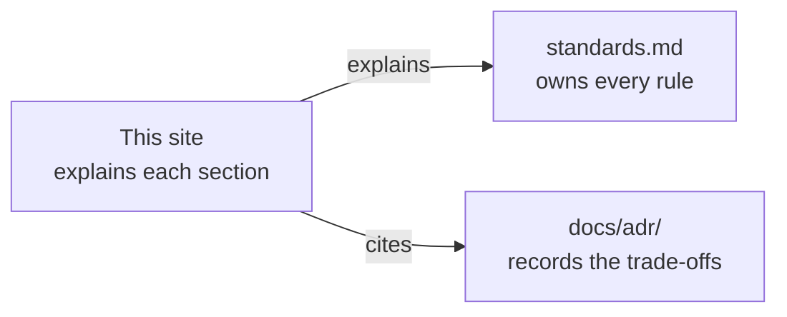
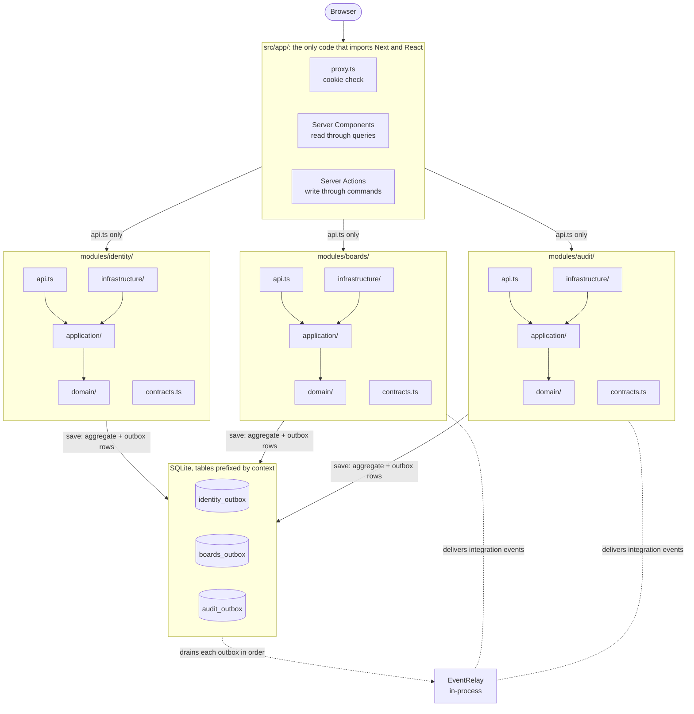

# next-ddd-starter

A multi-user task board built with domain-driven design on Next.js 16. Coding agents follow it as the reference implementation for future Next.js projects. This site explains how it is built and why.

- **[Standards](/standards/)**: the rules. If this site and `standards.md` disagree, `standards.md` wins.
- **The sections** in the sidebar each explain one part of the standards in depth.
- **[Using this as a template](/template/)**: starting a new app from this repository.

This page is the map. It draws the whole architecture once, then follows one change through it, so each section page has somewhere to fit. It explains the rules and adds none.

## The architecture

Read it from the top. The browser only ever talks to `src/app/`, the one place that imports Next and React ([§2](/layout/)). `app/` reaches a context only through its `api.ts`. Pages read through queries in Server Components, and forms write through commands in Server Actions ([§10](/presentation/)). `proxy.ts` only checks that a session cookie exists. Whether the session is valid is decided by identity, on every read and write ([§9](/auth/)).

Each context is one module with the same layers, and the arrows inside it are imports. `api.ts` re-exports the use cases. `application/` holds them: each loads, calls the domain and saves ([§4](/application/)). `domain/` is pure functions over immutable data and imports nothing but the shared kernel ([§3](/domain/)). `infrastructure/` holds the adapters, the only classes, which implement the ports the inner layers declare, each with an in-memory `.mock.ts` twin ([§5](/infrastructure/)). The DI container in `src/di/`, not drawn, binds each adapter to its port.

Contexts work together in only two ways ([§6](/contexts/)):

- **Tell**, the dotted arrows. Every save writes the aggregate and its integration events, as rows in that context's own outbox table, in one transaction. The relay drains each outbox in order and delivers the events to handlers in the consuming contexts' `application/`. A handler types its events from the publisher's `contracts.ts`, which is type-only, so nothing else of the publisher comes with it.
- **Ask**, not drawn here. A context that needs an answer now calls a port it owns, and that port's adapter calls the other context's `api.ts` queries. Boards asks identity for a User by email, and audit asks boards for a Board member's role. The [Between contexts](/contexts/) page draws both.

Dependencies only run one way: boards depends on identity, and audit on both. Identity hears from nobody, and nothing hears from audit. Audit has an outbox all the same, though it publishes nothing yet, because every context has one.

## One change, end to end

The rules make more sense on one concrete path. Here is what happens when a Board's Owner renames it in Settings.

### 1. A Server Action calls the command

The form posts to a Server Action in the route's `actions.ts`. It gets the actor, passes the raw strings to the command, and maps any failure through `toActionError`:

<<< @/../src/app/boards/[boardId]/settings/actions.ts#rename-board-action{ts}

The action validates nothing and authorizes nothing. Both happen in the module, so no rule lives in two places and the browser can't skip one ([§10](/presentation/), [§9](/auth/)). `renameBoard` comes from boards' `api.ts`, where it is wrapped as `traced('boards.renameBoard', …)`, so every call gets a span without the use case knowing ([§8](/observability/)).

### 2. The command loads, decides, saves

Every command has the same shape: check the input's shape with Zod, load one aggregate, call a domain function, save what it returned ([§4](/application/)):

<<< @/../src/modules/boards/application/commands/rename-board.command.ts{ts}

The port is resolved inside the body with `getInjection`, so importing `api.ts` never builds the container, and tests can run on mock adapters ([§2](/layout/)). Expected failures come back in a `Result` that the signature declares. Outages are thrown ([§7](/errors/)).

### 3. The domain decides and raises an event

The domain function checks the actor's role itself, parses the name into a value object, and returns the new state with the events it raised:

<<< @/../src/modules/boards/domain/board/board.ts#rename-board{ts}

It saves nothing and publishes nothing. It is a pure function of its arguments, so its tests need no mocks, and permission checks can't be forgotten by a caller, because there is no way to rename a Board without them ([§3](/domain/)).

### 4. Saving is publishing

`IBoardRepository.save(state, events, origin)` writes the Board and its outbox rows in one synchronous SQLite transaction, with a version check that rejects a stale write ([§5](/infrastructure/)). Each domain event is stored with its translation to a versioned integration event, the only shape another context ever sees:

<<< @/../src/modules/boards/application/contracts/board-renamed.v1.ts{ts}

Because the event commits with the change, there is never a renamed Board without its event, or an event without its Board. That is why one transaction holds exactly one aggregate, and why effects on anything else wait for a handler ([ADR 0007](https://github.com/B-Jones-RFD/next-ddd-starter/blob/main/docs/adr/0007-one-aggregate-per-transaction-with-a-transactional-outbox.md)).

### 5. The relay tells the other contexts

After the commit, the save kicks the relay, which `instrumentation.ts` started once for the process. It drains each outbox in order, the same order every time:

<<< @/../src/di/event-handlers.ts{ts}

Here `boards.BoardRenamed` has one handler, audit's. It turns the event into an Audit entry and records it with an inbox row in one transaction, so a redelivered event is dropped ([§6](/contexts/), [ADR 0010](https://github.com/B-Jones-RFD/next-ddd-starter/blob/main/docs/adr/0010-one-audit-entry-per-integration-event-and-activity-as-a-filtered-view.md)):

<<< @/../src/modules/audit/application/handlers/audit-handlers.ts#record{ts}

### 6. The next read sees it

The action calls `refresh()`, and the page re-renders on the server through boards' and audit's queries, filtered by the viewer's membership, with nothing cached per viewer ([§10](/presentation/), [ADR 0011](https://github.com/B-Jones-RFD/next-ddd-starter/blob/main/docs/adr/0011-server-components-read-server-actions-write-nothing-cached-per-viewer.md)). The new name shows at once, because it is boards' own data. The Board log entry lags by one relay drain, because audit learns of the change only through the event ([§6](/contexts/)).

## Why it is built this way

A task board doesn't need three contexts, ports and an outbox. This repository is the template for larger apps with many contexts, so it uses the patterns that scale even where a shortcut would do, and apps built from it copy what they see ([§1](/scale/)). Each piece of the diagram is there for a reason that grows with the app:

- **`app/` holds all of Next** so that every module runs in a plain Node test, and a framework upgrade touches one folder ([ADR 0002](https://github.com/B-Jones-RFD/next-ddd-starter/blob/main/docs/adr/0002-modules-around-a-pure-domain-with-next-confined-to-app.md)).
- **Two entry files per module** let lint tell what may be called (`api.ts`) from what may only be typed against (`contracts.ts`), so no context reaches into another's internals ([§2](/layout/)).
- **A pure domain with class adapters and mock twins** keeps business rules testable without IO, and lets the dev server and the tests run without a database ([ADR 0003](https://github.com/B-Jones-RFD/next-ddd-starter/blob/main/docs/adr/0003-functional-core-class-adapters-and-mock-mode.md)).
- **Ask through consumer-owned ports, tell through published events**, so each context speaks its own language and a supplier can change behind its anti-corruption layer ([ADR 0006](https://github.com/B-Jones-RFD/next-ddd-starter/blob/main/docs/adr/0006-contexts-integrate-through-consumer-owned-ports-and-published-events.md)).
- **One outbox per context and an in-process relay** mean an outage delays an event but never drops it, with no second process to run locally. A deployed app can move delivery to a worker behind the same `IEventRelay` seam ([§6](/contexts/), [§13](/exceptions/)).

The section pages in the sidebar take each layer in turn. Start with [Layout](/layout/) for where code lives, then [Domain](/domain/) and [Application](/application/) for the core, and [Between contexts](/contexts/) for the outbox and relay.
