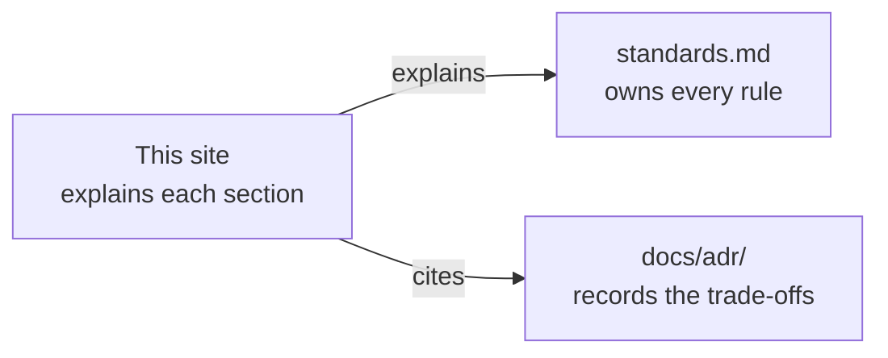

# next-ddd-starter

A multi-user task board built with domain-driven design on Next.js 16. It is the reference implementation coding agents follow for future Next.js projects. This site explains how it is built and why.

- **[Standards](/standards/)**: the rules. If this site and `standards.md` disagree, `standards.md` wins.
- **The sections** in the sidebar each explain one part of the standards in depth.
- **[Using this as a template](/template/)**: starting a new app from this repository.

::: info Stub
The architecture overview diagram is drawn once the build slices have landed.
:::
