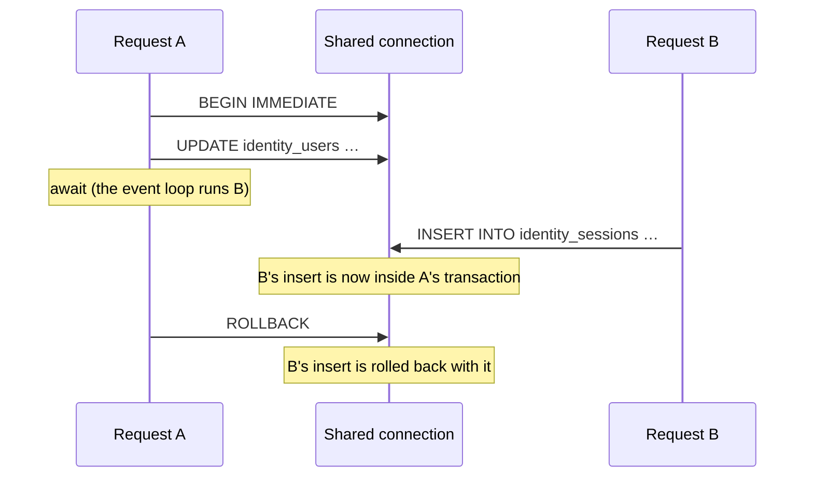
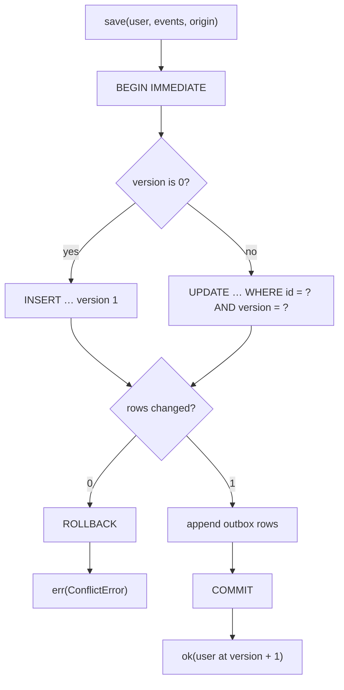

# §5 Infrastructure and persistence

Adapters behind ports, raw SQL on SQLite, and one aggregate per transaction with an outbox.

This page explains the rules in [§5 Infrastructure and persistence](/standards/#_5-infrastructure-and-persistence) of the standards with the code that follows them. The rules live there. This page only says what they look like and why they exist.

The examples come from the identity context, which owns the **User** and the **Session**. Its repositories are the first ones the build landed, and the boards context follows the same shape.

## Adapters are classes behind ports

The domain and the use cases are plain functions and types. The one place that uses classes is `infrastructure/`. There, each adapter is `class <Name> implements I<Name>`. A repository's port lives next to the aggregate it stores, and it says what the adapter returns and what it throws:

<<< @/../src/modules/identity/domain/user/user-repository.port.ts{ts}

The SQLite adapter that implements it is `UserRepository` in `src/modules/identity/infrastructure/user-repository.ts`. The file name says what the adapter does, not which technology it uses, so `user-repository.ts` and not `sqlite-users.ts`. Swapping SQLite for another store then changes the inside of the file and nothing else.

Adapters are classes because they hold dependencies, here the shared connection and the context's outbox, and the container builds them once. Everything else stays a function, because functions return `{ state, events }` and pass through Next's serialization boundaries without breaking ([ADR 0003](https://github.com/B-Jones-RFD/next-ddd-starter/blob/main/docs/adr/0003-functional-core-class-adapters-and-mock-mode.md)).

### Every adapter has a `.mock.ts` twin

Next to each adapter is an in-memory twin with the same port: `user-repository.mock.ts` holds `MockUserRepository`. The container loads the twins in mock mode, which is what tests and a dev server with no database run on. A twin isn't a stub. It enforces the same version and uniqueness rules and writes the same outbox rows, so code that works on mocks works on SQLite:

<<< @/../src/modules/identity/infrastructure/user-repository.mock.ts#save{ts}

One contract suite per port keeps the pair honest. `tests/contracts/user-repository.contract.ts` describes what any `IUserRepository` must do, and `tests/modules/identity/infrastructure/user-repository.test.ts` runs it twice: once against `UserRepository` on a `:memory:` database with the production migrations, and once against `MockUserRepository`. When the two disagree, a test fails ([ADR 0012](https://github.com/B-Jones-RFD/next-ddd-starter/blob/main/docs/adr/0012-tests-go-through-api-on-mock-adapters-kept-honest-by-contract-suites.md)).

## Repositories only load and save

A repository has finders, such as `findById` and `findByEmail`, and one `save`. Nothing else writes an aggregate: no `updateEmail`, no `delete`, no SQL in a use case. Every command is load, then a domain function, then `save`, so the aggregate's own rules run before every write.

`save` takes the aggregate, the events the domain function raised and their origin: the user who started the change and, for a change a handler made, the id of the event it reacted to (§6). Saving is publishing. The same call that writes the User writes its events to the outbox, so an event can't be published for a change that didn't commit, and a change can't commit without its events.

## `save` is synchronous inside an `async` signature

Here is the whole of `UserRepository.save`:

<<< @/../src/modules/identity/infrastructure/user-repository.ts#save{ts}

The signature is `async` because the port is: a networked database would need it, and the application layer shouldn't take its shape from SQLite. The body never awaits. It builds the outbox entries first, then runs one `transaction(...)` call whose body is synchronous: the upsert, the outbox rows, and `COMMIT`.

`transaction` is the shared helper every repository uses:

<<< @/../src/shared/infrastructure/sqlite/transaction.ts#transaction{ts}

### Why no `await` inside a transaction

`node:sqlite` is synchronous, and every context shares one connection (`getDatabase()` below). A transaction belongs to the connection, not to the request that opened it. If `save` awaited between `BEGIN` and `COMMIT`, the event loop would run another request in the gap, and that request's statements would land inside the first one's transaction:

With no `await` in between, nothing else can run on the connection until `COMMIT` or `ROLLBACK`, and the problem can't happen. `BEGIN IMMEDIATE` takes SQLite's write lock at the start, so a second process waits on `busy_timeout` instead of failing halfway through.

### Reading happens outside the transaction

The use case loads the User before it calls `save`, outside any transaction. Holding a transaction open across those reads would mean awaiting inside it. The version check makes this safe instead.

## Stale writes are rejected

Persistence owns `version`. A new aggregate carries `version: 0`, and `save` inserts it at 1. An update runs `WHERE id = ? AND version = ?` with the version that was loaded, and bumps it. If someone else saved the same aggregate in between, the `UPDATE` changes 0 rows:

0 changed rows rolls back the whole transaction, outbox rows included, and `save` returns a `ConflictError`. It returns it rather than throws it, because a conflict is an expected outcome the port declares (§7). For a new User the insert has `ON CONFLICT DO NOTHING`, so an email someone else just took is a conflict too, not a driver error.

Nothing retries a conflict automatically. The second writer's change was based on a state that no longer exists, and only the user can decide whether it still makes sense, so the screen tells them to reload ([ADR 0007](https://github.com/B-Jones-RFD/next-ddd-starter/blob/main/docs/adr/0007-one-aggregate-per-transaction-with-a-transactional-outbox.md)). The contract suite's "rejects a stale version with ConflictError, writing nothing" case checks this on both adapters.

## Raw SQL with prepared statements

Every query is hand-written SQL through `db.prepare(...)`, with `?` placeholders for values. There's no ORM, query builder or driver package: `node:sqlite` ships with Node. The SQL in the adapter is the SQL that runs, so a reader needs to know SQLite and nothing else.

This is this app's choice, and a project should decide it for itself ([ADR 0004](https://github.com/B-Jones-RFD/next-ddd-starter/blob/main/docs/adr/0004-sqlite-raw-sql-and-one-synchronous-commit.md)). The ports don't change either way: a use case calls `IUserRepository.save` whether the adapter writes SQL by hand or through a library.

## Migrations go forward only

Each context owns its migrations in `infrastructure/migrations.ts`, and `src/di/migrations.ts` lists them all in the order they shipped:

<<< @/../src/di/migrations.ts{ts}

`migrate` applies the ones the database hasn't seen. `PRAGMA user_version` counts how many of the list a database has applied, so the list is append-only. A migration that has shipped is never edited, reordered or removed. To change a table, add a new migration:

<<< @/../src/shared/infrastructure/sqlite/migrate.ts{ts}

There are no down migrations. A rollback that drops a column also drops its data, and on a live database the safe fix for a bad migration is another forward one. A database newer than the code makes `migrate` refuse to run rather than guess. `npm run db:migrate` runs it from the command line, and the contract suites run the same list on `:memory:`, so tests use the production schema.

## Tables carry their context's prefix

Every table starts with the name of the context that owns it: `identity_users`, `identity_sessions`, `identity_outbox`. No query joins tables from two contexts, and no foreign key crosses a context. Another context that needs to know about users keeps its own copy, fed by identity's published events (§6).

The prefix makes ownership visible in every query, and the missing joins keep the seam real. Each context's tables could move to their own database without rewriting another context's SQL.

## Driver errors never escape an adapter

A use case must never see a `node:sqlite` error. An adapter catches whatever the driver throws and throws a `PersistenceError` instead (or an `ExternalServiceError` for an adapter that calls a service), with the original error as `cause` and `retryable` set:

<<< @/../src/shared/infrastructure/sqlite/translate-error.ts{ts}

`query` wraps every read, and `transaction` wraps every write, so no adapter method calls the driver bare. `SQLITE_BUSY` and `SQLITE_LOCKED` are retryable: the database was there, but another writer held the lock past the timeout. Anything else isn't.

The error classes live in the kernel, so the mocks throw exactly the same ones:

<<< @/../src/shared/kernel/errors/infrastructure-error.ts{ts}

`retryable` matters most to the outbox relay. A delivery that fails with a retryable error is retried with backoff while the rest of the stream waits, so a busy database delays the audit log without dropping part of it. A non-retryable failure is marked `failed` and skipped ([ADR 0008](https://github.com/B-Jones-RFD/next-ddd-starter/blob/main/docs/adr/0008-error-classes-thrown-outages-and-an-edge-mapper-in-app.md), [ADR 0007](https://github.com/B-Jones-RFD/next-ddd-starter/blob/main/docs/adr/0007-one-aggregate-per-transaction-with-a-transactional-outbox.md)). `cause` keeps the driver's message and code for the logs, and `port` says which adapter failed.

## `DATABASE_PATH` is the only setting

The database is one SQLite file, opened from `DATABASE_PATH` on first use:

<<< @/../src/shared/infrastructure/sqlite/database.ts{ts}

The connection lives on `globalThis`, so every bundle in the process, instrumentation and app routes alike, shares it. WAL mode lets reads go on during a write, and `busy_timeout` makes a locked write wait before it fails with `SQLITE_BUSY`.

The same variable decides the adapter mode. In development, a missing `DATABASE_PATH` makes the container fall back to mock adapters with a warning, so `npm run dev` works on a fresh clone with no database. Production refuses to start without it, so it never runs on fakes by accident. One variable, used for both, means there's no state where the app thinks it has a database and doesn't.
