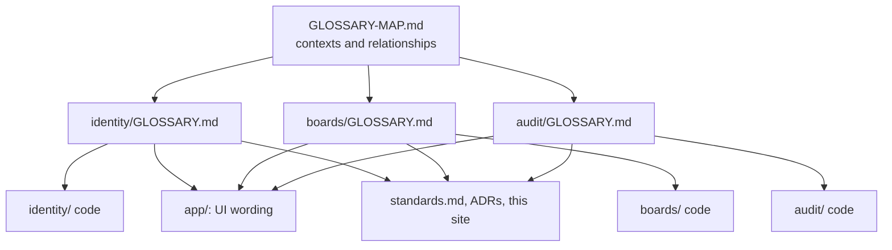
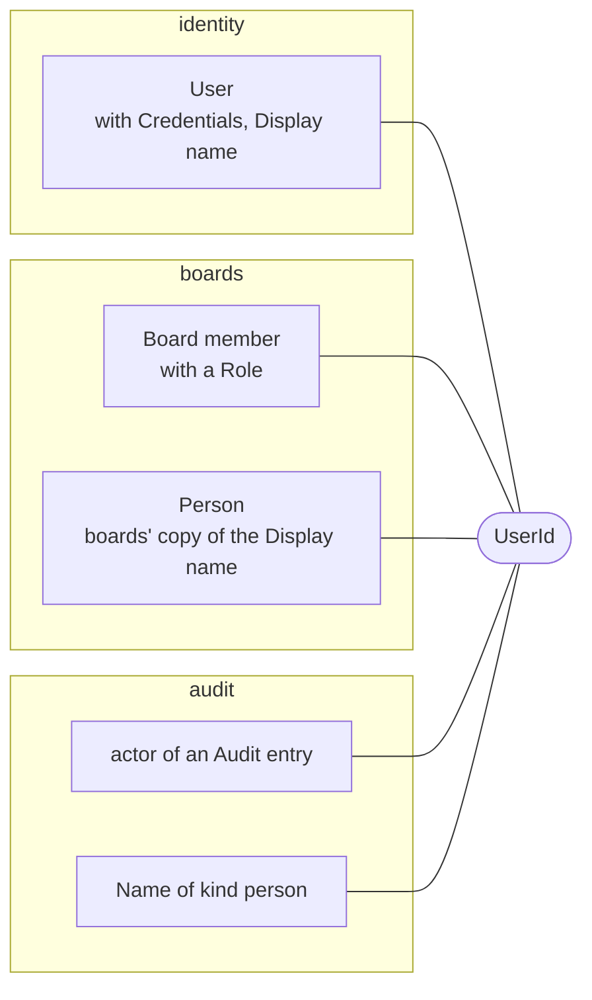

# Domain language

The three bounded contexts (identity, boards and audit), the words each one uses, and how they relate.

The standards give the language one rule, in [§3 Domain](/standards/#_3-domain): code, UI and docs use the terms in the context's `GLOSSARY.md`, never a synonym it lists under _Avoid_, and a term goes into the glossary before it goes anywhere else. [§14](/standards/#_14-recipe-adding-a-feature) makes that the first step of every feature. This page explains how the glossaries are laid out, how their words show up in the finished app, and why the rule exists. The standards own the rule. This page only says what it looks like.

## One map, three glossaries

Each bounded context keeps its own glossary beside its code, in `src/modules/<context>/GLOSSARY.md`, as [§2 Layout](/standards/#_2-layout-and-boundaries) requires. One file at the repo root, `GLOSSARY-MAP.md`, indexes them:

- **[Identity](https://github.com/B-Jones-RFD/next-ddd-starter/blob/main/src/modules/identity/GLOSSARY.md)**: User, Display name, Credentials, Session, Sign-in, Sign-out.
- **[Boards](https://github.com/B-Jones-RFD/next-ddd-starter/blob/main/src/modules/boards/GLOSSARY.md)**: Board member, Owner, Member, Board, List, Task, Assignee, Tag, Tag color, Archived, Active, Comment.
- **[Audit](https://github.com/B-Jones-RFD/next-ddd-starter/blob/main/src/modules/audit/GLOSSARY.md)**: Audit log, Audit entry, Consequence, Activity, Board log, User log.

The map also says how the contexts relate, in their own words: a Board member is a user seen from boards, every boards state change becomes an Audit entry, and `UserId` is the only domain type all three share.



A glossary governs its own context's code. The UI and the docs draw on all three, because a screen or a page can show a Task, its Assignees and its Activity at once.

The contexts themselves were cut from this language ([§1](/standards/#_1-scale-and-deliberate-overkill) calls that _this app's choice_). Signing in, organizing work and keeping a record of it each have a vocabulary of their own, and where the vocabulary changes, a context boundary goes.

### Why one glossary per context, not one for the app

The same person is a different thing to each context. To identity, they are a User, someone with Credentials who can sign in. To boards, they matter only as a Board member with a role on one board, and boards' glossary lists "user (within boards)" under _Avoid_. To audit, they are the actor of an Audit entry. One app-wide glossary would have to pick one meaning for each word or give each word several, and either way a reader of the code couldn't trust the name. A glossary per context keeps each word to one meaning inside its context. Translating between contexts is the job of the ports and events in [§6](/contexts/) ([ADR 0006](https://github.com/B-Jones-RFD/next-ddd-starter/blob/main/docs/adr/0006-contexts-integrate-through-consumer-owned-ports-and-published-events.md)).

## How an entry reads

Every entry has three parts: the term in bold, a definition of a sentence or two, and the synonyms to avoid. This is boards' List:

```md
**List**:
A named, ordered column on a board that holds tasks. The list a task sits in is that task's status.
_Avoid_: Column, lane, stage, status
```

The definition may describe what the thing looks like ("a column"), but the thing is only ever _named_ a List. The _Avoid_ line is what stops "column" becoming a second name for it.

The definition also settles questions the code would otherwise answer by accident. "The list a task sits in is that task's status" means there is no status field. A Task holds the id of its list, and moving it is how its status changes:

<<< @/../src/modules/boards/domain/list/list.ts#list{ts}

A board with a "Done" list has done tasks, without a separate `status` that could disagree with where the task sits.

## The words in the code

Names in `domain/` and `application/` are the glossary's terms, and doc comments repeat their definitions. Identity's Session is the glossary's "one signed-in stretch of a user on one browser":

<<< @/../src/modules/identity/domain/session/session.ts#session{ts}

### Definitions carry rules

Some definitions hold a rule, and the code enforces that rule under the same name. Boards' glossary says a board has exactly one Owner, and "the Owner cannot leave the board without first transferring ownership". The role type has exactly the glossary's two roles:

<<< @/../src/modules/boards/domain/board/board.ts#member{ts}

The rule about leaving becomes an error class, named for the rule in the glossary's words:

<<< @/../src/modules/boards/domain/board/board.errors.ts#owner-must-transfer-first{ts}

`leaveBoard` and `removeMember` return it when the Owner tries to go, and its `code`, `boards.board.owner-must-transfer-first`, is what `app/` turns into wording (below). From the glossary sentence to the message on screen, the rule keeps one name.

Tag color is another. The glossary says it is one of a fixed palette of named colors, and that it never stands in for the tag's name. So the domain stores a name from the palette, and never a hex value:

<<< @/../src/modules/boards/domain/board/tag-color.ts{ts}

`app/` maps each name to its theme tokens, and a tag always shows its name, so the color only decorates it ([§10](/presentation/)).

### One person, a different word in each context

Boards keeps its own copy of each user's Display name, learned from identity's events. Its type is named for what boards needs, not for identity's User:

<<< @/../src/modules/boards/application/ports/people-projection.port.ts#person{ts}

Audit has its own word too. Its name projections hold a current name for each `kind` of thing an Audit entry can mention, and a person is one kind among boards, lists, tasks and tags:

<<< @/../src/modules/audit/domain/name/name.ts#name{ts}

What ties these together is the one type in the shared kernel that every context uses:

<<< @/../src/shared/kernel/user-id.ts{ts}



Each context models only what it needs about a person, in its own words, and they agree only on the id. Every other id crosses contexts as a plain string in a contract ([§2](/layout/)). If boards reused identity's `User` type, every field identity added would leak into boards, and boards could no longer say that a Board member is a different idea from a User.

### Audit's language is its own

Audit doesn't record boards' events under boards' names. It maps each integration event into its own `AuditEntry`, keyed by an `action` in its own vocabulary ([ADR 0010](https://github.com/B-Jones-RFD/next-ddd-starter/blob/main/docs/adr/0010-one-audit-entry-per-integration-event-and-activity-as-a-filtered-view.md)):

<<< @/../src/modules/audit/domain/audit-entry/audit-entry.ts#audit-entry{ts}

This is also why audit's glossary lists "Event" under _Avoid_ for an Audit entry. In this codebase an event is a domain event or an integration event, both owned by the context that raised them. An Audit entry is audit's record of one, and it outlives a v2 of the contract. Calling it an "event" would blur the two.

## The words in the UI

User-facing text lives in `app/` ([§7](/errors/)), and it uses the same terms. The route is `/sign-in`, the button says "Sign in", and nothing says "Log in", which identity's glossary avoids. The wording for each error `code` names the roles and things as the glossaries do:

<<< @/../src/app/_lib/errors/to-action-error.ts#wording{ts}

Audit's wording for each Audit entry does the same, after the actor's name:

<<< @/../src/app/_lib/audit/entry-wording.ts#wording{ts}

"made Ben the Owner", "archived a list", "moved the task from “Backlog” to “Done”": a person reading Activity sees the words a developer reads in the code, and a bug report in the UI's words leads straight to the code that has them.

## The words in the docs

`standards.md`, the ADRs and this site use the glossary terms as well. The rules say "Board member" and "Owner" where boards means them, and "User" where identity does. When a page here names a domain thing, it is the glossary's thing, so a reader can look any term up in its context's glossary and find the code under the same name.

## Changing the language

A new feature often needs a new word, or a sharper meaning for an old one. The order is fixed: the glossary first, then the code ([§14](/standards/#_14-recipe-adding-a-feature), step 1). That order is what keeps the language honest:

- **A term defined before it is used gets one meaning.** Writing the definition forces the question of what the thing is, and its _Avoid_ line settles which synonyms are out before any of them reach a file name.
- **A missing term is a signal.** If a concept has no glossary entry, either the code is inventing language the domain doesn't use, or the domain has a real gap. Either way, the glossary is where it gets resolved, not a variable name.
- **A rename starts in one place.** Once the glossary has the new term, and the old one under _Avoid_, every remaining use of the old word in code, UI or docs is a synonym the rule already forbids, so a search for it finds the work left to do.

Where a change touches how two contexts' terms meet, such as how a User appears in boards, `GLOSSARY-MAP.md`'s relationships are where that meeting is described.
