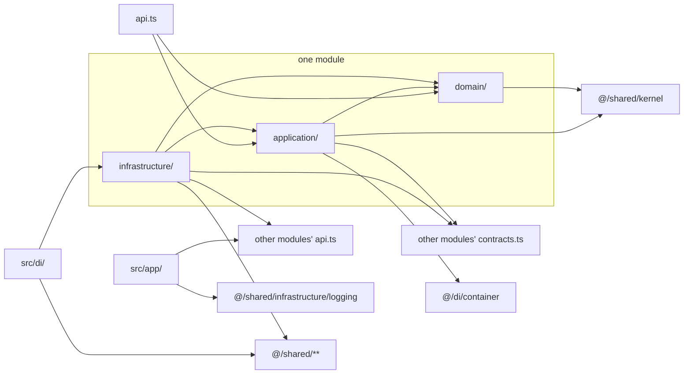

# §2 Layout and boundaries

Where code lives, how each module is shaped, which imports may cross which boundaries, and how the DI container picks and binds adapters. The rules are in [§2 Layout and boundaries](/standards/#_2-layout-and-boundaries). This page explains them with the code that follows them.

## Two top-level folders

All deployable code is in `src/`, and all tests are in a top-level `tests/` folder that mirrors it. A container build copies `src/` and nothing else, so no test, fixture or contract suite ends up in production.

```text
src/
  app/                  the whole presentation layer: routes, Server Actions, _components/, _lib/
  di/                   the container: container.ts, types.ts, modules/<context>.module.ts
  modules/
    identity/           one bounded context per module
    boards/
    audit/
  shared/
    kernel/             building blocks with no business meaning, plus UserId
    infrastructure/     adapters for the technical ports every context uses
  instrumentation.ts    thin Next shim (proxy.ts, the other one, arrives with sign-in)
  instrumentation.node.ts
tests/                  mirrors src/ (see §11)
```

## One module per bounded context

Each bounded context is one module in `src/modules/<context>/`. The three contexts are **identity** (Users, Credentials, Sessions, Sign-in), **boards** (Boards, Lists, Tasks, Tags, Comments and Board members) and **audit** (the Audit log and Activity). Every module has the same shape:

```text
src/modules/identity/
  GLOSSARY.md           this context's words (see Domain language)
  api.ts                entry file: commands, queries, DTO types, error classes
  contracts.ts          entry file: versioned integration events, types only
  domain/               aggregates, value objects, events, errors, repository ports
    user/
    session/
  application/
    commands/  queries/  dto/  ports/  contracts/
  infrastructure/       adapters and their .mock.ts twins
```

Folders are module-first rather than layer-first (`src/domain/`, `src/application/`, …) so that one context's code never shares a folder with another's. Password hashing and Session tokens live in identity, and nothing in boards sits next to them. Each module has its own `GLOSSARY.md`, so a word such as _User_ means one thing inside identity and _Board member_ means one thing inside boards. [Domain language](/language/) covers how the glossaries fit together.

The structure is more than a task board needs. It is deliberate, because this repo is the template for larger apps with many contexts ([§1](/scale/)).

## Next stays in `app/`

Next and React are imported only in `src/app/` and the two shims at the root of `src/`: `proxy.ts` and `instrumentation.ts`. The shims stay thin and hand straight off to code outside them, such as `instrumentation.node.ts`, which builds the OpenTelemetry SDK without importing Next. No module has a `presentation/` folder. `app/` is the whole presentation layer, and it reaches a module only through that module's `api.ts`. A module therefore never depends on the framework, and its domain and use cases run in a plain Node test with no Next runtime ([§11](/testing/)).

The `src/` lint block bans `next`, `react` and `react-dom` everywhere, and the `app/` block, which comes later in the config, doesn't repeat the ban, so it is lifted there.

## Two entry files per module

Each module has exactly two entry files at its root, and nothing else from inside a module is importable by another one.

`api.ts` is the module's public API. It starts with `import 'server-only'`, so a Client Component that imports it fails the build. It exports each command and query wrapped in `traced` ([§8](/observability/)), plus their DTO types and the error classes they return:

<<< @/../src/modules/identity/api.ts{ts}

`contracts.ts` re-exports the context's versioned integration events, each defined in its own file under `application/contracts/`. It is type-only, so importing it pulls no code from the publishing context:

<<< @/../src/modules/identity/contracts.ts{ts}

There are two files, not one `index.ts`, because the two surfaces are allowed to different importers. Another context's `application/` may import `contracts.ts` (to type the events it handles) but not `api.ts`, and lint can only tell them apart if they are separate files.

A module never imports its own `api.ts` or `contracts.ts`. Inside the module, code imports the file it needs directly. The entry files are for the outside, and an internal import through them would create cycles.

## The import matrix

Every scope also bans `../`, so every import names its target with the `@/` alias and the matrix can match it by path.



Each arrow is an allowed import, and anything without an arrow is banned. The arrows point inwards: `domain/` depends on nothing but the kernel, `application/` on the domain, and adapters on both. The full matrix, with packages and Zod, is the table in [§2 of the standards](/standards/#_2-layout-and-boundaries).

A few of the rules carry most of the weight:

- **`domain/` imports only its own `domain/` and `@/shared/kernel`.** No IO, Zod, DI or packages, so the domain is pure functions over plain data ([§3](/domain/)).
- **`application/` may import `@/di/container` and `zod`**, because use cases resolve their ports and validate their input ([§4](/application/)). From another context it imports only `contracts`.
- **`infrastructure/` may import another context's `api` and `contracts`**, never `@/di` or `@/app`. Calling another context's `api.ts` is how an anti-corruption adapter answers a port its own context owns ([§6](/contexts/)).
- **`src/app/` imports `@/modules/*/api`, `@/app/**` and the logging facade**, never `@/di` or Zod. Pages and Server Actions call use cases. They never resolve adapters or parse input themselves ([§10](/presentation/)).
- **`src/shared/kernel/` imports only itself**, so every context can depend on it without pulling in anything else.

### How lint enforces it

`eslint.config.mjs` builds the matrix from `no-restricted-imports` blocks. Flat config replaces a rule per file rather than merging it, so each scope has one complete block, and the most specific block for a file comes last. The blocks for the modules are generated, one set per context, from the list of contexts:

<<< @/../eslint.config.mjs#context-boundaries{js}

`onlyAllow` turns a regex of allowed paths into a pattern that matches everything else, so `domain/`, `application/`, `api.ts` and `contracts.ts` are allowlists. `infrastructure/` is a denylist, because it may also import packages. The `api.ts` and `contracts.ts` blocks add `no-restricted-syntax` selectors for the shape of each file: only `traced(...)` use cases in `api.ts`, and only type exports in `contracts.ts`. Adding a fourth context means adding its name to `CONTEXTS`, and every block follows.

### What lint can't check

Two rules are `review`, because an import path can't show them:

- **Call only another context's queries, never its commands.** Both come from the same `api.ts`. A side effect in another context travels as an integration event instead ([§6](/contexts/)), so a context never makes another one change inside its own call.
- **Keep business types out of the shared kernel.** The kernel holds building blocks with no business meaning, such as `Brand`, `Result` and the `AppError` tree, plus `UserId`. `UserId` is there because every context uses it as an identity. Other ids, such as a Board's or a Task's, cross contexts only as plain strings in contracts, so no context depends on another's types.

## Where ports go

A port lives with the code that needs it:

- A **repository port** is part of its aggregate, as `domain/<aggregate>/<aggregate>-repository.port.ts` ([§3](/domain/)).
- A **port one context uses** goes in that context's `application/ports/`, such as boards' `IPeopleProjection` ([§4](/application/)).
- A **technical port every context uses** goes in `src/shared/kernel/ports/`, with its adapters in `src/shared/infrastructure/`. The id generator is one:

<<< @/../src/shared/kernel/ports/id-generator.port.ts#port{ts}

## The DI container binds adapters only

`src/di/` is the only place that knows which class implements which port. It has three parts.

`types.ts` maps each token to its port with type-only imports. A token is the port's interface name, unique across the repo, so `getInjection('IUserRepository')` is typed by the map:

<<< @/../src/di/types.ts{ts}

`modules/<context>.module.ts` and `shared.module.ts` hold the bindings. Each loads its adapters with `import()` for the mode the container picked, so mock code is never evaluated in real mode:

<<< @/../src/di/modules/identity.module.ts#mock-mode{ts}

`container.ts` picks the mode and exports `getInjection`. Use cases are never bound. They are plain functions that resolve their ports when called, so there is nothing for the container to build for them ([ADR 0003](https://github.com/B-Jones-RFD/next-ddd-starter/blob/main/docs/adr/0003-functional-core-class-adapters-and-mock-mode.md)).

### Resolve inside the function body

`getInjection` builds the container on its first call and memoizes it:

<<< @/../src/di/container.ts#get-injection{ts}

A use case calls `await getInjection('IPortName')` inside its body, never at module top level. Importing `api.ts` then never builds the container or opens a database, so an import has no side effects. Because resolution happens at call time, not import time, tests can also swap a binding between cases.

### The adapter mode

The container picks real or mock adapters once, at startup:

<<< @/../src/di/container.ts#adapter-mode{ts}

The order is what makes the defaults safe. `ADAPTERS` lets anyone force a mode. Tests get mocks without configuring anything. A developer who hasn't set `DATABASE_PATH` gets a working dev server on mocks, with an `adapters.mock_fallback` warning in the diagnostic log. Production refuses mock mode and missing variables, so it never quietly runs on fakes.

### Mock twins

Every adapter has an in-memory `.mock.ts` twin beside it, such as `user-repository.ts` and `user-repository.mock.ts`. The twin keeps the real adapter's behaviour: the same version checks, the same ordering and the same error classes. A test on mocks therefore exercises the same rules a real run does, and the shared contract suites keep each pair honest ([§11](/testing/)).

Mock stores live on `globalThis`, so every bundle in the process (instrumentation and the app's routes) sees one copy, and `resetMockStores()` empties them between tests:

<<< @/../src/shared/infrastructure/mock-stores.ts{ts}
