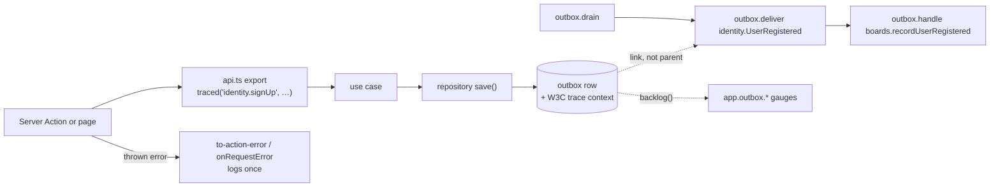

# §8 Observability

Diagnostic logs, traces and the only metrics the template ships, with user input kept out by construction.

This page explains the rules in [§8 Observability](/standards/#_8-observability) of the standards, using the code that implements them. The standards own the rules. This page only says how they work and why.

A word on vocabulary first. A **diagnostic log** is technical and operational logging: lines written for an operator. A bare "log" in this project means the **Audit log**, the domain record that the audit context keeps of every change. The two never share code, storage or wording, so say "diagnostic log" whenever you mean the technical one.

## The three signals

The template produces three kinds of telemetry, and each has one job.

| Signal | What it answers | Written by |
| --- | --- | --- |
| Traces | What did this request, or this delivery, do, and where did it fail? | `traced`, the outbox relay, and Next itself |
| Diagnostic logs | What needs a person to look, and which ids do they need? | infrastructure, `src/di/`, the instrumentation shims and the `app/` edge |
| Metrics | Is any outbox falling behind, or holding failed rows? | the three outbox backlog gauges |

They point at each other rather than repeat each other. A log line carries the trace id of the span that was active, a span carries codes and ids rather than log text, and the gauges hold the state that neither spans nor logs can express.



## Traces

### `traced` wraps every `api.ts` export

Every use case a module publishes is one line in its `api.ts`: the command or query, wrapped in `traced` with a span name. This is the identity module's whole public API:

<<< @/../src/modules/identity/api.ts{ts}

`traced` is the only place a request span is started for our own code, so no feature writes tracing code. It is also where expected errors and thrown errors are told apart on the span:

<<< @/../src/shared/infrastructure/tracing/traced.ts#traced{ts}

What it does, and why:

- **The span name is `<module>.<exportName>`**, such as `identity.signUp`. It matches the `identity.UserRegistered` prefix of integration events, so a trace and an event read the same way. The command/query folder isn't in the name, because a reader of a trace rarely needs the file layout. Lint checks the format of the literal in each module's `api.ts`. A lint selector can't compare the literal with the exported identifier, so review checks that the two match.
- **`app.module`** is the span name up to its first `.`. A backend can group request spans by module without parsing names.
- **An expected error**, a `Result` whose `error` is an `AppError`, sets `app.error.kind` to `expected` and `app.error.code` to its code, and leaves the status unset. A validation failure or a taken email is the system working, so it must not count towards an error rate.
- **A thrown error** sets `app.error.kind` to `thrown`, records the error and each link of its `cause` chain as exception events, sets the status to `ERROR`, and rethrows the same object. Rethrowing the same object is what lets the edge map it once, and nothing between the throw and the edge loses its `cause`.
- **It never logs.** Spans nest, so a `traced` that logged would log one error once per level, and a throw during rendering would be logged again by `onRequestError`. Logging happens once, at the edge ([below](#log-a-thrown-error-once-where-it-leaves-the-server)).

Which errors are returned and which are thrown is decided in [§7 Errors](/errors/). `traced` only records the difference.

### Nothing from the input, never the actor

`traced` receives the use case's arguments and records none of them. Request spans carry no aggregate ids, no arguments and no actor, neither `actorId` nor the semantic-convention `user.id`. Two reasons:

- **Personal data is hard to purge from a vendor backend.** An actor id is pseudonymous, which still makes it personal data. Once it is in someone else's trace store, removing it is somebody's project.
- **It isn't needed to find a failure.** A user who hits an unexpected error is shown a reference, which is the trace id. That one id already finds their request.

The cost is real: "every request user X made" can't be answered from traces. The Audit log and the app's own records answer it instead.

### Span data is written in one module, through closed types

Every attribute our code may set is a key in one closed type, `AppAttributes`, with no index signature:

<<< @/../src/shared/infrastructure/tracing/attributes.ts#attributes{ts}

Span data is written only in `src/shared/infrastructure/tracing/`, through helpers that accept only `Partial<AppAttributes>`:

<<< @/../src/shared/infrastructure/tracing/span-data.ts#set-attributes{ts}

Lint bans `setAttribute`, `setAttributes`, `addEvent`, `recordException` and `setStatus` everywhere else in `src/`, and `app/` can't import OpenTelemetry at all. Together they make "what may a span hold?" a question about one type in one file. Adding an attribute means adding a key to `AppAttributes`, which shows up in review. Each value at a call site is then a small question for the reviewer: is this a code, an id or a name? This is the enforcement [ADR 0017](https://github.com/B-Jones-RFD/next-ddd-starter/blob/main/docs/adr/0017-telemetry-keeps-user-input-out-by-construction-except-error-messages.md) chose over runtime scrubbing, which guesses from patterns, misses free text and mangles ids.

There is one accepted gap: error messages. A third-party library's message can quote a value, and Next records thrown errors on its own spans. Our own `AppError` messages are constant text plus codes, ids and field names, so the gap is limited to libraries, and an app whose libraries echo request data wraps those errors in its adapter.

### Relay spans, and why delivery spans are linked

The outbox relay ([§6 Between contexts](/contexts/)) runs outside any request, so it starts its own spans with fixed names:

| Span | Kind | When |
| --- | --- | --- |
| `outbox.drain` | `INTERNAL` | a cycle that claims at least one row, with `app.outbox.rows` |
| `outbox.deliver <type>` | `CONSUMER` | each row, with the outbox name, scope, attempt and event ids |
| `outbox.handle <module>.<handler>` | `INTERNAL` | each handler, a child of the delivery, with `app.module` |

An idle poll claims nothing and starts no span, so polling never fills a backend with empty traces.

Handlers aren't `api.ts` exports, so lint can't see their names. The relay checks the `<module>.<camelCaseName>` format itself when a handler is registered, and throws while it is being built if a name is wrong:

<<< @/../src/shared/infrastructure/outbox/event-relay.ts#handler-name{ts}

When a repository saves an aggregate, each outbox row stores the W3C trace context of the span that was active, the `traced` request span. The delivery span **links** to that context rather than becoming its child. A delivery can happen seconds later, be retried for minutes, or be replayed days later. As a child it would stretch the request's trace across all of that time. As a link, the request's trace ends with the request, and the delivery still points back at its cause. `causationId` on the envelope stays the domain's own record of cause. The trace link is diagnostic only, and nothing reads it to decide behaviour.

### The contract

The `app.*` attribute keys, the relay span names and the metric names are a contract with whatever dashboards, alerts and saved queries a deployment builds on them. Renaming one needs a new ADR. Request span names are deliberately not frozen: they follow their exports, so renaming a use case's export renames its span.

## Diagnostic logs

### One facade, and who may use it

Every diagnostic log line goes through `@/shared/infrastructure/logging`, a module-level pino logger that code imports directly. It isn't a port and has no container binding, because nothing behind a port needs to log, and the code that does log (the relay, `instrumentation.ts`, the edge) runs outside the container or before it exists.

Only infrastructure, `src/di/`, the instrumentation shims and the `app/` edge may import it. Domain and application never log: their import allowlists keep them from reaching it. Lint bans `pino` everywhere except the facade, so its trace-id mixin and its error serializer can't be bypassed, and `no-console` is an error across `src/`.

The facade's surface is narrow on purpose, our own type rather than pino's:

<<< @/../src/shared/infrastructure/logging/index.ts#logger{ts}

### A closed set of events

`event` is a stable dotted name, not prose, and `fields` is exactly the type that event declares. There is no shared field bag and no event takes extra keys, so a line can only carry what its event says: codes, ids, field names and `err`.

<<< @/../src/shared/infrastructure/logging/log-events.ts{ts}

Adding an event is a change to this type, made on purpose and visible in review. A free-form `logger.info('something happened', anything)` doesn't compile.

### Each level has one meaning

| Level | Meaning | Examples |
| --- | --- | --- |
| `error` | A person needs to look. | `action.unexpected`, `request.failed`, `outbox.row.failed`, `outbox.row.stuck` |
| `warn` | Degraded but self-healing, or an unusual setup. | `outbox.row.retrying`, `adapters.mock_fallback`, `app.started` in production with traces at `none` |
| `info` | Rare lifecycle events. | `app.started`, `outbox.row.recovered` |
| `debug` | Development detail. | `outbox.row.delivered` |

There is no `fatal`: a fatal condition is a throw. One meaning per level is what lets an alert watch `error` without anyone tuning it. A row that keeps retrying logs `warn` each time, then escalates to `error` once, as `outbox.row.stuck`, after five minutes, so a long outage still reaches a person.

### Log a thrown error once, where it leaves the server

A thrown error is logged exactly once, at the point where it leaves the server:

- **`onRequestError`** logs `request.failed` for a throw from a page, layout or route handler.
- **`to-action-error`**, the one place a Server Action's error becomes a plain object ([§7 Errors](/errors/)), logs `action.unexpected` for anything it maps to `unexpected`, under the same trace id it returns to the user as the `reference`.

Expected errors are never logged. They are already on the span as `app.error.code`, and they aren't anything a person needs to look at.

The `reference` is the active span's trace id. When no span is active, it is a fresh id in the same format, so it still finds its `action.unexpected` line:

<<< @/../src/shared/infrastructure/logging/index.ts#reference{ts}

`onRequestError` lives in the instrumentation shim that Next loads at startup:

<<< @/../src/instrumentation.ts{ts}

It logs `routePath`, the route's pattern, never `path`, which holds ids and can hold user input in its query.

### An `error` line stands on its own

With traces at `none`, nothing else is exported, so an `error` line must be enough to act on by itself: the event, the error `code`, the ids needed to act, and `err`. It never copies span timings, attributes or request shape. Logs point at traces through `trace_id`, they don't duplicate them.

Every line also gets `time`, `level`, `event` and `service`, plus `trace_id`, `span_id` and `trace_flags` whenever a span is active. pino's `pid` and `hostname` are dropped, because the OpenTelemetry resource carries them:

<<< @/../src/shared/infrastructure/logging/index.ts#root{ts}

### Errors are serialized by a fixed list

`err` goes through the facade's own serializer, never pino's standard one. Pino's copies every enumerable property, so it would carry whatever a library attaches to an error: request config, headers, response bodies. Ours copies exactly `type`, `message`, `stack`, `code`, `retryable` and the data an `AppError` subclass declares, along the `cause` chain:

<<< @/../src/shared/infrastructure/logging/serialize-error.ts{ts}

There is no pino `redact` either. With closed field types and a fixed `err` list, it would have nothing to match, and it can't clean text inside a message anyway.

## Metrics: three backlog gauges

Spans already record every event: each request, delivery, retry and drain. A backend can derive counts, rates and durations from them. What spans and logs can't express is **state**. A stalled stream emits nothing, and a `failed` row is logged once and then sits until someone replays it. The three gauges cover exactly that gap, and nothing else ships:

<<< @/../src/shared/infrastructure/metrics/outbox-gauges.ts{ts}

- **The values come from `IOutbox.backlog()`**, read at collection time, not from counts the relay keeps in memory. Those would be wrong after a restart and would miss `failed` rows from an earlier run.
- **Each gauge has only `app.outbox.name`**, the module that owns the outbox. Ids never go on metric attributes, so cardinality stays bounded.
- **The relay registers them once**, when it starts, because it already knows every outbox it drains.

Any metric an app adds later goes through `getMeter()`. It is a function, not a constant, and it must be called after the SDK starts:

<<< @/../src/shared/infrastructure/metrics/index.ts{ts}

Unlike tracing, the OpenTelemetry metrics API has no proxy provider. A meter taken before the SDK starts is a no-op forever, silently. Lint bans the metrics API and the metrics SDK outside this facade and the Node instrumentation shim, so there is one place where that ordering is handled.

## Configuration

### Standard `OTEL_*` variables, read by our code

All observability configuration is the standard OpenTelemetry environment variables plus `LOG_LEVEL`. Operators and vendor docs already use these names, so the template invents none. `.env.example` lists each with its default, mirroring the table in [ADR 0015](https://github.com/B-Jones-RFD/next-ddd-starter/blob/main/docs/adr/0015-observability-is-configured-by-standard-otel-env-with-safe-defaults.md):

<<< @/../.env.example#observability{sh}

Our code reads and validates the variables, then builds every span processor, metric reader and log processor itself. `NodeSDK` never chooses from env. Left to itself, `NodeSDK` would export all three signals over OTLP to `localhost:4318` with nothing set, so dev and mock mode would export to a collector that doesn't exist, and its `none` for traces would remove the tracer provider.

One pure function reads everything, the way `pickAdapterMode` reads the adapter settings:

<<< @/../src/shared/infrastructure/observability-config.ts#reader{ts}

It throws at startup on any unknown value, in every environment. A typo such as `OTEL_TRACES_EXPORTER=otpl` stops the server instead of silently exporting nothing. It also throws on `OTEL_SDK_DISABLED=true`, because that would remove the tracer provider whatever the code passes, and with it the trace id every `reference` depends on. The message points to `OTEL_TRACES_EXPORTER=none`, which exports nothing and keeps the ids.

### Every exporter defaults to `none`

The default is `none` in every environment, production included. A deployment opts in with `=otlp`. Defaults stay vendor-neutral, and nothing errors while no collector exists.

For traces, `none` is a `NoopSpanProcessor`, not "no tracing". The provider stays registered, so every request still has a trace id, and the `unexpected` reference still works:

<<< @/../src/instrumentation.node.ts#span-processor{ts}

For metrics, `none` means no reader at all, so the gauge callbacks never run. Nothing depends on a metric existing the way the reference depends on a trace id. For logs, `none` means pino's lines aren't sent through OpenTelemetry. Pino still writes NDJSON to stdout, which is why `console` isn't accepted for logs.

A forgotten opt-in in production is made visible rather than prevented. When the server starts in production with traces at `none`, `app.started` logs at `warn`, the level for "an unusual setup":

<<< @/../src/instrumentation.node.ts#app-started{ts}

### Sampling is never set in code

No sampler is passed to `NodeSDK`, so the standard `OTEL_TRACES_SAMPLER` variables apply, with the spec's default of `parentbased_always_on`. A trace that isn't sampled still has a valid trace id, so the reference survives any sampling ratio. A production deployment with real volume will usually want `parentbased_traceidratio`, and sets it in env. Delivery spans are roots in the drain's own trace and standard samplers ignore links, so a delivery is sampled independently of the request it links to.

### CLI scripts run with `--conditions=react-server`

The logging facade starts with `import 'server-only'`, which keeps it out of client bundles. Outside Next, `server-only` resolves to a module that throws unless the `react-server` condition is set. Every CLI script that can reach the facade passes it:

```sh
node --conditions=react-server --import tsx scripts/db-seed.ts
```

## Telemetry is tested once

Telemetry is infrastructure, so it is tested once, not per feature ([§11 Testing](/testing/)):

- The `unit` Vitest project registers an in-memory tracer, and `tests/fixtures/spans.ts` gives `recordedSpans()` and `withTestSpan(fn)`.
- `traced` has one test file, which checks the span name, `app.module`, the expected and thrown cases, and that nothing from the input is recorded. The `reference` from `to-action-error` is tested once too, against `withTestSpan`.
- `readObservabilityConfig`, the error serializer and the gauges each have their own tests.
- Logs are silent under test (`LOG_LEVEL` defaults to `silent`) and are never asserted on. A feature test that asserted on a log line would break whenever wording changed, and would test the facade again instead of the feature.
- Mock mode changes nothing here: the mock adapters run inside the same `traced` wrapper and the same relay.
