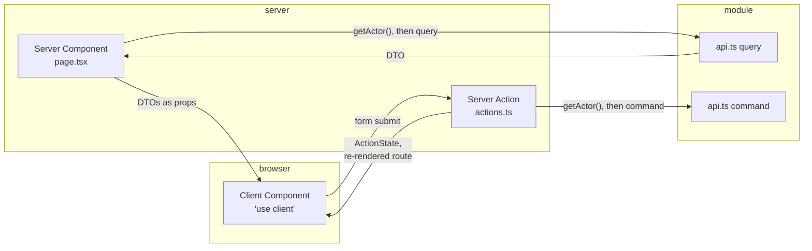
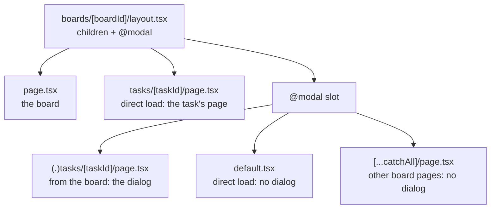

# §10 Presentation

Server Components read, Server Actions write, and nothing that depends on the viewer is cached.

The rules are in [§10 Presentation](/standards/#_10-presentation). This page explains them with the code the task board uses: the board and task pages, the actions beside them, the shared form parts in `src/app/_components/form/`, the task dialog over the board, and the theme and focus code that the accessibility rules rest on.

## Two ways in, and nothing else

`app/` is the whole presentation layer, and it reaches the application layer in exactly two ways ([ADR 0011](https://github.com/B-Jones-RFD/next-ddd-starter/blob/main/docs/adr/0011-server-components-read-server-actions-write-nothing-cached-per-viewer.md)):

A page reads; a form writes. There are no route handlers, no client-side fetching and no data library. Each of those would be a second way in: another surface to secure, another place where who-is-asking has to be checked, and another shape for errors. A route handler is added only for a caller that isn't this UI, such as a webhook.

## Server Components read

A page is a small static shell, with the part that reads the request inside `<Suspense>`. The board page is the pattern:

<<< @/../src/app/boards/[boardId]/page.tsx{tsx}

Three rules meet here:

- **`params` is awaited inside the boundary.** In Next 16, `params`, `cookies()` and `headers()` are async, and they are request-time data. Under Cache Components, whatever reads them has to sit under a `<Suspense>`, so the shell outside can still prerender. Reading them in the page's top-level component would make the whole page wait.
- **The read goes through `api.ts`.** `requireActor` gives the actor, and `getBoard` takes its `actorId` and filters by membership in the read itself (see [Auth](/auth/)).
- **A `NotFoundError` becomes `notFound()`.** So does a `ForbiddenError`: a board the actor isn't a Board member of looks the same as one that was never created. Anything thrown is left alone, to reach `error.tsx` and `onRequestError` (see [below](#loading-errors-and-not-found)).

What comes back is a DTO, and the page uses it as it is. There is no view-model layer between the query and the JSX: the query already returns what the screen needs (the board's name, its members with their roles, its lists with their tasks), and a mapping layer would only be a second place for a field to be renamed. Timestamps are the one thing formatted on the way, by a client `<Time>` component (DayJS) inside `<time dateTime>`, so the machine-readable value is in the HTML and the shown text is in the viewer's own time zone.

## Nothing per viewer is cached

No query result that depends on who is asking goes into `'use cache'`, and nothing in this app does. Every board read is filtered by membership. To cache one, the entry would have to be keyed by `actorId` and cleared on every write and on every membership change. Miss one `updateTag`, and a removed Board member could still be served the board they just lost. Against a local SQLite file, that risk buys almost no speed.

The memo in `getActor()` isn't an exception: React's `cache()` lasts one request, so it only collapses repeat calls within a render. A larger app with a remote database may opt in for a specific query, but only with an invalidation for every way access to it can change.

## Server Actions write

Each route keeps its actions in its one `actions.ts`, beside its `page.tsx`. The board's actions are in `src/app/boards/[boardId]/actions.ts`, the task's in `tasks/[taskId]/actions.ts`, the Members tab's in `settings/members/actions.ts`. One file per route means a reviewer can find every write a screen can make in one place, and a Client Component imports actions from its own route, never from a module.

Every action has the same shape. Here is the one that adds a list:

<<< @/../src/app/boards/[boardId]/actions.ts#create-list-action{ts}

In order:

1. **`getActor()`**, and a redirect to sign-in if there is no session. The action is its own POST endpoint and never renders the page's checks, so it checks again.
2. **A plain input from `formData`.** `formValues` reads the named fields as strings and nothing more.
3. **`command({ actorId, ...input })`.** The bound `boardId` and the strings go in as they are.
4. **`refresh()` on success**, or `redirect()` for a full-page form. With nothing cached, `refresh()` is what puts the re-rendered route into the action's response, so the board the user sees is the board in the database.

`ActionState` is what every action returns:

<<< @/../src/app/_lib/actions/action-state.ts{ts}

`values` is there because React 19 resets an uncontrolled form after its action runs. Without it, a rejected submission would come back with the user's input wiped. Each input reads `values` back through `defaultValue`, so the form refills only on error, and stays uncontrolled.

### Validation is the command's job

`formValues` doesn't check anything, and neither does the action. The command's Zod input schema is the only validation there is ([Application](/application/)). The browser gets HTML constraint attributes such as `required` and `maxLength` as hints for the user, and the form sets `noValidate`, so a submission always reaches the server and the error the user sees is the command's.

This keeps a rule in one place. A length limit enforced in the action and the schema can drift apart, and a shared schema in the browser would ship Zod and the domain's input rules to the client. Lint keeps Zod out of `src/app/` entirely.

### Every failure is an `ActionState`

The `try/catch` is not optional. A `Result` error and a thrown outage or bug all go through `toActionError` and come back as `{ status: 'error' }`, so a failed save shows in its own form instead of replacing the page with `error.tsx` and losing what was typed. `toActionError` decides all wording, and logs an unexpected failure once with the trace id it shows as the reference; [Errors](/errors/) explains it ([ADR 0008](https://github.com/B-Jones-RFD/next-ddd-starter/blob/main/docs/adr/0008-error-classes-thrown-outages-and-an-edge-mapper-in-app.md)).

The split differs between pages and actions on purpose. A page that hits `ForbiddenError` or `NotFoundError` calls `notFound()`, because there's nothing to show. An action shows the same errors in the form's alert: the user was looking at a form a moment ago, and keeping it lets them read what happened. Only a missing session redirects, to sign-in with the path to come back to.

## Forms

Every form is built from the same three parts in `src/app/_components/form/`. A dialog form shows all of them. This is "Create board":

<<< @/../src/app/boards/create-board-dialog.tsx{tsx}

**`Field`** labels its input and shows its error under it. The error is linked by `aria-describedby` and marks the input `aria-invalid`, so a screen reader hears the problem when it reaches the field:

<<< @/../src/app/_components/form/field.tsx{tsx}

**`FormAlert`** shows everything that isn't a field error: a conflict, an outage, a forbidden action, with the trace reference for an unexpected failure. It is `role="alert"`, so a failure is announced. There is no toast library, so an error never appears somewhere other than the form that caused it, and never times out before it is read:

<<< @/../src/app/_components/form/form-alert.tsx{tsx}

**`SubmitButton`** reads `useFormStatus()`, so it is disabled while its form is pending without the form tracking any state:

<<< @/../src/app/_components/form/submit-button.tsx{tsx}

A dialog form closes on `success` through the `onSuccess` callback its parent passes in, as `CreateBoardForm` does. Wrapping the action in `useActionState` keeps the action itself unaware of dialogs, and the popup unmounts on close, so each opening starts with an empty form. A full-page form, such as sign-up, redirects instead.

## Buttons that change something are forms

A button that archives, moves, removes or leaves is a `<form>` whose action has the target's id bound to it, never an `onClick`. A form posts before hydration, and with JavaScript off, so the button works the moment it is on screen. The Members tab gives each button its own form:

<<< @/../src/app/boards/[boardId]/settings/members/member-forms.tsx#button-form{tsx}

`AddMemberForm` passes `addMemberAction.bind(null, boardId, userId)`. The bound ids end up in the page's HTML and come back in the POST, so they are untrusted input like any form field. The action passes them to the command, and the domain checks again that the actor is the board's Owner and that the user is who they claim to be. A forged id gets `ForbiddenError` or `NotFoundError`, not a change.

The ⋯ menus follow the same rule. A menu item can't hold a form, because the popup unmounts on close, so each move is a hidden `<form>` beside the menu and the menu item is a submit button pointing at it with `form={id}`.

## Server by default, client at the leaves

Components are Server Components unless they need the browser, and `'use client'` goes on the smallest part that does. On the board, `BoardLists` lays the columns out on the server, and only the parts with state are Client Components: each list's header with its ⋯ menu, each task card, the add forms and the jump strip. A task's dialog and page share a server `TaskDetails`, which renders the client title and description forms.

A Client Component gets serializable DTOs as props and imports actions from its route's `actions.ts`. It never imports `@/modules`. Every module's `api.ts` starts with `import 'server-only'`, so a client import of one fails the build: a query in a Client Component would put a database read in the browser bundle.

`useOptimistic` is used only where the lag is built in: posting a comment shows it in Activity at once, because Activity trails the command by one relay drain and the action never waits for the relay ([ADR 0010](https://github.com/B-Jones-RFD/next-ddd-starter/blob/main/docs/adr/0010-one-audit-entry-per-integration-event-and-activity-as-a-filtered-view.md)). Everywhere else the response is the truth. An optimistic move that the domain then rejects would show a board that never existed and snap back.

## The task dialog is an intercepted route

A task has one URL, `/boards/<id>/tasks/<id>`, and two ways to show it. Followed from the board, it opens as a dialog over the board. Loaded directly, or from a shared link, it is a page of its own:

The board's layout renders the slot beside the page:

<<< @/../src/app/boards/[boardId]/layout.tsx{tsx}

The intercepting page reads the task the same way the task's own page does, then wraps the shared details in the dialog. It renders nothing until the task has loaded, so the dialog opens on its heading rather than on a fallback:

<<< @/../src/app/boards/[boardId]/@modal/(.)tasks/[taskId]/page.tsx{tsx}

The slot needs a catch-all page that renders nothing. A soft navigation keeps a slot's last page, so without it a dialog would stay open over the board's settings after following a link there:

<<< @/../src/app/boards/[boardId]/@modal/[...catchAll]/page.tsx{tsx}

The dialog itself is a Client Component:

<<< @/../src/app/boards/[boardId]/tasks/[taskId]/task-dialog.tsx{tsx}

- **Whether it is open follows the URL.** There is no separate open state to drift: the dialog is open only while the path is this task's. Next keeps a hidden copy of the slot when it navigates, and deriving `open` from the URL means that copy never reopens stale.
- **Closing goes back.** Escape or the close button starts the close animation, and when it finishes, `router.back()` returns to the board's URL, so the browser's back button and the dialog's close button do the same thing.
- **Focus goes to the heading on open and back to the task's link on close.** `initialFocus` points at the title, which is focusable only by script, and `finalFocus` finds the card's link by id, because the trigger was a link on another route, not the dialog primitive's own trigger.

## Loading, errors and not found

Each route segment has a `loading.tsx`, which Next shows during navigation while the segment's server work runs. Inside a page, each independent part gets its own `<Suspense>`, so the slow part doesn't hold back the rest: the root layout puts the header's account menu in one, because it reads the session cookie, and the board page puts the board in one under a static shell.

`error.tsx` at the root catches what a page throws. Both it and `global-error.tsx` render the same message, which shows `error.digest` as the reference:

<<< @/../src/app/_components/error-message.tsx{tsx}

The digest is what Next logs with the server-side error, so a user's report of "reference 3b1f…" finds the server-side failure in the logs, without the error's message, which may hold input, ever reaching the browser. `not-found.tsx` says the page doesn't exist "or you don't have access to it", which is true for both of the cases that reach it.

## Where things go

- **`src/app/_components/`** holds shared UI: shadcn/ui primitives in `ui/`, the form parts in `form/`, and pieces several routes use, such as `AvatarStack` and the refocus hook.
- **`src/app/_lib/`** holds shared edge code with no UI: `actions/` (`ActionState`), `errors/` (`toActionError`), `auth/` (`getActor`) and `theme/`.
- **A route's own components** sit beside its `page.tsx`, named for what they are: `board-lists.tsx`, `task-card.tsx`, `task-dialog.tsx`. Nothing is moved to `_components/` until a second route needs it.

## Accessibility and theming

The task board meets WCAG 2.2 AA in every theme. The rules in this sub-block are what that takes for this kind of UI, and most of them are seams that carry over to any app: tokens, never reading the theme on the server, and where focus goes.

### Contrast lives in the tokens

Components style with semantic tokens only (`bg-card`, `text-muted-foreground`, `border-destructive`), never raw palette classes like `bg-zinc-100`. Each token is defined once per theme in `globals.css`, extending shadcn's variables, so a contrast fix is one line in one place, and a theme can't be half-applied by a component that hard-coded a color. New meaning gets a new token in every theme: a tag's color is a `--tag-<name>` and `--tag-<name>-foreground` pair at 4.5:1, chosen from one of 8 names that the domain stores as a closed union. The domain never sees hex or a class, so the palette can change without a migration.

The targets are 4.5:1 for text, 3:1 for large text, UI parts and the focus ring, and at least 24px for a target. `--ring` is tuned to 3:1 against every surface in each theme, and focus is shown with shadcn's `focus-visible` ring. New shadcn components arrive with `ring-ring/50`, which falls short, so the opacity is removed when one is added.

### Never color alone

Something a color says is also said in text or shape. Archived items get a text badge. Tags always show their name, and the tag picker shows each swatch with its name. Errors get text and an icon. The Owner gets a crown and "(Owner)" in the accessible name:

<<< @/../src/app/_components/avatar-stack.tsx{tsx}

That component also shows the avatar-stack rule. The stack is one element named by its members, with each avatar hidden, so a screen reader hears one sentence rather than a row of initials.

### The server never reads the theme

The theme follows the system, with a System / Light / Dark choice in the account menu stored in this device's `localStorage` ([ADR 0018](https://github.com/B-Jones-RFD/next-ddd-starter/blob/main/docs/adr/0018-the-theme-choice-is-stored-per-device-and-applied-by-an-inline-script.md)). That is this app's choice. What carries over is that no cookie is involved: a cookie read in the root layout would make `<html>` depend on the request, which under Cache Components makes the whole static shell dynamic, since `<html>` can't sit inside `<Suspense>`.

The flash is prevented another way. A hand-written inline script in `<head>` sets `data-theme` before first paint, and only for an explicit choice:

<<< @/../src/app/_lib/theme/theme.ts#theme-script{ts}

The root layout renders it, with `suppressHydrationWarning` on `<html>` because the script changes an attribute React didn't render. The `dark` variant then matches either an explicit `data-theme="dark"` or, with no choice stored, the system preference:

<<< @/../src/app/globals.css#dark-variant{css}

So System works before hydration and with JavaScript off, and an OS switch applies at once. The theme radios read the choice through `useSyncExternalStore` with a `matchMedia` listener, so they stay in step, and they render System on the server, which is the only answer the server could give.

### Focus moves on purpose, and only when it must

The dialog primitive already does the right thing: focus goes in on open and back to the trigger on close, including a close through `onSuccess`. That is kept, and overridden only on purpose. The task dialog focuses its title heading, as [above](#the-task-dialog-is-an-intercepted-route), and returns to a link on another route.

When an action moves or removes the element that has focus, focus would otherwise fall to `<body>`, and a keyboard user would start again from the top of the page. So focus moves to the logical successor. After a ⋯-menu reorder, that is the moved item's ⋯ in its new place. After an archive that hides the item, it is the next item, or the column heading if there isn't one. One hook does it, keyed by id:

<<< @/../src/app/_components/refocus.tsx{tsx}

The request waits for the render in which the scope's order changes, because that is when the refreshed board arrives, and a failed action cancels it, so a later change can't steal focus. The Members tab has no ordered collection, so its `ButtonForm` (above) moves focus to the Members heading when its own button disappears.

Navigation focus is left to Next. A full-page redirect uses Next's route announcer and default focus, with no custom focus-to-`h1`, because a second mechanism would fight the first.

### Keyboard and structure

Tab order follows the DOM, column by column: heading, ⋯, tasks, then "Add task". There is no roving `tabIndex` and no positive `tabIndex`, so the order a sighted user sees is the order a keyboard user gets. On a phone, a jump strip scrolls to a column and focuses its heading, which has `tabIndex={-1}` so only script can focus it:

<<< @/../src/app/boards/[boardId]/jump-strip.tsx{tsx}

There are no custom keyboard shortcuts. The primitives cover Tab, Enter and Space, arrows in menus, and Escape, and a shortcut layer is a set of conflicts with screen readers and browser keys to manage. That is this app's choice.

An icon-only button is named after its target ("Actions for list Backlog"), so a list of buttons read out of context still says which is which. Each page has `header`, `nav` where there is one, and `main`, with one `h1`. On the board, each list column is a `section` named by its `h2`, and each task card's title is an `h3`, so the headings menu of a screen reader is the board's outline. A dialog's title is its accessible name.

### Announce failures, not successes

`FormAlert` is `role="alert"`, and field errors are reached through `aria-describedby`, so a failure is always heard. A success gets no extra announcement: the change itself is the confirmation, and a shared success live region would chatter on every save. Activity isn't a live region either, since a busy board would read out every event. The one exception is posting a comment, which gives a visually hidden `role="status"` saying "Comment posted", so the one action whose result lands somewhere else on the page still confirms itself. That is this app's choice.

### Reduced motion

One global block turns animation and smooth scrolling off under `prefers-reduced-motion`, and components add `motion-safe:` to any motion of their own:

<<< @/../src/app/globals.css#reduced-motion{css}

The block covers CSS. A scroll started by script has to ask, as the jump strip does, and uses `behavior: 'auto'` under reduced motion.

### How it is checked

`jsx-a11y`'s recommended config runs in lint. Beyond that, axe runs once, not per feature: one E2E test visits every screen in light and dark and fails on any WCAG 2.2 AA violation, and a `ui` test covers the refocus hook. A new screen is added to the sweep's list; [Testing](/testing/) shows the sweep. Most of the rules above are `review`, because no tool can tell whether focus went to the right place or whether a label names the right target.

## Checklist

- A page reads through `api.ts` queries inside `<Suspense>`, awaits `params` there, and calls `notFound()` for `NotFoundError` and `ForbiddenError`.
- Nothing that depends on the viewer is in `'use cache'`.
- A new write is an action in the route's `actions.ts`: `getActor()`, `formValues`, the command with `actorId`, `try/catch` with `toActionError`, then `refresh()` or `redirect()`.
- Its form uses `Field`, `FormAlert` and `SubmitButton`, refills from `values` through `defaultValue`, sets `noValidate`, and closes through `onSuccess` if it's in a dialog.
- A button that changes something is a form with its ids bound, and the command checks those ids again.
- `'use client'` is on the smallest part that needs it, which gets DTOs as props and never imports `@/modules`.
- Colors are semantic tokens defined in every theme, and nothing relies on color alone.
- When an action moves or removes the focused element, focus goes to its successor through `useRefocus`.
- A new screen is in the axe sweep.
