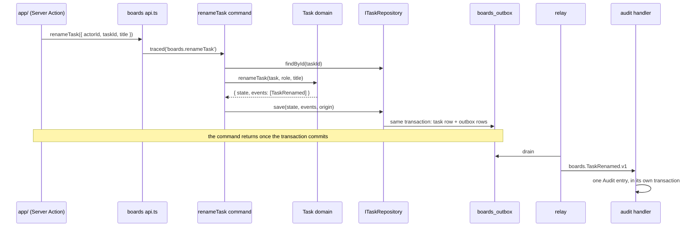

# §1 Scale and deliberate overkill

Why the template is deliberately bigger than a task board needs, and which choices belong to this app alone.

This page explains the rules in [§1 Scale and deliberate overkill](/standards/#_1-scale-and-deliberate-overkill) of the standards, using the code that follows them. The standards own the rules. This page only says what they look like and why they exist.

The app is a task board: people sign up, make boards, add Board members, and move tasks between lists. A small team could build that with a folder of Server Actions and a few SQL statements. This repo builds it with three bounded contexts, ports and adapters, published integration events, a transactional outbox and an Audit log fed by a relay. That is far more than the product needs, and it is on purpose.

## The structure is deliberate overkill

This repo is a template. Its real users are the large, multi-context apps that will be built from it, and the task board is just a domain small enough to read in an afternoon. So the code is shaped for those apps, not for this one ([ADR 0002](https://github.com/B-Jones-RFD/next-ddd-starter/blob/main/docs/adr/0002-modules-around-a-pure-domain-with-next-confined-to-app.md)).

Renaming a task shows the cost. A minimal app would run one `UPDATE`. Here, the rename goes through every layer, and audit hears about it later through an event:

The command itself is small, because each layer does one thing: check the input's shape, load, ask the domain, save.

<<< @/../src/modules/boards/application/commands/rename-task.command.ts{ts}

What each extra piece buys, and the simpler version it replaces:

| Here                                                                                      | The simpler version                                  | Why the template keeps it                                                                                                                     |
| ----------------------------------------------------------------------------------------- | ---------------------------------------------------- | --------------------------------------------------------------------------------------------------------------------------------------------- |
| Three contexts, `identity`, `boards` and `audit`, each with its own glossary              | One module split only by folder                      | Shows how a large system is cut into contexts by language, which is what the template is for ([§2](/layout/))                                 |
| Ports in the consumer, adapters in `infrastructure/`                                      | Use cases that import SQL helpers or another context | Each context can change its storage or its suppliers by editing one adapter ([§6](/contexts/))                                                |
| `save(state, events, origin)` writes one aggregate and its outbox rows in one transaction | Write the task and the Audit entry in one `UPDATE`   | Survives contexts moving to their own stores, where no transaction spans them ([ADR 0007](https://github.com/B-Jones-RFD/next-ddd-starter/blob/main/docs/adr/0007-one-aggregate-per-transaction-with-a-transactional-outbox.md)) |
| Versioned integration events, an inbox and a relay                                        | Audit reads boards' tables                           | Audit learns everything from published contracts, so boards can reshape its tables freely ([ADR 0006](https://github.com/B-Jones-RFD/next-ddd-starter/blob/main/docs/adr/0006-contexts-integrate-through-consumer-owned-ports-and-published-events.md)) |
| A `.mock.ts` twin of every adapter                                                        | Tests against the real database only                 | Tests run through `api.ts` without a database, and the dev server falls back to mock mode when `DATABASE_PATH` is unset ([§11](/testing/))                                      |

## Where simplicity competes, the scalable pattern wins

Several decisions behind this repo had a simpler option that was enough for the task board. Each time, the option that keeps working at scale was chosen, and the ADRs say so in their considered options:

- **One context split into modules** would have shared one glossary across the app. It was rejected because it doesn't show how a large system is cut into contexts ([ADR 0002](https://github.com/B-Jones-RFD/next-ddd-starter/blob/main/docs/adr/0002-modules-around-a-pure-domain-with-next-confined-to-app.md)).
- **A unit of work that commits several aggregates at once** is cheap and strictly consistent on one SQLite file. It was rejected because it "teaches the pattern that breaks first when contexts get their own stores" ([ADR 0007](https://github.com/B-Jones-RFD/next-ddd-starter/blob/main/docs/adr/0007-one-aggregate-per-transaction-with-a-transactional-outbox.md)), and it replaced the earlier commit in [ADR 0004](https://github.com/B-Jones-RFD/next-ddd-starter/blob/main/docs/adr/0004-sqlite-raw-sql-and-one-synchronous-commit.md).
- **Synchronous ports** would have made a plain `BEGIN … COMMIT` safe. They were rejected because they let SQLite's API shape the application layer, and moving to a networked database would mean rewriting every port (ADR 0004). That is why `save` is `async` on the outside and synchronous inside ([§5](/infrastructure/#save-is-synchronous-inside-an-async-signature)).
- **One `InfrastructureError` class** is enough for an app whose only outside dependency is SQLite. The template splits it into `PersistenceError` and `ExternalServiceError`, because the apps built from it will call services ([ADR 0008](https://github.com/B-Jones-RFD/next-ddd-starter/blob/main/docs/adr/0008-error-classes-thrown-outages-and-an-edge-mapper-in-app.md)).

The test for the rule is the same each time: picture the pattern in an app with ten contexts and a team per context. If the simpler option would have to be undone there, the template doesn't take it here.

## Don't simplify a pattern away because the app is small

Agents and developers building a new app from this template copy what they see. A shortcut that is harmless in a task board becomes the default in an app where it isn't. So the template keeps a pattern even where, in this app, it has only one user or no second case yet:

- **Every contract is a `v1`.** Nothing has a v2, but each contract file carries its version and each handler registers for one, so the first breaking change has somewhere to go ([§6](/contexts/#tell-through-versioned-integration-events)).
- **Domain events and integration events are separate types**, though today they look alike. One belongs to boards' model and the other to every consumer.
- **Anti-corruption adapters translate a three-field answer.** `UserDirectory` copies a `DirectoryUser` out of identity's DTO and maps identity's errors, though both contexts live in one process and one database.
- **The relay has one adapter, in-process, behind a port.** A worker process could replace it without touching any context:

<<< @/../src/shared/kernel/ports/event-relay.port.ts#port{ts}

When a pattern looks like too much for the change you're making, it is still the rule. The only places the template knowingly departs from its own patterns are listed in [§13 Exceptions](/exceptions/), and that list is closed: don't add to it to save effort, and don't copy anything on it into new code.

## Prefer the platform

Reach for web standards and Node's standard library before a package. Each package is code to update, audit and understand, and an agent copying the template copies its dependencies too.

The database is one SQLite file opened through `node:sqlite`, with no driver package, query builder or ORM:

<<< @/../src/shared/infrastructure/sqlite/database.ts{ts}

Session tokens come from `node:crypto`, and so do password hashes (`scrypt`, compared with `timingSafeEqual`) and the random bits in UUID v7 ids:

<<< @/../src/modules/identity/infrastructure/token-generator.ts{ts}

Small, well-specified pieces are written by hand rather than installed: the UUID v7 generator in `src/shared/infrastructure/uuid-v7.ts`, the base-62 `keyBetween` for positions in the kernel, and the inline script that applies the theme.

### A package earns its place

A package is added when the platform doesn't cover its area and writing it would cost more than depending on it. It is chosen on purpose, one per area:

| Area                                 | Package                                         | Instead of                                                                                                                                                                       |
| ------------------------------------ | ----------------------------------------------- | -------------------------------------------------------------------------------------------------------------------------------------------------------------------------------- |
| Input shape at the use-case boundary | Zod                                             | hand-written parsers                                                                                                                                                             |
| Dependency injection                 | `@evyweb/ioctopus`                              | Inversify, which loads `reflect-metadata` and patches the global `Reflect` ([ADR 0003](https://github.com/B-Jones-RFD/next-ddd-starter/blob/main/docs/adr/0003-functional-core-class-adapters-and-mock-mode.md)) |
| Logs, traces and backlog gauges      | pino and the OpenTelemetry SDK                  | a home-made logger and exporter ([§8](/observability/))                                                                                                                         |
| Accessible UI primitives             | Base UI, with shadcn's styling helpers and Lucide icons | hand-rolled menus, dialogs and popovers ([§10](/presentation/))                                                                                                          |
| Dates in `<Time>`                    | dayjs                                           | hand-written relative-time formatting                                                                                                                                            |

The ADRs also record packages turned down because the platform or a few lines did the job: jose, because opaque tokens need no signing ([ADR 0009](https://github.com/B-Jones-RFD/next-ddd-starter/blob/main/docs/adr/0009-database-sessions-with-opaque-tokens-not-jwts.md)); `next-themes`, because the script is about 15 lines ([ADR 0018](https://github.com/B-Jones-RFD/next-ddd-starter/blob/main/docs/adr/0018-the-theme-choice-is-stored-per-device-and-applied-by-an-inline-script.md)); and Node runtime and host metrics, which add dependencies to an SDK that is still churning ([ADR 0014](https://github.com/B-Jones-RFD/next-ddd-starter/blob/main/docs/adr/0014-outbox-backlog-gauges-are-the-only-metrics-the-template-ships.md)). There's no toast library either; forms report through `FormAlert`.

## Per-project choices, and the seams that carry over

Some answers in this repo are right for a local task board and wrong for many other apps. The standards mark each one _this app's choice; decide per project_. A new project replaces the answer, but keeps the seam named with it, because the seam is what lets the answer change without touching the rest of the app.

| Choice                         | This app                                                                                   | Keep                                                                     |
| ------------------------------ | ------------------------------------------------------------------------------------------ | ------------------------------------------------------------------------ |
| Authentication and sessions    | Self-built email and password, sessions as database rows                                   | The [§9 auth seam](/auth/)                                               |
| Database                       | One SQLite file through `node:sqlite`, raw SQL                                             | Repository ports, one aggregate per transaction, the outbox (§5, §6)    |
| Deployment                     | Local only                                                                                 | What [§13](/exceptions/) lists a deployed app adding                     |
| Contexts                       | `identity`, `boards`, `audit`                                                              | The module shape (§2) and the integration rules (§6)                     |
| Theme and interaction details  | System / Light / Dark, an 8-color tag palette, no keyboard shortcuts, a "Comment posted" status | The §10 accessibility rules, and the server never reads the theme |

### Authentication and sessions

This app signs people in with an email and a password and keeps sessions in identity's own table. Many apps built from the template will authenticate against an external directory such as Active Directory, and that choice decides the session model ([ADR 0009](https://github.com/B-Jones-RFD/next-ddd-starter/blob/main/docs/adr/0009-database-sessions-with-opaque-tokens-not-jwts.md)). What carries over is how `app/` learns who is signed in:

<<< @/../src/app/_lib/auth/get-actor.ts{ts}

Every other context receives a plain `actorId`. Swapping the provider changes identity's internals, the cookie handling in `app/` and `proxy.ts`, and nothing in boards or audit. The [§9 page](/auth/#swapping-in-an-external-provider) walks through the swap.

### Database

SQLite in one file suits a local app with no server to run. Another project may need PostgreSQL or a store per context. What carries over is the repository port, which says nothing about SQL:

<<< @/../src/modules/boards/domain/task/task-repository.port.ts{ts}

Each method is `async`, and `save` takes one aggregate, its events and their origin. A networked database fits behind that signature, and so does a store per context, because no use case relies on two aggregates committing together.

### Deployment

The app runs locally only. That is why sessions are never purged, the sign-in throttle lives in memory, and the relay runs in-process. [§13](/exceptions/) lists each of these with what a deployed app adds in its place. They sit behind ports (`ISignInThrottle`, `IEventRelay`) so the replacement is a new adapter, not a rewrite.

### Contexts

The three contexts are cut from this domain's language: identity speaks of Users and Sessions, boards of Boards, Lists, Tasks and Board members, and audit of Audit entries and Activity. Each has its own `GLOSSARY.md`, indexed by `GLOSSARY-MAP.md`. Another domain will have other contexts. What carries over is the module shape, `domain/`, `application/` and `infrastructure/` with two entry files ([§2](/layout/)), and the rule that contexts only ask through consumer-owned ports and tell through published events ([§6](/contexts/)).

### Theme and interaction details

The theme follows the system, with a System / Light / Dark choice stored per device. Tags carry one of eight named Tag colors, each mapped to a token pair in both themes:

<<< @/../src/app/_components/tags/tag-colors.ts{ts}

Another app may want a different palette, keyboard shortcuts, or a different status after posting a comment. What carries over is the §10 accessibility rules, which every palette and interaction must still meet, and one seam: the server never reads the theme. The choice is applied in the browser by an inline script before first paint, so `<html>` never depends on the request and the static shell stays static under Cache Components ([ADR 0018](https://github.com/B-Jones-RFD/next-ddd-starter/blob/main/docs/adr/0018-the-theme-choice-is-stored-per-device-and-applied-by-an-inline-script.md)):

<<< @/../src/app/_lib/theme/theme.ts#theme-script{ts}

## Checklist

- A change that seems to need less structure than the rest of the repo still follows the same pattern as its neighbours.
- A shortcut is never justified by the app's size; the only departures are the ones [§13](/exceptions/) lists.
- A new dependency names the area it covers and why the platform or a few lines of code don't do the job.
- A new project replaces each _this app's choice_ answer it needs to, and keeps the seam named with it.
