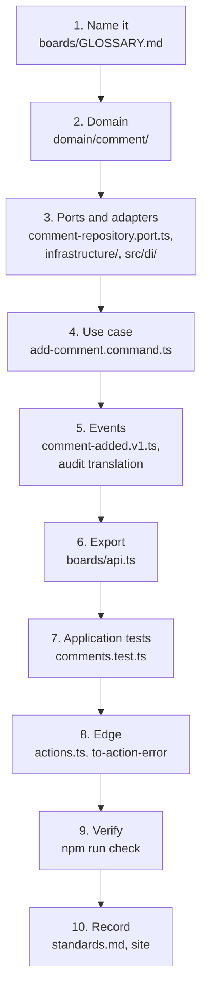

# Using this as a template

How to start a new app from this repository: what to keep, what to decide per project, and the recipe for adding a feature.

The task board is the worked example, not the product. A new app keeps its shape and swaps out its answers. This page explains [§14 Recipe: adding a feature](/standards/#_14-recipe-adding-a-feature) and the per-project choices in [§1 Scale](/standards/#_1-scale-and-deliberate-overkill), using the code in the repo. The standards own the rules. This page only explains them.

## What carries over, and what you decide

Most of the standards are seams, and those carry over to every app built from this template. A few are answers that suit a local task board. Those are marked _this app's choice; decide per project_, and each one names the seam to keep when the answer changes:

| Choice                          | This app's answer                                                               | The seam to keep                                                                  |
| ------------------------------- | ------------------------------------------------------------------------------- | --------------------------------------------------------------------------------- |
| Authentication and sessions     | Email and password, database sessions with an opaque cookie token               | §9: identity's `api.ts`, `getActor()` and an explicit `actorId`      |
| Database                        | One SQLite file through `node:sqlite`, raw SQL                                  | §5 and §6: repository ports, one aggregate per transaction, the outbox            |
| Deployment                      | Local only                                                                      | §13 lists what a deployed app adds                                                |
| Contexts                        | `identity`, `boards` and `audit`                                                | §2 module shape and §6 integration rules                                          |
| Theme and interaction details   | System / Light / Dark, 8 tag colors, no shortcuts, a "Comment posted" status    | §10 accessibility rules, and the server never reads the theme                     |

Why the line falls there:

- **The answers depend on the app, the seams don't.** Many apps sign users in through an external directory, not a password form ([ADR 0009](https://github.com/B-Jones-RFD/next-ddd-starter/blob/main/docs/adr/0009-database-sessions-with-opaque-tokens-not-jwts.md)). Many use a database server, not a file ([ADR 0004](https://github.com/B-Jones-RFD/next-ddd-starter/blob/main/docs/adr/0004-sqlite-raw-sql-and-one-synchronous-commit.md)). But every app still needs an actor passed into each use case, and every app still needs a write that can't change state without publishing it. Swapping the answer behind a seam touches its adapters and its bindings in `src/di/`, not the domain or the use cases.
- **Your contexts come from your domain's language.** `identity`, `boards` and `audit` were cut from a task board's vocabulary. A new app finds its own, writes a `GLOSSARY.md` for each, and lists them in `GLOSSARY-MAP.md`. Each new context still gets the module shape in [Layout](/layout/) and integrates only as [Contexts](/contexts/) describes ([ADR 0002](https://github.com/B-Jones-RFD/next-ddd-starter/blob/main/docs/adr/0002-modules-around-a-pure-domain-with-next-confined-to-app.md), [ADR 0006](https://github.com/B-Jones-RFD/next-ddd-starter/blob/main/docs/adr/0006-contexts-integrate-through-consumer-owned-ports-and-published-events.md)).
- **The theme is a per-app taste.** What carries over is that no cookie holds it, so the shell stays static ([ADR 0018](https://github.com/B-Jones-RFD/next-ddd-starter/blob/main/docs/adr/0018-the-theme-choice-is-stored-per-device-and-applied-by-an-inline-script.md); see [Presentation](/presentation/)).

Everything not marked carries over as it is, including the patterns that look like overkill for a small app. §1 is explicit: apps built from this template copy what they see, so a pattern simplified away here is a pattern missing from every app that follows ([Scale](/scale/)). The deliberate exceptions in [Exceptions](/exceptions/) are the opposite: they belong to this app, and you don't copy them.

## The recipe, walked through one feature

§14 is ten steps, in order. This section follows them through one real feature: **comments**. A Board member writes a Comment on a task, and it shows in the task's Activity. Comments touch every layer and two contexts. Boards owns the Comment, and audit shows it, so each step has real code behind it.

The order runs from the inside out. Each step depends only on the steps before it, so the code compiles and its tests pass at every step, and nothing at the edge is written against a use case that doesn't exist yet.

### 1. Name it

Before any code, the term goes into the context's glossary. Boards' [`GLOSSARY.md`](https://github.com/B-Jones-RFD/next-ddd-starter/blob/main/src/modules/boards/GLOSSARY.md) defines a **Comment** as free text a Board member writes on a task, recorded with its author and time, and lists _note_ and _message_ as words to avoid. Audit's glossary already said that a task's **Activity** includes its comments.

The glossary comes first because the code takes its names from it. With the term settled, the type is `Comment`, the event is `CommentAdded`, the field issue is on `text`, and nobody adds a `Note` beside it later (see [Domain language](/language/)).

### 2. Domain

The domain gets the value objects, the operation, its rule errors and its domain event (§3). The Comment's text is a value object that parses raw input into a branded type:

<<< @/../src/modules/boards/domain/comment/comment-text.ts{ts}

The event says what happened, in boards' own language:

<<< @/../src/modules/boards/domain/comment/comment.events.ts{ts}

The operation is a pure function that takes everything it needs and returns `{ state, events }`, or the rule it broke:

<<< @/../src/modules/boards/domain/comment/comment.ts#add-comment{ts}

A Comment is its own aggregate, not part of the Task, so commenting never contends with someone renaming the task at the same moment ([ADR 0001](https://github.com/B-Jones-RFD/next-ddd-starter/blob/main/docs/adr/0001-small-aggregates-with-parent-owned-order.md); see [Domain](/domain/)). The task is passed in as a read-check: the operation decides whether an archived task can take a comment, but it never changes the task. No new rule error was needed, because `ForbiddenError` and `TaskArchivedError` already existed. Domain tests in `tests/modules/boards/domain/comment/comment.test.ts` cover each outcome without a container or a database.

### 3. Ports and adapters

A new aggregate needs a repository port. It lives beside the aggregate in `domain/`, and it declares what it returns and when it throws:

<<< @/../src/modules/boards/domain/comment/comment-repository.port.ts{ts}

The SQLite adapter needs a table, so a migration is appended to the shared list:

<<< @/../src/modules/boards/infrastructure/migrations.ts#comments-table{ts}

The adapter and its `.mock.ts` twin are bound in boards' DI module, one binding per mode:

<<< @/../src/di/modules/boards.module.ts#comment-mock{ts}

<<< @/../src/di/modules/boards.module.ts#comment-real{ts}

The token `ICommentRepository` is added to the registry in `src/di/types.ts`, so `getInjection` is typed. Both adapters must behave the same, so one contract suite runs against each of them:

<<< @/../tests/modules/boards/infrastructure/comment-repository.test.ts{ts}

Why a mock twin and a contract suite for every adapter:

- **Mock mode runs the whole app without IO.** Every application test, and the app itself in mock mode, runs on the mocks ([ADR 0003](https://github.com/B-Jones-RFD/next-ddd-starter/blob/main/docs/adr/0003-functional-core-class-adapters-and-mock-mode.md)).
- **The contract keeps the mock honest.** A mock that accepted a stale version, or forgot to write the outbox rows, would let tests pass that the real adapter fails. The suite in `tests/contracts/comment-repository.contract.ts` runs the same cases on both, so they can't drift ([ADR 0012](https://github.com/B-Jones-RFD/next-ddd-starter/blob/main/docs/adr/0012-tests-go-through-api-on-mock-adapters-kept-honest-by-contract-suites.md); see [Testing](/testing/)).

### 4. Use case

The command checks the input's shape with Zod, takes the `actorId`, resolves its ports inside the body, and runs load, domain function, save (§4):

<<< @/../src/modules/boards/application/commands/add-comment.command.ts#add-comment-command{ts}

It loads the task and its board only to read them. It saves one aggregate, the new Comment, in one transaction ([ADR 0007](https://github.com/B-Jones-RFD/next-ddd-starter/blob/main/docs/adr/0007-one-aggregate-per-transaction-with-a-transactional-outbox.md)). Its signature declares every expected failure, and an outage is left to propagate (see [Application](/application/)).

### 5. Events

A state change is published. The `v1` contract in `application/contracts/` is the shape other contexts may rely on, kept separate from the domain event so boards can change its internals without breaking them:

<<< @/../src/modules/boards/application/contracts/comment-added.v1.ts{ts}

The repository translates each domain event as it saves, so the contract reaches the outbox in the same transaction as the Comment:

<<< @/../src/modules/boards/application/contracts/translate.ts#comment-events{ts}

`contracts.ts` re-exports the type, because that file is the only part of boards another context may import. The consumer then adds its handler in its own `application/`. Audit's handlers are made from its translations, so here the handler is one entry, which files the Comment on its task:

<<< @/../src/modules/audit/application/handlers/translations.ts#comment-added{ts}

That entry registers `audit.recordCommentAdded` with the relay. Boards never calls audit, and audit never reads boards' tables: it learns about the Comment from the published event, one relay drain after the commit ([ADR 0006](https://github.com/B-Jones-RFD/next-ddd-starter/blob/main/docs/adr/0006-contexts-integrate-through-consumer-owned-ports-and-published-events.md), [ADR 0010](https://github.com/B-Jones-RFD/next-ddd-starter/blob/main/docs/adr/0010-one-audit-entry-per-integration-event-and-activity-as-a-filtered-view.md); see [Contexts](/contexts/)). The new `comment.added` entry also needs its wording in `src/app/_lib/audit/entry-wording.ts`, and the compiler refuses the build until it has one.

### 6. Export

The command becomes public by being added to `api.ts`, wrapped in `traced`:

<<< @/../src/modules/boards/api.ts#add-comment{ts}

`traced` gives every call its span, named `boards.addComment`. The span name is a contract that dashboards and alerts rely on, so it follows the module and the export name exactly ([ADR 0016](https://github.com/B-Jones-RFD/next-ddd-starter/blob/main/docs/adr/0016-span-names-and-app-attributes-are-a-contract.md); see [Observability](/observability/)).

### 7. Application tests

Application tests call `api.ts` on the mock adapters, the way `app/` does. `tests/modules/boards/application/comments.test.ts` covers the happy path end to end, from `addComment` to the entry in `getActivity` after a relay drain, and each declared error. The non-member case shows the shape:

<<< @/../tests/modules/boards/application/comments.test.ts#non-member{ts}

It checks both halves: the result is the declared error, and nothing reached Activity. Comments added a command but no query, so the membership test is unchanged. Activity is audit's query, and its membership case already covers it.

### 8. Edge

The write goes in the route's `actions.ts`. The action reads the actor, passes the submitted strings through to the use case unchecked, and maps any failure with `toActionError`:

<<< @/../src/app/boards/[boardId]/tasks/[taskId]/actions.ts#add-comment-action{ts}

The new field `text` needs wording for each issue the domain can raise:

<<< @/../src/app/_lib/errors/to-action-error.ts#comment-wording{ts}

<<< @/../tests/app/_lib/errors/to-action-error.test.ts#comment-field{ts}

The action never waits for the relay, so the form shows the posted Comment optimistically until Activity has it (see [Presentation](/presentation/) and [Errors](/errors/); [ADR 0008](https://github.com/B-Jones-RFD/next-ddd-starter/blob/main/docs/adr/0008-error-classes-thrown-outages-and-an-edge-mapper-in-app.md)).

### 9. Verify

`npm run check` runs the typecheck, lint, format check and the Vitest suite. Commenting is a critical flow, so it also got an end-to-end test in `tests/e2e/comments.spec.ts`, and the task dialog's comment form joined the accessibility sweep. `npm run test:e2e` runs both.

### 10. Record

A feature that only follows the rules, as comments did, changes no rule, so `standards.md` stays as it is. A feature that does change a rule edits `standards.md` and that section's page in the same change, so the rules and their explanations never disagree. Either way, the site page for each section the feature first makes concrete is updated with it, so a page never explains a section with placeholder code once real code exists.

## Why a fixed recipe

- **The order is the dependency order.** The glossary names the domain, the domain is what the ports carry, the ports are what the use case resolves, and the use case is what the edge calls. Written in that order, each step is tested before anything depends on it.
- **Nothing gets skipped silently.** Most steps have a check behind them: the compiler for a missing DI token or audit wording, a contract suite for a mock that drifts, the relay coverage test for a published event that audit doesn't record. The rest, such as the glossary and the error wording, are on the list so that a reviewer, or an agent, can ask for each one by number.
- **Every feature looks the same.** Comments, tags and assignees each have a domain file, a command, a contract and an action in the same places. Someone who has read one feature can find their way around any other, and an app built from this template inherits that sameness.
