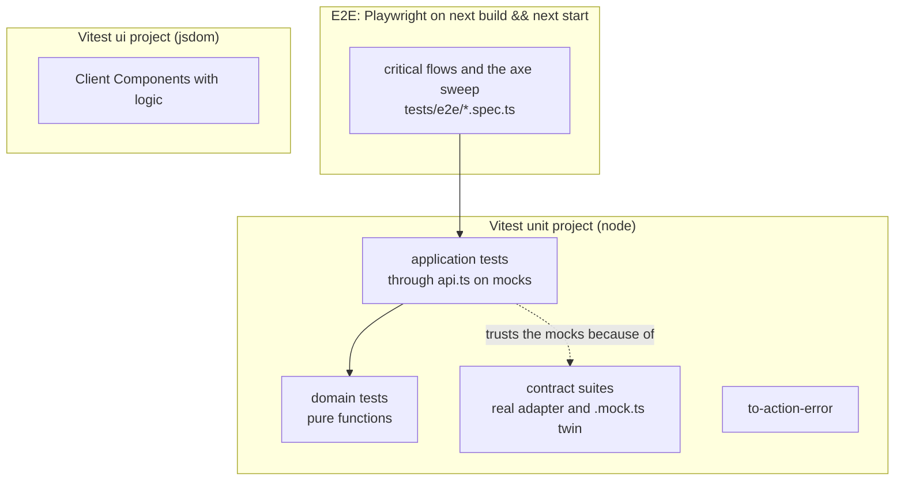
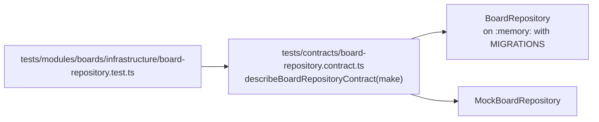

# §11 Testing and definition of done

What is tested where, how the mocks are kept honest, and when work is done.

The rules are in [§11 Testing and definition of done](/standards/#_11-testing-and-definition-of-done). This page explains them with the tests the build has landed so far: identity's sign-up, sign-in and sessions, and boards with its Board members. The standards own the rules. This page only explains them.

## Four seams, chosen on purpose

Each tier of the suite tests at one seam: a public boundary where behaviour can be observed without reaching inside. There are four, and every test belongs to one of them ([ADR 0012](https://github.com/B-Jones-RFD/next-ddd-starter/blob/main/docs/adr/0012-tests-go-through-api-on-mock-adapters-kept-honest-by-contract-suites.md)).



| Seam | What it catches | What it leaves to another tier |
|---|---|---|
| Domain functions | every rule and rule error, with exact events | how state is loaded, saved and published |
| A module's `api.ts` on mocks | use-case wiring, authorization, cross-context flows after the relay drains | whether SQLite behaves like the mocks |
| One contract suite per port | a mock drifting from its real adapter | anything above the port |
| E2E on a production build | routing, Server Components and Actions, the proxy, a11y in both themes | the many edge cases, which are cheaper below |

Why these and not others:

- **They are the boundaries the app already has.** `app/` only reaches a module through `api.ts`, and a use case only reaches storage through a port (§2). Testing at those same boundaries means a test never depends on a file that a refactor is free to move.
- **The bulk runs fast.** Domain and application tests need no database, no build and no browser, so `npm run check` can run them all on every change.
- **No Server Component or Server Action unit tests.** Vitest can't render an `async` Server Component, and actions are kept thin ([ADR 0011](https://github.com/B-Jones-RFD/next-ddd-starter/blob/main/docs/adr/0011-server-components-read-server-actions-write-nothing-cached-per-viewer.md)), so what they do is covered by the application tier below them and E2E above.

## Two Vitest projects and a Playwright suite

`npm run check` runs typecheck, lint, the format check and `npm test`, which is Vitest. The config has two projects:

<<< @/../vitest.config.mts{ts}

- **`unit`** runs in `node`: domain, application, contract suites and the `to-action-error` edge mapper. The mapper lives in `app/`, but it is server code that imports the log facade, so it runs here and not in jsdom. `server-only` is aliased to an empty module in this project only, so server code can be imported at all.
- **`ui`** runs in `jsdom` with React Testing Library, for Client Components with logic, such as the theme choice on the account page. It keeps the real `server-only`, so a Client Component test that pulls in server code fails loudly.

The `unit` setup file also registers a real tracer in memory, because `traced` and the `reference` from `to-action-error` need span context to be tested against. Feature tests never assert on spans or logs (see [Observability](/observability/#telemetry-is-tested-once)).

E2E is `npm run test:e2e`, and stays out of `check` because it needs a browser download and a production build. Run it when a change touches a critical flow, routing, or actions in `src/app/`, `proxy.ts` or identity.

## Domain tests: pure functions, nothing else

A domain function takes state and inputs and returns `{ state, events }` or a rule error (§3). So its test needs no container, no mock and no clock: build the state, call the function, compare the whole result.

<<< @/../tests/modules/boards/domain/board/board.test.ts#rename-board{ts}

What makes these tests worth keeping:

- **They assert on the whole `{ state, events }`.** The event is the change, as far as everyone downstream is concerned, so "raises `BoardRenamed` with `from` and `to`" and "raises nothing when the name doesn't change" are both rules and both tested.
- **State comes from a builder.** `aBoard()` gives a valid saved board, and each test overrides only what it is about. A test that spelled out every field would break whenever the aggregate grew one:

<<< @/../tests/fixtures/boards.ts{ts}

- **Time and ids are arguments.** `createBoard` takes `now` and `id`, so its test passes fixed ones and asserts on exact values. There is no `IClock` port; it would be a binding that exists only for tests.

## Application tests: through `api.ts` on mocks

Behaviour is tested where `app/` calls it: a module's `api.ts` exports. Under `NODE_ENV=test` the container picks the `.mock.ts` adapters ([ADR 0003](https://github.com/B-Jones-RFD/next-ddd-starter/blob/main/docs/adr/0003-functional-core-class-adapters-and-mock-mode.md); see [Layout](/layout/#the-di-container-binds-adapters-only)), so these tests exercise the real use case, the real domain and the real `traced` wrapper, on in-memory storage.

Every application test file starts the same way:

<<< @/../tests/modules/boards/application/rename-board.test.ts#arrange{ts}

- **`resetMockStores()` in `beforeEach`.** Mock stores live on `globalThis` so that every bundle in a process shares one copy. That makes them shared between tests too, so each test empties them first.
- **State is arranged through commands, never written into a mock store.** Ada is signed up through identity's `signUp`, and her board is made with `createBoard`. A test that wrote a row into a store directly would skip the invariants the commands enforce, and would break when the store's shape changed.

`givenUser` is the shared helper for that first step. It signs up through identity's `api.ts`, then drains the relay, because boards learns display names from identity's `UserRegistered` event:

<<< @/../tests/fixtures/users.ts{ts}

### Drain the relay before asserting downstream

A command only saves its own aggregate and its events, and other contexts react later, from the outbox ([ADR 0007](https://github.com/B-Jones-RFD/next-ddd-starter/blob/main/docs/adr/0007-one-aggregate-per-transaction-with-a-transactional-outbox.md)). A test that asserts on that reaction has to run the relay first, with `await relay.drain()`. Cross-context flows are tested here, at the application tier, because this is where both contexts run for real. The pair of cases below pins both halves: boards knows the name after the drain, and not before.

<<< @/../tests/modules/boards/application/record-user-registered.test.ts{ts}

### Outages are injected with a spy

To test what a use case does when its storage fails, spy on the bound adapter and make one call reject:

<<< @/../tests/modules/boards/application/create-board.test.ts#outage{ts}

This works because mock-mode bindings are singletons, so the adapter the test spies on is the one the use case resolves. The other ways to do it were rejected. A `failNext()` hook on each mock would ship in the bundle, since mocks are real code that dev mock mode runs. Rebinding the container per test would test a different wiring from the one that runs. An outage is thrown, not returned ([ADR 0008](https://github.com/B-Jones-RFD/next-ddd-starter/blob/main/docs/adr/0008-error-classes-thrown-outages-and-an-edge-mapper-in-app.md)), so the test expects a rejection with the same object.

### Conflicts come from real stale versions

A `ConflictError` is never injected. The test makes a real one, by letting another change land between the use case's load and its save:

<<< @/../tests/modules/boards/application/rename-board.test.ts#stale-conflict{ts}

`findById` returns the board as it was, after a second rename has already been saved. The first rename then saves a stale version, and the mock repository rejects it exactly as SQLite would (see [Infrastructure](/infrastructure/#stale-writes-are-rejected)). The test proves the use case passes the conflict on and that the other change survives, which an injected error could not.

### Time is set, not passed

Use cases read the real clock; only the domain takes `now` as an argument. So an application test that depends on time fakes `Date` and moves it with `vi.setSystemTime()`:

<<< @/../tests/modules/identity/application/sessions.test.ts#expiry{ts}

The test file restores real timers in `afterEach`, so no other test runs on a fake clock.

## Contract suites keep the mocks honest

The application tier is only as trustworthy as the mocks it runs on. So every port has one contract suite, and both its adapters must pass it: the real one on a SQLite `:memory:` database with the production migrations, and its `.mock.ts` twin.



The suite exports one function that takes a factory, so it knows nothing about either adapter. Here is the case that keeps the conflict test above honest:

<<< @/../tests/contracts/board-repository.contract.ts#stale-version{ts}

And the runner calls it once per adapter:

<<< @/../tests/modules/boards/infrastructure/board-repository.test.ts{ts}

The SQLite side runs on a fresh database with the same migrations production applies, so the contract tests the schema as shipped:

<<< @/../tests/fixtures/database.ts{ts}

A mock can't drift from SQLite without a red test, and that is what lets every other test run on mocks. When the two disagree, the suite says which side is wrong, because its cases describe what the port promises, not what either adapter happens to do. A port whose adapter isn't SQLite gets a suite the same way: boards' `IUserDirectory`, which calls identity's `api.ts`, has one too.

## Every query proves membership

Queries skip the domain and filter by membership in the read itself (§4, [Application](/application/#queries-skip-the-domain)). So there is no domain function to test the rule, and a new query could simply forget it. Each context has one test that catches that. It calls every query its `api.ts` exports as a non-member, and fails if an exported query has no case:

<<< @/../tests/fixtures/membership.ts{ts}

Boards' proof lists its commands, and gives each query a call made by an outsider:

<<< @/../tests/modules/boards/membership.test.ts{ts}

Three details make it a proof rather than a check:

- **It reads the exports.** The first case compares the names `api.ts` exports with the names the proof lists. Add a query without a case and the test fails, before anyone has written a test for the query itself.
- **Someone else's data exists.** Ada's board is created in `beforeEach`, so an empty list means the read filtered, not that there was nothing to find.
- **An exemption needs a reason.** A query that takes no actor can't be called as a non-member, so it is listed as exempt with why. Identity exempts `authenticate`, which takes a session token, and `findUserByEmail`, which boards lets only an Owner call.

Audit exports nothing yet, and still has its proof file, so its first query fails until it has a case.

## E2E: a few critical flows, on a real build

Playwright runs against `next build && next start`, in real mode, on a SQLite file created for the run:

<<< @/../playwright.config.ts{ts}

About five flows are covered end to end: those where a break would stop someone using the app at all, such as signing up and signing in, or an Owner adding a Member who then sees the board:

<<< @/../tests/e2e/members.spec.ts{ts}

- **Each test signs up its own users.** `aNewVisitor()` gives a unique email, so tests run in parallel and never see each other's data. Nothing depends on the seed, which is for people trying the app, and can change without breaking a test.
- **A production build, not `next dev`.** Prerendering, Suspense streaming and caching behave differently in development, and E2E is the only tier that sees them.
- **Few flows, on purpose.** Each one is slow and touches everything. Edge cases belong in the tiers below, where they are fast and fail with a precise message.

### One axe sweep for every screen

Accessibility is checked once, by one spec that visits every screen in both themes (§10). A slice that adds a screen registers it in the list:

<<< @/../tests/e2e/accessibility.spec.ts#screen{ts}

The sweep then runs axe on each one, with the stored theme set against the OS preference, so the stored choice is what's checked:

<<< @/../tests/e2e/accessibility.spec.ts#sweep{ts}

## Where tests go

`tests/` mirrors `src/`, so a test is found by the path of what it tests:

```text
tests/
  modules/boards/domain/board/board.test.ts      ← src/modules/boards/domain/board/board.ts
  modules/boards/application/rename-board.test.ts ← boards' api.ts, one file per use case or group
  modules/boards/infrastructure/board-repository.test.ts ← runs the contract on both adapters
  modules/boards/membership.test.ts              ← one per context
  contracts/board-repository.contract.ts         ← one per port
  app/_lib/errors/to-action-error.test.ts
  fixtures/                                      ← builders (aBoard) and given* helpers (givenUser)
  e2e/*.spec.ts
```

Tests live outside `src/` so the import rules for `src/` don't bend for them, and nothing under `tests/` is ever bundled. Fixtures are imported through the `@tests/*` alias, like `@/*` for `src/`.

## Definition of done

A feature is done when it ships with each of these. Each item is there because a tier above can't catch what it catches:

| Ships with | Because |
|---|---|
| domain tests for each operation and rule error | a rule untested in the domain is tested nowhere precisely |
| application tests for each `api.ts` export's happy path and declared errors | the declared errors are the use case's contract with `app/` |
| a membership case for each query | queries have no domain function to hold the rule |
| contract coverage for each port method | a method only the mock implements is a method the app can't rely on |
| UI tests for Client Components with logic | logic in a component is invisible to the tiers below |
| a `to-action-error` case for each new error `code` | every code needs words a person can read |
| an E2E change only when a critical flow changes | E2E is slow; it holds the flows, not the cases |
| `standards.md` amended if a rule changed, and the site page updated for each section the change first makes concrete | the rules and their explanation stay in step |
| every site page that cites a changed ADR updated | a page must not explain a decision that changed |

A `to-action-error` case is as small as the code it words:

<<< @/../tests/app/_lib/errors/to-action-error.test.ts#code-case{ts}

Telemetry is not on the list. `traced`, the log facade and the gauges are tested once (see [Observability](/observability/#telemetry-is-tested-once)), and a feature adds no span or log assertions.

There is no coverage threshold. A percentage is easy to raise without testing a single rule, and says nothing about which rules are tested. The list above names them.

## Checklist

- `npm run check` passes; `npm run test:e2e` too when the change touches a critical flow, routing, actions, `proxy.ts` or identity.
- Domain tests call pure functions with builder-made state and assert on `{ state, events }` or the rule error.
- Application tests call `api.ts`, reset mock stores in `beforeEach`, arrange through commands, and drain the relay before asserting on another context.
- Outages are injected with `vi.spyOn(await getInjection('IPort'), ...)`; conflicts come from a real stale version; time moves with `vi.setSystemTime()`.
- A new port method has a case in its contract suite, run against both adapters.
- A new query has a case in its context's membership proof.
- A new screen is in the axe sweep's list.
