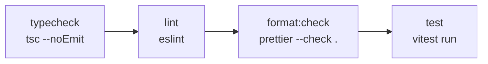

# §12 Tooling and naming

The toolchain, the formatting and lint gate, and how files and symbols are named.

The rules are in [§12 Tooling and naming](/standards/#_12-tooling-and-naming). This page explains them with the config files at the repo root and the code that follows them.

## One gate: `npm run check`

Every check the app has runs from one script, in this order:



Each step stops the chain, so the cheapest failure is the one you see first. A type error is reported before a lint error that may only be its echo, and neither waits for the test suite. The E2E suite (`npm run test:e2e`) is outside the gate, because it builds and starts the app.

There are no pre-commit hooks. A hook runs on one machine, can be skipped with `--no-verify`, and slows every commit, including the work-in-progress ones. A single script anyone can run, an agent included, says the same thing on every machine. A coding agent's "done" means `npm run check` passes, and a reviewer can ask for exactly that.

When this page says a rule is enforced by `lint` or `type`, it means one of the steps above fails. A `review` rule has no step, so only a reviewer catches it.

## Node `>=26`

The app runs on Node 26 or later, pinned twice: `engines` in `package.json` for npm, and `.nvmrc` (`26`) for version managers. The docs workflow builds on the same major.

The floor exists for one API. `node:sqlite` is the only database driver ([ADR 0004](https://github.com/B-Jones-RFD/next-ddd-starter/blob/main/docs/adr/0004-sqlite-raw-sql-and-one-synchronous-commit.md)), and Node 26 is where its connection class is `Database`. The older name, `DatabaseSync`, is the same class under an alias. The code still imports `DatabaseSync`, because `@types/node` doesn't declare `Database` yet, so the alias is what typechecks. The one shared connection:

<<< @/../src/shared/infrastructure/sqlite/database.ts{ts}

When the typings catch up, the import switches name and nothing else changes. The rule is a `review` rule: npm only warns on an `engines` mismatch, so nothing fails on an older Node until `node:sqlite` is missing.

## Prettier formats, and nobody argues

Formatting is never a review comment. Prettier owns it, and `format:check` fails on any file it would rewrite:

<<< @/../.prettierrc{json}

- **No semicolons, single quotes (in JSX too), 2 spaces.** These are this repo's taste; what matters is that one tool decides.
- **`es5` trailing commas**, so adding an item to a list or an object changes one line in the diff, not two.
- **The Tailwind plugin** sorts class names into one canonical order. It reads the theme from `globals.css` and also sorts the strings passed to `cn(...)` and `cva(...)`, so a class list reads the same wherever it is built.

`npm run format` rewrites everything. `.prettierignore` skips build output, the lockfile, the agent worktrees and `site/`, which is its own project.

## ESLint: Next's config, four type-aware rules, and the boundaries

`eslint.config.mjs` is a flat config built in layers. It starts from `eslint-config-next` (`core-web-vitals` and `typescript`), adds the full `jsx-a11y` recommended set for §10, and then turns on four rules that need type information:

<<< @/../eslint.config.mjs#type-aware{js}

Each one catches a bug that the compiler lets through:

- **`no-floating-promises`**: a promise nobody awaits. In a Server Action or a use case, a forgotten `await` on `save` means the response goes out before the write, and a rejection becomes an unhandled one instead of an `ActionError`.
- **`no-misused-promises`**: an `async` function where a plain callback is expected, such as an `onClick` or an `Array.prototype.forEach` callback, whose returned promise is thrown away.
- **`consistent-type-imports`**: types are imported with `import type`. The import is then erased at build time, which is what lets `src/di/types.ts` and a module's `contracts.ts` name types from anywhere without pulling in their code, and lets the boundary blocks tell a type import from a value one.
- **`switch-exhaustiveness-check`**: a `switch` over a union must handle every member. Adding a variant to `AuditEntry` or to an error `code` then fails lint at every switch that forgot it, instead of falling through at runtime.

`projectService` gives these rules the same `tsconfig.json` the compiler uses, so lint and `tsc` agree on what every type is.

Imports are kept in four groups, in a fixed order, with a blank line between groups:

<<< @/../eslint.config.mjs#import-order{js}

Built-ins come first, then packages, then `@/` (and `@tests/` in tests), then siblings. A reader sees at a glance what a file depends on from outside the repo and what from inside it, and the blank lines keep two people adding imports to the same file from producing a merge conflict over order.

`eslint-config-prettier` comes last, after every other block, so it switches off any stylistic rule an earlier block turned on. ESLint never reports what Prettier will fix.

### Boundary blocks are generated, not custom

The module boundaries of [§2](/layout/) are enforced with ESLint's own `no-restricted-imports` and `no-restricted-syntax`, configured by a loop over the list of contexts ([ADR 0002](https://github.com/B-Jones-RFD/next-ddd-starter/blob/main/docs/adr/0002-modules-around-a-pure-domain-with-next-confined-to-app.md)). [Layout and boundaries](/layout/#how-lint-enforces-it) shows the generated blocks. There is no custom rule and no plugin of our own. A custom rule is code that needs its own tests and its own upkeep, and one that nobody remembers how to change is worse than a rule left to review. [ADR 0016](https://github.com/B-Jones-RFD/next-ddd-starter/blob/main/docs/adr/0016-span-names-and-app-attributes-are-a-contract.md) weighs exactly this for span names: a custom rule could check that a `traced(...)` name equals its export, and it was rejected because review sees the mistake at a glance.

## TypeScript: `strict` and three more

<<< @/../tsconfig.json{json}

`strict` turns on the checks every TypeScript codebase should have. The three additions at the end each close a gap `strict` leaves open:

- **`noUncheckedIndexedAccess`**: `rows[0]` and `record[key]` are typed `T | undefined`. A query for one row that finds none is the commonest way an adapter crashes, and this makes the compiler ask about it.
- **`noImplicitOverride`**: a subclass method that replaces its parent's must say `override`. The error tree under `AppError` overrides `data`, and a rename in the base class then fails to compile instead of leaving a dead method behind.
- **`noFallthroughCasesInSwitch`**: a non-empty `case` must `break` or `return`. Together with the exhaustiveness lint rule above, every `switch` over a union handles each member once and on purpose.

There are no decorators. The domain is functions over plain data, the adapters are plain classes, and the DI container binds them in code ([ADR 0003](https://github.com/B-Jones-RFD/next-ddd-starter/blob/main/docs/adr/0003-functional-core-class-adapters-and-mock-mode.md)), so nothing needs `experimentalDecorators` or metadata reflection. `paths` defines the `@/` alias (and `@tests/` for tests), and `exclude` keeps agent worktrees and `site/` out of the compile.

## File names: kebab-case with a role suffix

Every file and folder is kebab-case. Case-insensitive file systems (macOS, Windows) treat `TaskCard.tsx` and `taskCard.tsx` as the same file, while Linux CI doesn't; lowercase with hyphens can't collide that way. The one exception is a Next dynamic route segment: the brackets hold the param's name, and a param is a value, so it is camelCase (`[boardId]`, `[taskId]`), the name `params.boardId` reads.

The suffix says what a file is before you open it. One aggregate folder in boards:

```text
src/modules/boards/domain/task/
  task.ts                     the aggregate root            (no suffix)
  task-id.ts                  a value object                (no suffix)
  task-title.ts               a value object                (no suffix)
  task-description.ts         a value object                (no suffix)
  task.events.ts              its domain events             .events
  task.errors.ts              its rule errors               .errors
  task-repository.port.ts     its repository port           .port
```

And the other layers:

```text
src/modules/boards/
  application/commands/rename-task.command.ts        .command
  application/queries/get-task.query.ts               .query
  application/dto/task.dto.ts                         .dto
  application/ports/user-directory.port.ts            .port
  domain/services/task-placement.service.ts           .service
  infrastructure/task-repository.ts                   an adapter (no suffix)
  infrastructure/task-repository.mock.ts              its mock twin, .mock
tests/
  contracts/task-repository.contract.ts               a contract suite, .contract
  modules/boards/application/rename-board.test.ts     .test
```

The suffix carries meaning that tools use, too. `.mock` pairs a twin with its real adapter by name; `.command` and `.query` are what the folders under `application/` hold, and the `api.ts` lint rule relies on use cases living there; Vitest finds tests by `.test`, and each port's runner imports its `.contract` suite. Two suffixes are named by the sections that own them: an integration event is `<name>.v<n>.ts` ([§6](/contexts/)), and an E2E spec is `*.spec.ts` ([§11](/testing/)).

Adapters, aggregates, value objects, components and a route's `actions.ts` take no suffix. They are the default thing in their folder (`infrastructure/` holds adapters, `domain/<aggregate>/` holds the root and its value objects, a route folder holds components), so a suffix would repeat the folder.

## Symbol names

Values and functions are camelCase, types, components and classes are PascalCase, and SCREAMING_CASE is kept for true module constants: a fixed value set once at the top of a file and never computed per call. One value object shows all three:

<<< @/../src/modules/boards/domain/board/tag-color.ts{ts}

`TAG_COLORS` is a constant, `TagColor` a type, and `parseTagColor` a function. A local that happens to be `const` is not a module constant and stays camelCase.

### Unions, not enums

`TagColor` above is a string-literal union, derived from the constant array so the list is written once. `Role` is the plain form:

<<< @/../src/modules/boards/domain/board/board.ts#role{ts}

An `enum` is a TypeScript-only construct that emits runtime code, can't be stripped by type-erasing tools, and makes a value from the database or a form a different type from the same string in an enum. A union is just strings: it serializes as itself, crosses `api.ts` and integration-event payloads unchanged, and works with `switch-exhaustiveness-check`.

### `type` by default, `interface I<Name>` for ports

Shapes are declared with `type`, with no `I` or `T` prefix. A port is the one exception: it is an `interface` named `I<Name>`, because an adapter class `implements` it, and the prefix tells the port (`IUserDirectory`) from its adapter (`UserDirectory`) when both are in scope ([ADR 0003](https://github.com/B-Jones-RFD/next-ddd-starter/blob/main/docs/adr/0003-functional-core-class-adapters-and-mock-mode.md)). The name is also the DI token. One port file holds both kinds:

<<< @/../src/modules/boards/application/ports/user-directory.port.ts{ts}

`DirectoryUser` is data, so it is a `type`. `IUserDirectory` is a port, so it is an `interface`. [Known exceptions](/exceptions/) lists the prefix as deliberate.

## Exports and imports

Every export is named. A named export has one name everywhere it is imported, so search and rename find every use, and an import of a name that doesn't exist fails to compile. A default export can be imported under any name, and usually is.

Default exports appear only where Next requires one: `page.tsx`, `layout.tsx`, `loading.tsx`, `error.tsx`, `not-found.tsx`, `global-error.tsx`, `default.tsx` and `next.config.ts`. (The other tools' config files at the repo root, such as `eslint.config.mjs`, are outside `src/` and follow their tool's convention.) The `@modal` slot's catch-all is the smallest:

<<< @/../src/app/boards/[boardId]/@modal/[...catchAll]/page.tsx{tsx}

Imports go through the `@/` alias, which maps to `src/`. `./` is for a sibling in the same folder, and `../` is never written. Every lint scope starts with the same pattern:

<<< @/../eslint.config.mjs#no-parent-relative{js}

The reason is the boundary matrix. Its blocks match imports by path, and `@/modules/boards/domain/...` names its target where `../../domain/...` only names a direction. A file can also move without breaking its own imports, and an import line says which layer it reaches into.

Node's built-ins take the `node:` prefix (`node:sqlite`, `node:crypto`), so a built-in can never be shadowed by a package of the same name, and an import line shows at a glance that nothing is installed for it. No lint rule checks the prefix, so it is held by review.

## Checklist

- `npm run check` passes: typecheck, lint, format and tests.
- New files are kebab-case, with the role suffix their folder expects.
- New shapes are `type`s; a new port is `interface I<Name>` in a `.port.ts` file.
- Fixed value sets are string-literal unions, never `enum`.
- Exports are named, except the files Next requires a default from.
- Imports use `@/` or `./`, never `../`, and built-ins use `node:`.
